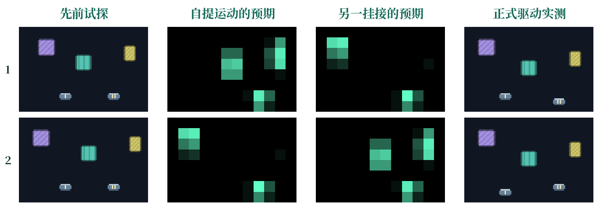

# 联合状态转移预测 · 岳轲

**一个模型既能预见载荷会怎么动，也能正确驱动自己的把手。如果只改变前一种预期，它的手会不会跟着变？**

这个仓库保存两项独立研究。第一项问模型能否从经历中分出哪些局部会一起动；第二项把自身运动移入同一网络，专门区分“能预见”和“靠预见行动”。两次研究的训练、成绩、论文和证据分开存放。

**研究二：** [论文 PDF：《预期能否驱动行动？》](paper/mechanism_study/JSTP-运动与符号回输-岳轲.pdf) · [可编辑论文](paper/mechanism_study/manuscript.md) · [协议与逐题复现](docs/MECHANISM-REPRODUCE.md)  
**理论与前作：** [岳轲的理论原稿](theory/JSTP-详细理论稿.md) · [五项主张及模型审阅](theory/研究一之后的理论审阅.md) · [研究一：《同一画面，不同后果》](README-v1.md)

上、下两行是同一台装置的不同挂接。从左到右：过去试探时的相机、网络对自己预演动作的感觉预期、换挂接后同动作的预期、原世界正式执行后的相机。中间两列是粗网格的运动能量，不是对象掩码。

## 研究二得到了什么？

| 检验 | 冻结后的结果 | 能说明什么 |
|---|---:|---|
| 熟悉接线、从未见过的布局 | 主动搬运 **99.59%**；严格共动判别 **100%** | 没有实例掩码监督也能从试探预测一个局部会不会随把手移动；不是完整对象分割。 |
| 固定真实世界，只换动作提交前的预期 | 相对于匹配的无关替换，**定向换手差 0.00 个百分点** | “后果预期参与了这次动作”的事前主判据**未通过**。换真实试探经历却能改变运动。 |
| 换成训练没见过的中间单件接线 | 主动搬运 **48.98%**；严格共动 **54.28%** | 不能把熟悉接线的通关率解释为普遍的结构迁移；同场直接策略的任务成绩是 **56.48%**。 |
| 新布局上只移植两维物理相关隐状态 | 主模型的物理读数 **100%** 改指供体；**0%** 定向换手 | 可读后果和动作在被测方向上分离。带后果辅助训练、没有感觉回输入口的对照有 **20.12%** 两者同步改变，三个种子的结果差别很大。这是另行锁定的后续试验。 |
| 训练最多四步，冻结后处理八步电路 | 显式三谓词、整体码和自学三位均 **100%**；清空回输均 **50%** | 在这套有限任务里，预置的符号通道非必要；自学三位在每个种子里都等价于物理三位的重排或反相。没有测试自然语言论证或主观意识。 |

[每项估计和布局区间](evidence/mechanism/analysis/metrics.csv) · [各初始化的原始表现](evidence/mechanism/analysis/per_seed.csv) · [后续隐状态移植](evidence/mechanism/latent_followup/metrics.csv) · [自学码逐状态计数](evidence/mechanism/codebook.json)

## 看、核对、重训

以下命令都在仓库根目录执行。模拟器只驱动自己的虚拟机构；不读取屏幕，不控制桌面鼠标，不用任何私人训练数据。

**只核对发布包**（Python 3.11+ 标准库）：

    python scripts/verify_release.py

**在 CPU 上重算论文主结果**（不需 PyTorch、显卡或联网下载模型）：

    python -m pip install numpy==2.5.5
    python -m mechanism.analyze --release evidence/mechanism --out work/recount-m2

**打开独立窗口，或者从零重训**（实测 Windows、Python 3.13.5、RTX 3090；以下为 PowerShell）：

    py -3.13 -m venv .venv
    .\.venv\Scripts\python.exe -m pip install -r requirements-windows-cu132.txt
    .\.venv\Scripts\python.exe -m mechanism.window

窗口执行冻结网络，可以切换目标、挂接和主动／被动牵引。要做一份新的完整研究二，在同一目录另开终端：

    .\.venv\Scripts\python.exe scripts/reproduce_mechanism.py --out work/fresh-m2
    .\.venv\Scripts\python.exe scripts/compare_mechanism.py evidence/mechanism work/fresh-m2/release

复现程序从种子生成训练记录，不用随包权重作初始化；拒绝覆盖旧结果。已经在同一台机器、独立 GitHub 克隆和新环境中完成了第二次全量训练：**1,670,400 个离散提交逐项一致**；这不是同等数量的独立场景，也不是第三方复现。[逐文件、逐数组的比较结果](evidence/mechanism/independent-reproduction.json)

## 材料导航

- [主协议](mechanism/protocol.json)、[考试前追加的相机对照](mechanism/secondary-plan.md)、[主结果之后另锁定的隐状态实验](mechanism/latent-plan.json)：保留试验先后顺序，不让后续发现替代事前判据。
- [单一共享网络](mechanism/net.py)、[数据和装置](mechanism/data.py)、[冻结、封卷、执行](mechanism/exam.py)、[统计](mechanism/analyze.py)、[独立窗口](mechanism/window.py)。
- [研究二全部证据](evidence/mechanism)：15 份冻结权重、训练曲线、预测封存、相机实测、两项补充干预及重训报告。[研究一对照说明](docs/COMPARISON.md)中的 DINO-WM 适配、直接策略等采用前作自己的任务，不跨实验排技能榜。
- [引用](CITATION.cff) · [作者与依赖的权利边界](THIRD_PARTY.md) · [私有发布说明](docs/PUBLISHING.md)。论文为研究手稿，无 DOI，未宣称已经投稿或录用。
