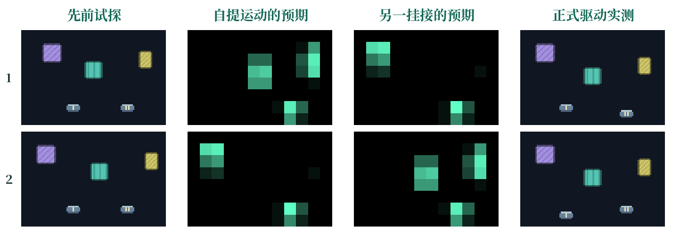
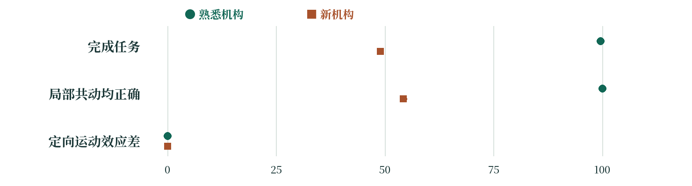
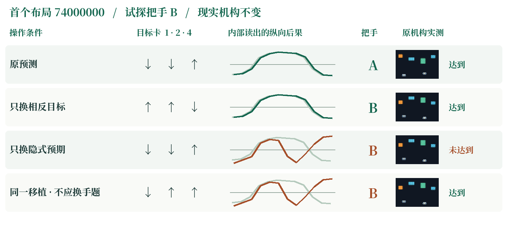

# 预期能否驱动行动？
## 联合状态转移预测的运动、符号回输与晚到目标实验
**岳轲**

### 摘要
联合状态转移预测（JSTP）提出，预测可以同时包含外界与自身运动，不必另设判断者。怎样区分模型“知道会发生什么”和“据此行动”？在两项搬运研究中，我们都保留从历史直达动作的通路，先封存驱动，再测实际后果。在双台装置上，主要模型在熟悉接线中的主动成功率为 **99.59%**、严格共动判别为 **100%**；移植感觉预期的定向运动效应却为 **0.00 个百分点**，新接线成功率降至 **48.98%**。在另一项电路任务中，显式谓词、整体码及自学三位都能完成未训练过的八步操作，清空回输后均降到 **50%**。随后，我们另锁定四轨实验：目标在试探和后果预测之后才给出，冻结网络实际操作训练未见的目标组合。同经历的一对相反新目标均完成的比例为 **99.83%**。在应该改换把手的题上，仅移植隐式后果的物理方向就有 **59.93%** 定向换手，等幅零空间改动为 **0.88%**；同一移植在不应换手的题上误换 **0.54%**。直接动作对照的任务对成功率为 **100.00%**。 三项结果分别涉及局部共动、内部信息的再利用和动作对后果表征的因果依赖；不据此推出一般智能优势或人的意识机制。

**关键词：** 联合状态转移预测；内生运动；可操作分组；中间状态干预；符号回输；可复现性

### 1　引言
拿杯子时，手和杯子往往一起动；被别人牵着手移动时，相近的画面却不需要自己发出相同的驱动。JSTP 要解释的不单是“看见什么就做什么”，而是已有经验、目标、身体及环境怎样共同限定下一状态。这个主张并不要求先出现有意识的画面。是否存在能读出未来的单元，也不是充分证据：动作可能早已由历史决定，预期只是同时生成的旁支。

本文分开三个问题：网络能否预测哪些可见部分会一起运动？在能够走捷径时，这种预期是否实际改变自身运动？若让网络自己的输出继续参与预测，持续运行是否必须依赖预先定义的语言？我们不以一次通关或一种漂亮的中间图回答全部问题。

<!-- page -->
### 2　理论层次与比较对象
世界可以从局部的共同变化来描述，是本研究的出发点，不是让一个模拟器运行就能证明的本体论。可区分的神经活动提供表示多个部分的条件；哪些部分在特定操作下应一起更新，仍须由经验与结构共同确定。“分割”在本文特指可用干预检验的**局部共动判别**，不等同于完备实例轮廓、遮挡后的持续身份或神经系统的生理分区。

视觉前瞻控制已经用预测的动作后果规划操作 [1]；DINO-WM 在预训练视觉特征中规划 [2]；DreamZero 联合建模未来视频和动作 [3]。因此“未来包含世界与动作”不是独有贡献。上项 JSTP 研究同样从两条外给运动中按目标误差选取一条。本研究把运动量移入预测输出，并在控制器仍可忽略预期时，追问**改变哪段计算会改变实际运动**。我们没有与通用机器人系统同场对战，不据此排名。

这里的逻辑区别很简单：动作和后果的联合分布总能分解成“先给出动作，再生成给定动作的后果”。仅看两路输出或任务准确率，不能确定实现使用哪条路径。借鉴互换干预对可读性与因果作用的区分 [4]，我们同时问：交换内容是否正确地改变物理读数？运动是否沿供体世界应有的方向变化？不把任意破坏后的掉分算作通过。

人类动作—效应学习显示，经验形成的效应关联可以影响后续响应 [5]，但这不意味着所有自主行为都由可视化后果生成。严重语法障碍者在部分非语言因果任务中仍能作答 [6]；专家数学判断也不简单等同于语言区活动 [7]。这些证据不排除既往语言学习的作用，提示“高级活动只存在于语言层”须先界定语言和活动。内言可改变对相合外部音节的听觉反应 [8]，这既不指定必须经过外周耳朵的回路，也不证明自我体验不存在。

> 两项可错的预言：在一个成功学习了物理后果的系统里，互换相关预期会比互换无关预期更经常使运动改投供体一侧；在固定记忆容量下，如果指定的语言通道是必要条件，非语言回输就不应稳定解决同一组新组合。

<!-- page -->
### 3　实验 A：运动也必须由网络给出
两台相同装置各有三件带随机纹理的载荷。每台一个把手带一件，另一个带余下两件；两台挂接独立。上台是任务台，下台只提供同尺度的无关运动。小幅水平拉左把手再复位，两世界末帧相同；试探过程中哪些载荷曾经移动提供历史证据。熟悉机构以左件或右件为单件，外推机构改为中件。每个正式目标要求完成一次实际搬运，同时指定一带“移动”或“保持”。保持不等于放弃整次搬运。

虚拟相机为 96 × 64。网络看到基准亮度和两台试探变化：把可见色差的绝对值按 8 × 8 像素平均，经固定增益得到每台 8 × 12 的感觉网格。这是人为给定的运动能量表示，不是从原始视网膜自学一切；没有实例掩码或接线标签。双台共用几何，基准帧只需输入一次。目标带、目标变化、手边位置、外力模式及其已知驱动、先前误动及复位提示构成其余公开输入。正常主动试次没有外力驱动提示答案。

有符号运动端口低于 −0.35 驱动左把手，高于 0.35 驱动右把手，其余保持。机械接口把一次激活落实为 4 像素竖拖，不提供候选坐标给模型，不比较两种后果。被动试次由外力牵引，目标和可见终点与正确主动试次配对，但模型不应自己发力。此处检验的是有来源线索的驱动区分，不是自我意识测验。

训练用 1,536 个布局、76,635 条有事前目标的记录，含 2,907 条误动后复位纠正。模拟示范者只读先前试探时目标带是否动过；主动试次有 8% 的随机反向失误；另有被动配对。示范、物理先验和初始就近试拉倾向均是实验设计，不是模型自主发明。确定性装置的同一分支可被多条记录复用；两台的感觉预测还以目标无关的实测驱动分支校准。96 个单独布局用于监测，不用它挑参或选最好一次。

<!-- page -->
### 4　控制路径、对照与统计
每个模型共 159,443 个参数。运动和继电器不是两个独立网络：同一模型复用同一更新块及同一组读出权重；物理端口、阶段时钟和任务输入格式是给定的。运动阶段先由完整经历产生一项预演驱动，再用该驱动形成两台感觉预期。经 16 档量化的预期重新进入同一更新块，产生正式自身驱动。正式驱动的末端感觉和身体运动另行预测，不能倒流改写已提交的命令。回输网格经过量化并阻断反向梯度，以减小通过细微的感觉变化暗传动作的空间；不保证消除所有编码捷径。最终运动仍然能直接访问完整历史：没有把“必须用感觉回输”写成接线定理。

完整组有感觉回输与实测后果约束；断开组保留相同后果学习和更新次数，但不回输入口；直接组保留相同大小与运行轮数，只训练运动而不训练运动任务的感觉后果。三组的继电器通道均为显式谓词。另两组保留完整运动设置、把符号端口改成整体码或自学三比特。五组各用 1729、2718、31415 三个初始化。每份模型训练 2,600 步，每步各取 96 条运动和电路训练例；AdamW 学习率 0.0015，固定末步后冻结。世界预测得到实测网格、身体反馈与动作示范的监督；不是无监督或无先验训练。

主考试分熟悉和新机构，各 160 个全新布局。每布局交叉两台各两种挂接、三条目标带、移动/保持、主动/被动。先封存所有模型的预测、驱动和指纹，再在同一虚拟执行器产生并核对真实结果。每个条件每种子有 3,840 个主动决策；不把它们当作 3,840 个独立布局。供体通过换一台的经历生成，在网络先前自提的相同驱动下取感觉预期。只替换任务台或无关台的回输网格，不换现实，不换自身驱动、目标或其余隐状态。还测原样重算、整体历史对换以及抹平试探。

主量以全部主动试次为分母：正常动作正确且替换后改投供体正确把手的比例，相关台减无关台。预定门槛为至少 10 个百分点、按布局配对 95% 区间下界大于零、至少两个种子同向；还要求自然任务区间下界高于 60%、严格共动判别高于 50%。严格判别固定同一预演驱动，要求一带在孪生世界里该动与不该动均判对；以该带两份实际运动量的中点仅作裁判阈值。零预演不计作判对。固定种子面板，按布局或电路对自举 6,000 次。主协议在训练之前提交到私有 Git，不冒称第三方公开预注册。

<!-- page -->
### 5　主动搬运：完成任务不等于依赖预演
**表 1　主动成功率、严格共动配对（%）与感觉回输的定向差（百分点）**

| 训练条件 | 熟悉·成功 | 熟悉·共动 | 熟悉·定向差 | 新连接·成功 | 新连接·共动 |
| --- | --- | --- | --- | --- | --- |
| 共同预测＋符号 | 99.59 | 100.00 | 0.00 | 48.98 | 54.28 |
| 预测后果但不回输 | 98.93 | 100.00 | 0.00 | 46.30 | 48.74 |
| 直接运动对照 | 98.76 | — | 0.00 | 56.48 | — |
| 共同预测＋整体码 | 99.55 | 100.00 | 0.00 | 52.28 | 50.01 |
| 共同预测＋自学码 | 99.17 | 100.00 | 0.00 | 50.27 | 48.10 |

完整主模型在熟悉机构上三个初始化的主动成功率分别为 **99.95%、99.69%、99.14%**。其最初自提的就近预演本身仅有 50% 合乎目标；正式运动明显不是照抄它。同经历只换目标，99.95% 的主动配对选择发生改变。主动/被动同轨迹配对中，在两者均做对且两次身体位移预期误差各小于半个驱动单位的比例为 99.59%。固定同一驱动只换目标，未量化的末端感觉预期仍有 0.0028 的平均绝对差；这版目标进入网络，该不变性不再是硬接线保证。

相关台和无关台的感觉替换幅度分别为 0.0932、0.0927（0–1 量程）。普通“端口输出有任何改变”分别为 0.26%、0.48%；这些改变没有一次满足“由原本正确的驱动切换到供体方向”。事前主量为 **0.00 点**，三个种子均为零。重算不改变任何驱动。相反，替换实际输入的相关试探历史后，正式动作在原世界成功率降至 **0.03%**。因此系统确实用了过去，但这不等于使用了自己回输的那幅后果预期。全零观测的布局自举区间也为零，不表示所有可能布局中的真概率确为零。

熟悉机构的严格局部共动判别为 100%，不表示精确重建了轮廓；末端感觉的平均绝对误差为 0.0124。留出中件单独的新接线时，严格判别为 **54.28%**，任务只完成 **48.98%**，三个种子为 50.44%、56.56%、39.95%。直接组新接线为 56.48%。没有证据表明这套经验沉淀成了普遍的对象身份或结构迁移能力。

<!-- page -->
### 6　如果预测并不是一幅图：对隐状态的再检验
先做一项在首轮成绩揭示前登记的检查：把相关和无关替换都换成**独立副本在同驱动下的真实相机**。两个扰动的量化绝对幅度逐题相等。熟悉机构的定向差仍为零；真实内容本身也未令主要模型按错误世界换手。在同一台面上钳住非零手边驱动，未训练的相同结构严格判别为 0%，训练后的为 100%。投影与结构给出了表示条件，但初始权重没有直接给出正确局部共动。

根据首轮结果另立后续协议，在新题启封前固定分析规则。这不是事前主试验。冻结所有权重，用另外 192 个熟悉布局的实测资料，在标准化的“完整观测表示＋第一轮隐状态”中标定两维方向：取孪生隐状态差与三带真实运动差的交叉协方差，做奇异值分解。标定只看固定左驱动的物理差异，不用正确动作标签。另标定独立无关台方向，加入固定随机两维方向；后两种扰动逐样本匹配相关扰动的标准化长度。供体来自真实孪生经历，但合成的局部隐状态不保证完全在自然分布内。

在另外两组各 160 个新布局上，只替换相关两维在供体上的分量，固定预演驱动及供给运动的原感觉网格。分开观察：物理读出是否由更接近本世界变为更接近供体？主动运动是否从本世界正确改为供体正确？直接组的物理读出没有受过后果监督，不计第一项。

**表 2　新抽熟悉布局的两维隐状态移植（%，分母是全部主动题）**

| 模型 | 定向换手 | 物理转向 | 两者均变 | 无关·均变 | 随机·均变 |
| --- | --- | --- | --- | --- | --- |
| 共同预测＋符号 | 0.00 | 100.00 | 0.00 | 0.00 | 0.00 |
| 预测后果但不回输 | 20.12 | 100.00 | 20.12 | 0.00 | 0.00 |
| 直接运动对照 | 8.80 | — | — | — | — |

主要模型在熟悉机构中物理读出方向 **100%** 随移植改变，但运动定向变化 **0%**。这不是“换了一个无意义的特征，当然测不到”；分析方向确实控制了可读物理预期。不同训练对照的机制并不相同：断开感觉回输但仍训练后果的组，二者同步改变 **20.12%**，三个种子分别为 58.20%、0.00%、2.16%；纯直接策略在运动一项也有 **8.80%** 的定向改变。因此有些实现可以共同利用与物理相关的隐变量。但它也可能是对当前挂接的记忆，不等于证明大脑或机器先在后台模拟未来再行动。两维线性分析也不能排除其他分布式的隐式预测路径。

<!-- page -->
### 7　实验 B：同一网络复用自己的三比特状态
微世界有三只二值继电器。每张预先展示的电路卡指定源、目标以及触发极性：当源满足条件，翻转目标。初始状态只给一次；之后每个计算节拍读取原程序下一张卡，无新世界观测。最后用同一运动端口回答某一物理位的状态，不要求生成文字。两个孪生程序仅第一张卡的极性相反，余下相同；选择真实执行后答案不同的一位作为提问。问题有意让早期干预影响最后操作，不代表所有电路的自然分布。

在此电路试验中，跨节拍可改写的工作记忆只有三比特。显式符号组用固定主语次序的三个布尔谓词表示“某灯亮/灭”；这是人为定义的微型报告格式，不是自然语言，更没有让系统发明语法。整体码组使用对八种状态的固定非逐位双射。自学组用三个阈值单元反馈，没有给这三个单元语义标签；仍有真实下一状态显示、任意整体编码辅助任务和动作监督。三组有相同可见卡、读写节拍和有效回输容量。训练深度 1–4；每个测验深度各 384 对新程序。改变一次中间状态的对照都固定输入与余下程序。

**表 3　电路的非语言操作正确率（%）；供体列按供体正确答案核对**

| 同一模型的回输 | 四步 | 六步 | 八步 | 八步·清空 | 八步·供体 |
| --- | --- | --- | --- | --- | --- |
| 共同预测＋符号 | 100.00 | 100.00 | 100.00 | 50.00 | 100.00 |
| 共同预测＋整体码 | 100.00 | 100.00 | 100.00 | 50.00 | 100.00 |
| 共同预测＋自学码 | 100.00 | 100.00 | 100.00 | 50.00 | 100.00 |

三种回输在深度 6 和 8、三个种子上均完成 100%，不依赖规定的语言端口这一反例达到预定门槛。深度 8 清空每步回输，三者都为 50%；将中间状态换成首卡相反的供体，三者都 100% 按供体答案行动。因为回输是唯一跨节拍通路，这里能证明的是**内容可用且有方向性**；清空后的 50% 也与孪生题的答案恰好相反有关。这不是自然大脑必须有相同通路的证据。打乱三位的次序与极性，显式报告组正确率为 43.10%，不将其解释为一切内言失效的效应。

解读自学码尤其重要。事后核对每个种子在深度八的 6,144 个中间状态，三个网络的码都可由物理三位的一个固定置换或取反逐项无误地解释：种子 1729 互换最低和最高位，2718 互换中间和最高位，31415 只反转中间位。系统**没有预置词表仍长出了可组合的表示**。若把一切可组合编码都叫语言，这不是“没有任何符号”的证明；若语言指预置谓词或自然语言，则这种小型条件计算不需要它。这里没有检验道德是非、自由论证或开放式因果解释。

<!-- page -->
### 8　首轮研究的结论：哪些主张经受了检验？
第一，世界是联合转移的主张提供描述框架；一个按此构造的模拟器不能证明世界的终极本质。第二，多个可独立变化的网络单元足以承载后天形成的局部共动判别，在此模型里有训练前后差异；但相机网格、显著的试探线索与结构狭窄的场景限制了“内生分割”的含义。未测过遮挡后追踪与脱离后独立操作，不能把共动判别换算成人类分割水平。

第三，同一模型能在持续预测中使用符号，也能不用指定的语言通道完成这批条件题。非语言组学出了与实物状态逐位对应的码，不是任意噪声碰巧通过。第四，正常部署确实没有外部程序替它给候选打分，身体驱动由网络产生；然而只改变可读后果，并未按预定方向改变主要模型的运动。最符合观测的解释是，完整历史提供了足够强的直接线索，使感觉预期成为可用但非决定性的伴生产物。这是解释，不是已经穷尽了全部隐通路。第五，输出再输入能延续本试验中的依赖，但有没有“内在听众”、人是否有自我体验，以及心声是否经外周感受器环行，都不由仿真决定。功能、神经实现与体验不能互相代证。

由此得出的下一项预言不是“删去所有旁路后模型会听从预测”，而是：同一段经历若必须服务于稍后才出现的不同目标，一段可复用的物理预期可能会参与动作。下文是另行锁定、另行训练的检验。它不改写首轮没有通过的主判据。

**复现与署名。** 岳轲提出理论与研究问题；代码、实验及稿件整理使用 Codex 辅助。本研究没有采集人的数据。主程序、独立窗口、冻结权重、运行协议、逐题承诺、物理实测、统计及后续移植方向均附在研究仓库。此前的双舱演示不记入本文成绩。未宣称期刊录用、外部实验室复现或 DOI。

<!-- page -->
### 9　迟到的不是动作，是目标
四件带纹理的载荷分布在四条轨道。网络还不知道目标时，先根据初始画面和手的停靠侧给出自己的试探把手。虚拟执行器横拉该把手并复位：四件载荷各向左或向右移动。此后显示离合状态；离合只改变两条有标记轨道在**正式纵拉**时的上下传动，不改已经经历的试探。于是，同一次横拉之后可以有不同的未来；也可同时换掉试探接线和离合，得到不同的过去、相同的正式后果。把手和行程是给定的动作原语，模型学的是用哪只把手，未自行发明试探。

模型在不知道目标时，形成对“正式使用刚才那只把手”的隐状态。训练用十二个相互重叠、位置固定的光学测点监督其纵向位移读出；数据来自真实渲染图像的亮度重心差。它不接收实例掩码、物体身份或隐藏接线，也没有分割器。视觉网格、四个目标地址、离合标记和有符号动作接口都是人为提供的，不把这些当成涌现。

然后才发目标卡。例如“第 1 件向下、第 2 件向下、第 4 件向上”，三项中过半实现即算成功。训练有 8 张单轨卡和 16 张三轨卡；三轨组合仅为 123、234。正式考试的组合是 **124、134** 的全部 16 张正反方向卡，在训练和验证中均未出现。两只把手产生相反运动，每张卡恰有一个正确把手。均衡试卷中，若只照顾一条指定轨而忽略其余两条，正确率可达 75%；一半机会不是最有意义的参照。

同一模型内用稠密网络形成历史表示和隐式后果，目标抵达后两者都可影响同一个运动输出。四个指令经可学习的线性映射进入动作读出，另保留不依赖目标的自由偏置；这使组合目标较易表达。**模型不枚举两个把手再让裁判择优。** 对照使用同样的架构、目标编码与训练流：一组学习相机后果但切断后果到动作的支路，另一组还去掉后果监督。三组各有三个初始化；每份模型 46,478 个参数，2,048 个训练布局，4,096 步，每步 160 行，末步冻结。训练用实物分支的相机结果产生示范，不是纯无监督学习。

<!-- page -->
### 10　只改对未来的预期，怎样排除胡乱换手？
在完全分开的 192 个校准布局上，只用已冻结的感觉读出和实测光学位移，不用目标或正确把手，确定物理结果的四个主方向。它们解释约 99.59% 的校准光学方差。把这些方向通过线性感觉读出映射到隐状态，仅替换该四维子空间上的供体分量，保留其余分量。供体看过相同横拉，只是纵向离合的设置不同；**真实机构、原始视觉经历和离合输入、模型先前选的把手、晚到目标、直接动作通路与全部权重都不变**。行动控制器没有收到供体的答案。

第一种对照在完整感觉读出的零空间中，逐题施加相同长度的改动：隐状态有同等幅度的扰动，所读出的预计物理后果却不变。第二种对照使用**完全相同的物理移植**，只换一个即使供体后果为真、正确把手也不该变的目标。还有原样重算、不同历史但相同后果的自然供体，以及整段预期被自然供体替换的诊断。不是任何精度下降都叫作后果驱动。

权重与校准方向分别封存。每个新布局交叉两种接线、两档离合；同一段目标前状态被复用于所有目标，同时提交各干预下的命令。然后将每个命令施加于原机构的独立虚拟副本，从相机测得各轨实际移动方向。相同终态仅需渲染一次，不把镜像副本写成独立机器。三组、三个初始化共 663,552 个正式提交（含重复和干预）；统计单元是 **192 个新布局**。按布局作 6,000 次配对重采样，种子面板固定。

任务主判据预设为一对相反新目标都成功的比例达到 80%，区间下界高于 75%，至少两个种子超过 75%。机制判据还要求可读预期转向供体的比例至少 80%。在**本该换手**的题里，记正常操作本来正确、移植后改投供体一侧的比例为 D；在**不该换手**的题里，记录原先正确却被同一移植推错的比例 F。D 相对等幅零空间对照的指标、以及 D 减 F 都须达到 10 个百分点，两个区间的下界均须为正，至少两个种子的两个对比均同向。两个分母均包含各自组内的全部题，不先筛正常做对的题。

<!-- page -->
### 11　同一段经历能服务于两个新目标
两项事前主判据均通过。主要模型对单张新卡完成 **99.87%**，相反目标要求在同一真实前缀上两次都达成，成功 **99.83%**（95% 布局区间 99.76–99.89%）。对有一项与其余两项冲突的题目，正确率为 99.83%。三种条件都能把旧经历用到新卡上；仅直接动作对照的目标对正确率为 100.00%。

**表 4　新目标与隐状态移植（%，每组固定三个种子）**

| 训练条件 | 两目标均成功 | 应换·定向换手 | 等幅零空间 | 不应换·误换 | 物理读数转向 |
| --- | --- | --- | --- | --- | --- |
| 联合预测＋直接通路 | 99.83 | 59.93 | 0.88 | 0.54 | 100.00 |
| 后果学习、断开支路 | 100.00 | 0.00 | 0.00 | 0.00 | 100.00 |
| 仅直接动作 | 100.00 | 0.00 | 0.00 | 0.00 | — |

<!-- page -->
### 12　机制证据与通关成绩，是两个结论
固定真实世界，只换隐状态的物理分量，有 **100.00%** 的预期读数从更像本世界变为更像供体。物理上应改换把手的题占一半：三种子定向换手为 53.42%、62.45%、63.93%，汇总 **59.93%**（95% 布局区间 58.83–61.05%）。等幅零空间对照为 0.88%，差 **59.05 个百分点**（57.93–60.22）。当同一移植对应的目标不应换手时，误换为 0.54%；两个目标条件相差 59.40 点（58.33–60.50）。因此，观测到的不是普遍扰乱运动输出。

整段自然供体预期被移入时，应换手题有 98.60% 定向换手；它同时带走更多信息，不作为主判据。换成经历不同、实际后果相同的整段预期，动作只有 0.49% 发生变化。断开后果支路的辅助组也能把物理读数移向供体，但这条被切断的支路不能再改变它的动作。联合组相对直接组的目标对成功率差为 **-0.17 个百分点**（-0.24 至 -0.11）。没有任务性能优势。

这个结果比“能从活动中读出未来”更强：固定真实经历和目标，改变在训练外标定的物理内容，动作会按供体的物理含义改变；同量、但不改变这种内容的扰动不能解释其幅度。结论也比“模型必须靠预测才会行动”更窄：直接路仍能独立学会，而且本题已接近成绩上限。约四成应换手题未出现定向换手。把手对应的传动关系也可以理解为准备行动时的物理信念；这项试验不能判定网络是否在内部逐帧播放未来。

还有两项区分。第一，架构与训练事先提供了**可选**的后果支路、光学监督和适合组合目标的读出；学到的是这条路里的内容以及它对运动的影响，不是从零长出一整套预测机构。第二，和首轮相比，装置、目标发放时间、目标种类、感觉监督及干预位置都变了。因此第二轮阳性和首轮阴性应并列保留；两者之差不能归因于“晚给目标”这一个因素。这里也没有检验遮挡后的持续对象身份。

<!-- page -->
### 复现、审计与材料
实验主协议提交为 342b9df，物理相机辅助方案先于正式考试提交，隐状态后续试验方案提交为 d178154。后者是在看见首轮结果才提出，使用另选的校准与考试种子，不能替代失败的主判据。布局区间只对所训练的三个初始化面板成立；断开组 20.12% 的平均值尤其不能掩盖种子差异。

同一设备在独立的 GitHub 克隆与新环境中，从种子重建训练资料，重新训练全部 15 份模型。两次的 1,670,400 个主试验离散提交逐项比较，不同数为 0。这些提交含对照和交换，分母不是独立场景数。同机复现不代表跨设备或第三方复现。

训练依赖为 Python 3.13.5、PyTorch 2.15.0+cu132 和 NumPy 2.5.5，硬件为单张 RTX 3090。端口监督、预演分支校准、五组损失差异及完整源代码均随稿交付。付出的计算量不由参数数目完全代表：直接组不反向传播图像损失。源码可从种子生成数据、重训和重新作答；CPU 单独重算主表不需运行模型。执行端将同一布局同一物理分支缓存并分配给所有提交该驱动的决定，不把缓存复用写成独立真实机器人操作。

晚到目标协议在新训练之前存入私有仓库（ff9189f），完整装置和统计在启封之前存档（d0e062e）；首次留出提交写盘时的字段重名于开卷前修正（4348efe），没有改权重、模型或判据。重读冻结权重，在空结果目录重新标定物理方向、试探、封卷并执行；比较 663,552 项驱动及逐项光学、相机和统计记录。差异字段数为 0，统计汇总一致。这是同机冻结复演，不是独立重训。

研究仓库：[JSTP Intervention Bench](https://github.com/ykykykk/jstp-intervention-bench)（按作者选择为私有，阅读需获授权）。原理论稿、先前结果和新增试验分别存档。无公共 DOI。

### 参考文献
[1] Finn C、Levine S. [Deep Visual Foresight for Planning Robot Motion](https://research.google/pubs/deep-visual-foresight-for-planning-robot-motion/). ICRA，2017。

[2] Zhou G、Pan H、LeCun Y、Pinto L. [DINO-WM: World Models on Pre-trained Visual Features enable Zero-shot Planning](https://arxiv.org/abs/2411.04983). arXiv:2411.04983，修订版，2025。

[3] Ye S、Ge Y、Zheng K 等. [World Action Models are Zero-shot Policies](https://arxiv.org/abs/2602.15922). arXiv:2602.15922，2026。

[4] Geiger A、Lu H、Icard T、Potts C. [Causal Abstractions of Neural Networks](https://arxiv.org/abs/2106.02997). NeurIPS，2021。

[5] Elsner B、Hommel B. [Effect anticipation and action control](https://pubmed.ncbi.nlm.nih.gov/11248937/). J. Exp. Psychol. Hum. Percept. Perform. 27:229–240，2001。

[6] Varley R、Siegal M. [Evidence for cognition without grammar from causal reasoning and theory of mind in an agrammatic aphasic patient](https://pubmed.ncbi.nlm.nih.gov/10873809/). Current Biology 10:723–726，2000。

[7] Amalric M、Dehaene S. [Origins of the brain networks for advanced mathematics in expert mathematicians](https://doi.org/10.1073/pnas.1603205113). PNAS 113:4909–4917，2016。

[8] Whitford TJ、Jack BN、Pearson D 等. [Neurophysiological evidence of efference copies to inner speech](https://pmc.ncbi.nlm.nih.gov/articles/PMC5714499/). eLife 6:e28197，2017。
