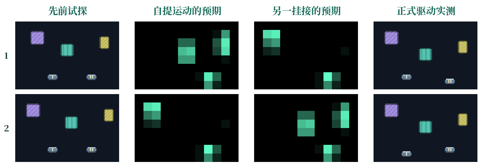
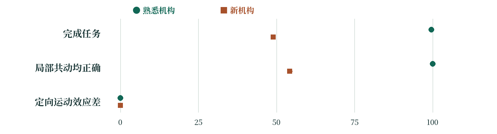

# 预期能否驱动行动？
## 联合状态转移预测的运动与符号回输实验
**岳轲**

### 摘要
联合状态转移预测（JSTP）提出，系统预测的未来既包含环境也包含自身；自身运动可由这一过程产生，不必由另一个判断者选择。一个同时预测运动和物理后果的网络，究竟有没有利用自己的后果预期？我们让同一组权重学习双台搬运和三继电器任务，保留从历史直接通往运动的路径，不给控制器备选动作或外部目标评分。五种训练条件各取三个初始化，按固定训练步数冻结，先封存选择后执行。在熟悉机构、未见布局上，主要模型的主动搬运成功率为 **99.59%**，同一局部在孪生接线下的严格运动判别为 **100%**。然而，替换动作提交前的相关感觉预期，相对于无关台匹配替换的定向运动效应为 **0.00 个百分点**，未达预定标准。新接线的主动成功率降至 **48.98%**。另一批布局上的隐状态移植改变了该模型可读出的物理后果，仍没有使运动定向换边。另一方面，同一网络可用显式谓词、整体码或自行学习的三比特状态完成训练中未见的八步条件链；三者均为 **100%**，清空回输则均为 **50%**。自学码在每个种子中都对应三个物理位的稳定重排或反相。结果支持有限系统中可学习的局部共动与状态再输入，不支持本模型靠可读后果预期生成动作，也反对本任务必须有预置语言通道。结果不能裁判人的主观体验。

**关键词：** 联合状态转移预测；内生运动；可操作分组；中间状态干预；符号回输；可复现性

### 1　引言
拿杯子时，手和杯子往往一起动；被别人牵着手移动时，相近的画面却不需要自己发出相同的驱动。JSTP 要解释的不单是“看见什么就做什么”，而是已有经验、目标、身体及环境怎样共同限定下一状态。这个主张并不要求先出现有意识的画面。是否存在能读出未来的单元，也不是充分证据：动作可能早已由历史决定，预期只是同时生成的旁支。

本文分开三个问题：网络能否预测哪些可见部分会一起运动？在能够走捷径时，这种预期是否实际改变自身运动？若让网络自己的输出继续参与预测，持续运行是否必须依赖预先定义的语言？我们不以一次通关或一种漂亮的中间图回答全部问题。

<!-- page -->
### 2　理论层次与比较对象
世界可以从局部的共同变化来描述，是本研究的出发点，不是让一个模拟器运行就能证明的本体论。可区分的神经活动提供表示多个部分的条件；哪些部分在特定操作下应一起更新，仍须由经验与结构共同确定。“分割”在本文特指可用干预检验的**局部共动判别**，不等同于完备实例轮廓、遮挡后的持续身份或神经系统的生理分区。

视觉前瞻控制已经用预测的动作后果规划操作 [1]；DINO-WM 在预训练视觉特征中规划 [2]；DreamZero 联合建模未来视频和动作 [3]。因此“未来包含世界与动作”不是独有贡献。上项 JSTP 研究同样从两条外给运动中按目标误差选取一条。本研究把运动量移入预测输出，并在控制器仍可忽略预期时，追问**改变哪段计算会改变实际运动**。我们没有与通用机器人系统同场对战，不据此排名。

这里的逻辑区别很简单：动作和后果的联合分布总能分解成“先给出动作，再生成给定动作的后果”。仅看两路输出或任务准确率，不能确定实现使用哪条路径。借鉴互换干预对可读性与因果作用的区分 [4]，我们同时问：交换内容是否正确地改变物理读数？运动是否沿供体世界应有的方向变化？不把任意破坏后的掉分算作通过。

人类动作—效应学习显示，经验形成的效应关联可以影响后续响应 [5]，但这不意味着所有自主行为都由可视化后果生成。严重语法障碍者在部分非语言因果任务中仍能作答 [6]；专家数学判断也不简单等同于语言区活动 [7]。这些证据不排除既往语言学习的作用，提示“高级活动只存在于语言层”须先界定语言和活动。内言可改变对相合外部音节的听觉反应 [8]，这既不指定必须经过外周耳朵的回路，也不证明自我体验不存在。

> 两项可错的预言：在一个成功学习了物理后果的系统里，互换相关预期会比互换无关预期更经常使运动改投供体一侧；在固定记忆容量下，如果指定的语言通道是必要条件，非语言回输就不应稳定解决同一组新组合。

<!-- page -->
### 3　实验 A：运动也必须由网络给出
两台相同装置各有三件带随机纹理的载荷。每台一个把手带一件，另一个带余下两件；两台挂接独立。上台是任务台，下台只提供同尺度的无关运动。小幅水平拉左把手再复位，两世界末帧相同；试探过程中哪些载荷曾经移动提供历史证据。熟悉机构以左件或右件为单件，外推机构改为中件。每个正式目标要求完成一次实际搬运，同时指定一带“移动”或“保持”。保持不等于放弃整次搬运。

虚拟相机为 96 × 64。网络看到基准亮度和两台试探变化：把可见色差的绝对值按 8 × 8 像素平均，经固定增益得到每台 8 × 12 的感觉网格。这是人为给定的运动能量表示，不是从原始视网膜自学一切；没有实例掩码或接线标签。双台共用几何，基准帧只需输入一次。目标带、目标变化、手边位置、外力模式及其已知驱动、先前误动及复位提示构成其余公开输入。正常主动试次没有外力驱动提示答案。

有符号运动端口低于 −0.35 驱动左把手，高于 0.35 驱动右把手，其余保持。机械接口把一次激活落实为 4 像素竖拖，不提供候选坐标给模型，不比较两种后果。被动试次由外力牵引，目标和可见终点与正确主动试次配对，但模型不应自己发力。此处检验的是有来源线索的驱动区分，不是自我意识测验。

训练用 1,536 个布局、76,635 条有事前目标的记录，含 2,907 条误动后复位纠正。模拟示范者只读先前试探时目标带是否动过；主动试次有 8% 的随机反向失误；另有被动配对。示范、物理先验和初始就近试拉倾向均是实验设计，不是模型自主发明。确定性装置的同一分支可被多条记录复用；两台的感觉预测还以目标无关的实测驱动分支校准。96 个单独布局用于监测，不用它挑参或选最好一次。

<!-- page -->
### 4　控制路径、对照与统计
每个模型共 159,443 个参数。运动和继电器不是两个独立网络：同一模型复用同一更新块及同一组读出权重；物理端口、阶段时钟和任务输入格式是给定的。运动阶段先由完整经历产生一项预演驱动，再用该驱动形成两台感觉预期。经 16 档量化的预期重新进入同一更新块，产生正式自身驱动。正式驱动的末端感觉和身体运动另行预测，不能倒流改写已提交的命令。回输网格经过量化并阻断反向梯度，以减小通过细微的感觉变化暗传动作的空间；不保证消除所有编码捷径。最终运动仍然能直接访问完整历史：没有把“必须用感觉回输”写成接线定理。

完整组有感觉回输与实测后果约束；断开组保留相同后果学习和更新次数，但不回输入口；直接组保留相同大小与运行轮数，只训练运动而不训练运动任务的感觉后果。三组的继电器通道均为显式谓词。另两组保留完整运动设置、把符号端口改成整体码或自学三比特。五组各用 1729、2718、31415 三个初始化。每份模型训练 2,600 步，每步各取 96 条运动和电路训练例；AdamW 学习率 0.0015，固定末步后冻结。世界预测得到实测网格、身体反馈与动作示范的监督；不是无监督或无先验训练。

主考试分熟悉和新机构，各 160 个全新布局。每布局交叉两台各两种挂接、三条目标带、移动/保持、主动/被动。先封存所有模型的预测、驱动和指纹，再在同一虚拟执行器产生并核对真实结果。每个条件每种子有 3,840 个主动决策；不把它们当作 3,840 个独立布局。供体通过换一台的经历生成，在网络先前自提的相同驱动下取感觉预期。只替换任务台或无关台的回输网格，不换现实，不换自身驱动、目标或其余隐状态。还测原样重算、整体历史对换以及抹平试探。

主量以全部主动试次为分母：正常动作正确且替换后改投供体正确把手的比例，相关台减无关台。预定门槛为至少 10 个百分点、按布局配对 95% 区间下界大于零、至少两个种子同向；还要求自然任务区间下界高于 60%、严格共动判别高于 50%。严格判别固定同一预演驱动，要求一带在孪生世界里该动与不该动均判对；以该带两份实际运动量的中点仅作裁判阈值。零预演不计作判对。固定种子面板，按布局或电路对自举 6,000 次。主协议在训练之前提交到私有 Git，不冒称第三方公开预注册。

<!-- page -->
### 5　主动搬运：完成任务不等于依赖预演
{{MOTOR}}

完整主模型在熟悉机构上三个初始化的主动成功率分别为 **99.95%、99.69%、99.14%**。其最初自提的就近预演本身仅有 50% 合乎目标；正式运动明显不是照抄它。同经历只换目标，99.95% 的主动配对选择发生改变。主动/被动同轨迹配对中，在两者均做对且两次身体位移预期误差各小于半个驱动单位的比例为 99.59%。固定同一驱动只换目标，未量化的末端感觉预期仍有 0.0028 的平均绝对差；这版目标进入网络，该不变性不再是硬接线保证。

相关台和无关台的感觉替换幅度分别为 0.0932、0.0927（0–1 量程）。普通“端口输出有任何改变”分别为 0.26%、0.48%；这些改变没有一次满足“由原本正确的驱动切换到供体方向”。事前主量为 **0.00 点**，三个种子均为零。重算不改变任何驱动。相反，替换实际输入的相关试探历史后，正式动作在原世界成功率降至 **0.03%**。因此系统确实用了过去，但这不等于使用了自己回输的那幅后果预期。全零观测的布局自举区间也为零，不表示所有可能布局中的真概率确为零。

熟悉机构的严格局部共动判别为 100%，不表示精确重建了轮廓；末端感觉的平均绝对误差为 0.0124。留出中件单独的新接线时，严格判别为 **54.28%**，任务只完成 **48.98%**，三个种子为 50.44%、56.56%、39.95%。直接组新接线为 56.48%。没有证据表明这套经验沉淀成了普遍的对象身份或结构迁移能力。

<!-- page -->
### 6　如果预测并不是一幅图：对隐状态的再检验
先做一项在首轮成绩揭示前登记的检查：把相关和无关替换都换成**独立副本在同驱动下的真实相机**。两个扰动的量化绝对幅度逐题相等。熟悉机构的定向差仍为零；真实内容本身也未令主要模型按错误世界换手。在同一台面上钳住非零手边驱动，未训练的相同结构严格判别为 0%，训练后的为 100%。投影与结构给出了表示条件，但初始权重没有直接给出正确局部共动。

根据首轮结果另立后续协议，在新题启封前固定分析规则。这不是事前主试验。冻结所有权重，用另外 192 个熟悉布局的实测资料，在标准化的“完整观测表示＋第一轮隐状态”中标定两维方向：取孪生隐状态差与三带真实运动差的交叉协方差，做奇异值分解。标定只看固定左驱动的物理差异，不用正确动作标签。另标定独立无关台方向，加入固定随机两维方向；后两种扰动逐样本匹配相关扰动的标准化长度。供体来自真实孪生经历，但合成的局部隐状态不保证完全在自然分布内。

在另外两组各 160 个新布局上，只替换相关两维在供体上的分量，固定预演驱动及供给运动的原感觉网格。分开观察：物理读出是否由更接近本世界变为更接近供体？主动运动是否从本世界正确改为供体正确？直接组的物理读出没有受过后果监督，不计第一项。

{{LATENT}}

主要模型在熟悉机构中物理读出方向 **100%** 随移植改变，但运动定向变化 **0%**。这不是“换了一个无意义的特征，当然测不到”；分析方向确实控制了可读物理预期。不同训练对照的机制并不相同：断开感觉回输但仍训练后果的组，二者同步改变 **20.12%**，三个种子分别为 58.20%、0.00%、2.16%；纯直接策略在运动一项也有 **8.80%** 的定向改变。因此有些实现可以共同利用与物理相关的隐变量。但它也可能是对当前挂接的记忆，不等于证明大脑或机器先在后台模拟未来再行动。两维线性分析也不能排除其他分布式的隐式预测路径。

<!-- page -->
### 7　实验 B：同一网络复用自己的三比特状态
微世界有三只二值继电器。每张预先展示的电路卡指定源、目标以及触发极性：当源满足条件，翻转目标。初始状态只给一次；之后每个计算节拍读取原程序下一张卡，无新世界观测。最后用同一运动端口回答某一物理位的状态，不要求生成文字。两个孪生程序仅第一张卡的极性相反，余下相同；选择真实执行后答案不同的一位作为提问。问题有意让早期干预影响最后操作，不代表所有电路的自然分布。

在此电路试验中，跨节拍可改写的工作记忆只有三比特。显式符号组用固定主语次序的三个布尔谓词表示“某灯亮/灭”；这是人为定义的微型报告格式，不是自然语言，更没有让系统发明语法。整体码组使用对八种状态的固定非逐位双射。自学组用三个阈值单元反馈，没有给这三个单元语义标签；仍有真实下一状态显示、任意整体编码辅助任务和动作监督。三组有相同可见卡、读写节拍和有效回输容量。训练深度 1–4；每个测验深度各 384 对新程序。改变一次中间状态的对照都固定输入与余下程序。

{{LANG}}

三种回输在深度 6 和 8、三个种子上均完成 100%，不依赖规定的语言端口这一反例达到预定门槛。深度 8 清空每步回输，三者都为 50%；将中间状态换成首卡相反的供体，三者都 100% 按供体答案行动。因为回输是唯一跨节拍通路，这里能证明的是**内容可用且有方向性**；清空后的 50% 也与孪生题的答案恰好相反有关。这不是自然大脑必须有相同通路的证据。打乱三位的次序与极性，显式报告组正确率为 43.10%，不将其解释为一切内言失效的效应。

解读自学码尤其重要。事后核对每个种子在深度八的 6,144 个中间状态，三个网络的码都可由物理三位的一个固定置换或取反逐项无误地解释：种子 1729 互换最低和最高位，2718 互换中间和最高位，31415 只反转中间位。系统**没有预置词表仍长出了可组合的表示**。若把一切可组合编码都叫语言，这不是“没有任何符号”的证明；若语言指预置谓词或自然语言，则这种小型条件计算不需要它。这里没有检验道德是非、自由论证或开放式因果解释。

<!-- page -->
### 8　结论：哪些主张经受了检验？
第一，世界是联合转移的主张提供描述框架；一个按此构造的模拟器不能证明世界的终极本质。第二，多个可独立变化的网络单元足以承载后天形成的局部共动判别，在此模型里有训练前后差异；但相机网格、显著的试探线索与结构狭窄的场景限制了“内生分割”的含义。未测过遮挡后追踪与脱离后独立操作，不能把共动判别换算成人类分割水平。

第三，同一模型能在持续预测中使用符号，也能不用指定的语言通道完成这批条件题。非语言组学出了与实物状态逐位对应的码，不是任意噪声碰巧通过。第四，正常部署确实没有外部程序替它给候选打分，身体驱动由网络产生；然而只改变可读后果，并未按预定方向改变主要模型的运动。最符合观测的解释是，完整历史提供了足够强的直接线索，使感觉预期成为可用但非决定性的伴生产物。这是解释，不是已经穷尽了全部隐通路。第五，输出再输入能延续本试验中的依赖，但有没有“内在听众”、人是否有自我体验，以及心声是否经外周感受器环行，都不由仿真决定。功能、神经实现与体验不能互相代证。

下一项适于检验的改变不是删除所有旁路迫使模型服从理论，而是让同一条经历可以服务于多种后来才出现的任务，使预先背好的动作映射不再够用；保留同等直接对照，并在新试卷启封前规定什么结果算失败。本次结果本身不因此改写。

**复现与署名。** 岳轲提出理论与研究问题；代码、实验及稿件整理使用 Codex 辅助。本研究没有采集人的数据。主程序、独立窗口、冻结权重、运行协议、逐题承诺、物理实测、统计及后续移植方向均附在研究仓库。此前的双舱演示不记入本文成绩。未宣称期刊录用、外部实验室复现或 DOI。

<!-- page -->
### 复现、审计与材料
实验主协议提交为 342b9df，物理相机辅助方案先于正式考试提交，隐状态后续试验方案提交为 d178154。后者是在看见首轮结果才提出，使用另选的校准与考试种子，不能替代失败的主判据。布局区间只对所训练的三个初始化面板成立；断开组 20.12% 的平均值尤其不能掩盖种子差异。

{{REPRO}}

训练依赖为 Python 3.13.5、PyTorch 2.15.0+cu132 和 NumPy 2.5.5，硬件为单张 RTX 3090。端口监督、预演分支校准、五组损失差异及完整源代码均随稿交付。付出的计算量不由参数数目完全代表：直接组不反向传播图像损失。源码可从种子生成数据、重训和重新作答；CPU 单独重算主表不需运行模型。执行端将同一布局同一物理分支缓存并分配给所有提交该驱动的决定，不把缓存复用写成独立真实机器人操作。

研究仓库：[JSTP Intervention Bench](https://github.com/ykykykk/jstp-intervention-bench)（按作者选择为私有，阅读需获授权）。第一项研究、第二项研究、原理论稿和本次后续协议分别存档。无公共 DOI。

### 参考文献
{{REFS}}
