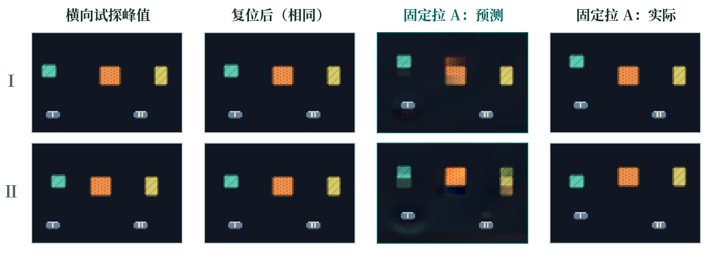
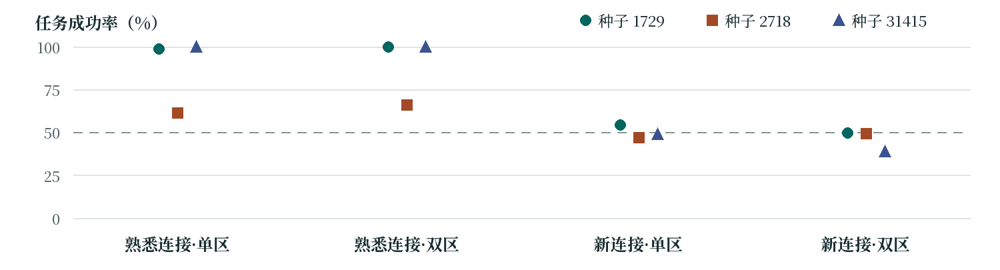

# 同一画面，不同后果
## 联合状态转移预测中功能性分组的形成与迁移边界
**岳轲**

### 摘要
当两个场景的当前画面完全相同，机器人能否从过去一次可逆的试探，判断接下来哪些部分会一起移动？本文把这一问题作为联合状态转移预测（JSTP）的可证伪命题，而不以一般任务成功替代物理预测。我们建立一个可精确复制的三载荷双驱动实验台：两种接线具有相同外观和鼠标轨迹，只有横向试探的视觉后果不同。模型先提交两种竖拖的后果，再根据目标选把手；所有决定封存后才在模拟器执行。六个学习方法各训练三个初始化，并与两条只读可见像素的规则比较。对训练见过的连接类型和未见过的双区域目标，JSTP 成功率为 **88.7%**，相同搬运网络仅训练单分支后果为 **49.7%**，完整历史直接策略为 **89.1%**。把连接类型和目标组合同换新，三者分别为 **45.8%、50.8%、68.3%**。在已知机构规则下，只读三带是否移动的算法四格均为 100%。结果表明，成对后果学习能使小型无对象槽网络在熟悉机制内形成可用于行动的分组；任务成功和准确的绝对位移判断不是同一能力，这种分组也没有自动推广到新机构。

**关键词：** 联合状态转移预测；功能性分组；动作条件世界模型；视觉控制；配对干预；结构泛化

### 1　引言
乘员舱和电池舱停在原位。向左试拉把手又原路放回，最后的画面没有改变，驾驶者却多知道了一件事：电池舱是否跟着移动。这个知识不是一条固定指令。同样的连接，在“电池必须同行”和“电池必须留下”两个目标下，要求选择不同的把手。问题因此不是能否画出物体轮廓，而是能否把局部间的作用关系从经验带到下一次行动。

JSTP 的较强设想是，同一个可学习系统能够在预测包含环境与自身运动的联合未来时形成不同功能。本文只检验其中有限的一项：**在不给对象身份或连接标签的条件下，历史依赖的后果预测能否产生足以选择动作的共同运动判断？** 这里的“功能性分组”是关于给定干预的行为定义，不等同于语义实例、持久身份，亦不预设网络内部一定表征了一个名为“对象”的变量。

本文贡献是可拆分的：一套把证据、目标和机构变化分开操作的封存评测；一组控制结构先验与训练目标的比较；以及一个明确的反例——同一网络在熟悉连接上有效，在新连接上却没有表现出一般性的组合能力。全部主要结果来自独立仿真执行，并有训练源码、冻结权重和逐布局承诺记录。

<!-- page -->
### 2　相关工作：相似的“未来”回答不同问题
视觉—语言—动作模型。OpenVLA [1] 将图像与语言指令映射到机器人动作；π0.7 [2] 还可利用视觉子目标和细粒度提示。CoT-VLA [3] 先生成视觉子目标，再产生到达子目标的动作。我们区分“想得到的画面”和“如果执行固定动作会发生的画面”：前者可以随任务改变，后者应取决于物理经历和候选动作。这个区分是对控制接口的描述，并不意味着 VLA 没有内部世界知识。本研究没有语言任务，也没有在双驱实验台上实测以上通用 VLA。

预测与规划。视觉前瞻控制已用动作条件视频预测帮助真实机器人推动物体 [14]。DreamerV3 通过想象轨迹学习行为 [4]；DINO-WM 在预训练视觉特征上预测转移，按目标特征规划 [5]；V-JEPA 2-AC 也将动作条件潜在动力学用于视觉目标控制 [6]。所以，把预测用于行动、让同一世界模型支持不同目标，都不是 JSTP 首创。本文用潜在空间方法作实际对手：采用 DINO-WM 的原始预测器代码和官方预训练视觉骨干，在相同实验台上重新训练动力学。

联合世界—动作模型。DreamZero [7] 和 GR00T 2 [13] 联合预测未来视频与机器人动作。Cosmos Policy [8] 还能产生未来状态及价值并在测试时规划。AD-WM [9] 则指出，单条轨迹的预测误差低不保证同状态下可区分备选动作。我们的实现比这些系统窄：动作候选是实验台给定的，不是模型自行生成的连续轨迹。本文检验的是哪段过去改变了哪一项后果、该差异是否足以改变实际操作，而不是宣称首次联合建模世界与动作。

对象与试探。OP3 [10] 从无对象标注的视觉观测学习实体表示，但架构明确按实体组织计算。Denil 等 [11] 让智能体通过推碰发现积木塔的隐藏连接，并权衡试验成本。本文没有对象槽，也没有要求模型回答对象数；我们直接检验像素预测里的局部位移，再看它能否完成任务。新实验规定一次试探，并未验证自主发明试探动作。

{{LITERATURE}}

### 3　可检验的命题
设 h 包含初始、试探峰值、复位三帧以及过去的虚拟鼠标命令，a 是正在考虑的运动，g 是所需工作区状态。本文的实现学习完整 RGB 后果 F(h,a)，包括上部载荷和下部把手；目标不输入物理转移网络。执行器计算两张候选图在目标指定区域内的误差，只执行误差较小的动作。模型学习“动哪里会影响什么”，但可用动作、目标比较器和平移先验由设计者给定。

> 后果检验：同一末帧、同一候选动作、不同试探证据，预测应按真实接线改变。目标检验：同一经历、同一动作，只换目标，不应改写物理后果，但应能改变选择。

目标不变性本身是该接口的保障，不能列作自然涌现。经验性问题是，那个不受目标影响的预测是否足够准确，以及预测不准确时任务是否可能碰巧做对。

<!-- page -->
### 4　实验台与配对构造
相机为 96 × 64 像素。上方三条可见空间带各有一件纹理和尺寸随机的载荷，下方有两个可操作把手。一个把手连接一个载荷，另一个连接其余两个；无件重叠或脱离驱动。两种孪生世界只交换把手与两组载荷的挂接。模型看不到接线、实例编号、模拟器坐标或答案；候选抓取点作为所有方法共同拥有的执行接口提供。布局包含随机位置与外观，但三带边界固定。

每段经历只给一次规定的试探：按住指定把手，横移 6 像素，原路复位。两个世界的三个自身命令阶段相同，初始与复位画面逐字节相同，峰值图像不同。考试时改为上拉或下拉 6 像素。把手身份、左右试探方向和最终上下方向在种子组中配平。交换接线是生成两个不同的物理世界；把另一世界的历史给模型、仍在原世界执行，只是干预模型的证据，并不改变现实的接线。

训练只见“左件单独”或“右件单独”；另外两件同行。新连接保留“一个对两个”的机构规则，只把训练未见的**中件单独、两端同行**留作外推。单区目标对一个指定空间带提出移动或保持要求；双区目标同时约束两带，训练从未给过这种目标组合。每个问法都有两个相反而可达的目标，且每个目标恰有一个正确把手。未指定区域不计分，两种目标的次序随机。双区要求按可达性构造，与把手置换无关，但可能透露同组关系，故它并非必然比单区更难。

每个连接条件测试 128 个独立新布局。对每个布局交叉两种接线、两种目标、两种目标类型；并分别使用事实试探、删除峰值视觉差异、交换试探历史。后两者保留同一复位画面和实际过去的命令。评测先把**所有**模型的候选代价、选择、可读物理后果与指纹写入承诺文件；其后重建试探并实际按下、移动、释放。成功要求真实相机在指定区域与目标逐像素一致，不能用模型自评替代。

<!-- page -->
### 5　模型、训练与度量
JSTP 用时间差分、局部卷积和全局历史表示预测候选动作下的有符号三通道信号 S。输出是当前图像加上按候选位移平移后的 S，再减去原 S。不输出掩码，没有对象槽、分割头、动作头或独立价值网络。这个解码器明示了平移，不明示哪件载荷应随哪个把手动。把候选自身运动作为条件不等于从无到有生成动作。

训练分两段。先在 2,048 个布局中直接抓取任一载荷做上下左右拖动；再在另外 2,048 个布局中，从两种试探历史分别实做两个候选竖拖，得到 8,192 个真实分支。96 个独立同分布布局用于选择权重。阶段一更新 300 步；阶段二 1,500 步中有 300 步复习直接拖动。直接拖动批量 32，成组批量 8 个布局。不同方法在同一个种子下使用独立于初始化的同一取样序列。每 150 步比较验证任务成功率，同分选较晚检查点，不在最终题上挑权重。

单分支 RGB 目标是观测像素的平滑绝对误差，按真实变化强调移动区域。成对训练再加入两份实测 RGB 的差：固定接线换把手，以及固定把手换经历；另用模型与实测后果对目标的距离分布作排序监督。两个差分项分别加权 0.275，目标排序加权 0.12。训练确有配对结构、目标与真实后果监督，不能描述为无监督视频自学全部能力。

单分支损失的对照也看到了同一批四个实做分支；差别不是“少给它看一半数据”，而是损失只分别重建各分支，不要求同题分支之间的差值或目标次序正确。普通残差模型通过空洞卷积在输出点两侧各可读取最多 7 像素，足以覆盖 6 像素位移，但不内置搬运公式。

{{METHODS}}

DINO-WM 适配使用 DINOv2 ViT-S/14 [12] 的冻结官方参数和 DINO-WM 原仓库未修改的 ViTPredictor。相机缩放到 84 × 126，得到 6 × 9 个 384 维 patch 向量。将特征投影到 96 维，按三帧加入真实过去及候选动作，使用两层时序因果 Transformer 预测下一组特征；按目标区域的 patch 距离选动作。它采用相同经历和两个候选，不使用模拟器真值；不是照搬原论文数据、分辨率、预测器规模和搜索器，不能把结果外推为官方基准成绩。完整历史直接策略看到相同的视觉证据、目标区域与运动命令，以真实后果给出的最佳选项监督候选分数，不生成未来图像。

所有神经模型各训练三个初始化（1729、2718、31415）。参数量和优化步数可比并不意味计算量完全相同，特别是 DINO 还有冻结的预训练编码器。两条规则不训练：一位规则仅读右带在试探中是否移动，枚举与该比特相容的六种非平凡驱动分配中的可能项，平均其预期帧；三位规则读取三带的响应，利用另一把手驱动补集的已知先验。它们都使用可见相机和显式机构知识，不是网络也没有读取隐藏接线。

<!-- page -->
### 6　封存任务结果
表 2 的一列对应一种“连接 × 目标”条件。每个学习方法在每列有 128 个布局 × 4 个配对决策 × 3 个种子；各格共享布局，不是 1,536 个独立场景。表中成功率先在布局内、再在种子与布局间平均。非学习规则只运行一次，不重复三份计算。

{{MAIN}}

在已见连接、双区新目标上，JSTP 相对同网络单分支训练高 **38.9 个百分点**，按布局配对自举的 95% 区间为 **[36.8, 41.0]**。它与完整历史直接策略相差 **−0.4 个百分点 [−2.7, 2.0]**，这不是已经证明两者等效。回到单区旧目标，直接策略为 100.0%，JSTP 为 86.7%。相同容量级别的普通残差 RGB 网络没有在本预算下学到稳定的把手效果；提供成对损失并未独自解决问题。

换成中件单独的新连接后，JSTP 在单区目标上为 50.1%，在双区目标上是 **45.8%**；后者比直接策略低 **22.5 个百分点 [−24.8, −20.1]**。一位规则在这格仍为 **81.25%**，三位规则为 100%。这不是模拟器无解，而是模型没有把训练中有效的历史判断普遍推广到另一种局部组合。双区目标给出更多约束，部分方法在新连接上的双区成绩反而高于单区，不能把四列当作简单的难度阶梯。

区间固定本次三个已训练模型，对每个连接条件的 128 个布局有放回重采样 10,000 次；差值始终使用相同布局及配对方法。它不覆盖重新采集训练集或无限多种初始化的不确定性。熟悉连接的双区结果中，三个种子的 JSTP 成功数分别是 512、338 和 512；只报最佳种子会掩盖明显的优化不稳定性。

<!-- page -->
### 7　局部物理判断与证据干预
在上部三带内，用超过亮度阈值的像素质心读纵向位移，沿指令方向计正。真实值是 6 或 0 像素。对每带、每个固定候选，把 3 像素作“跟随”阈值，要求两种接线在正确一侧才算一对正确。表 3 汇总实际指定方向的绝对误差与这种严格的成对准确率。亮度读尺只用于验收；没有 RGB 未来的直接策略和潜在模型不使用此尺，未测不当作零分。

{{PHYS}}

熟悉连接上，JSTP 的物理成对判断为 **51.7%**，明显低于它的任务成功率；新连接只有 **16.0%**，位移误差从 **1.53** 增至 **3.02** 像素。该指标不是单例二分类准确率，不能按 50% 机会线解释。任务只关心给定区域里哪张候选更接近目标，候选相对排序正确时，绝对位移仍可能严重错误。一位规则的相对排序和严格物理读数也不同；低成本局部证据足以完成相当比例的题，不能据此声称系统已经表征了持续存在的个体。

删除峰值视觉证据后，各方法成功率均为 50%。这是均衡孪生构造的可辨识性下限：相同输入对应相反的正确选择。交换证据后，熟悉连接、双区目标的 JSTP 由 88.7% 降至 11.3%；新连接、双区目标却由 45.8% 变成 54.2%。由于两个世界只是置换把手、每题只有一个正确选项，互换后的成功率正好是事实成功率的补数；它与原成绩不是两份独立的统计证据。逐目标重算时，目标不进动力学的图像模型和潜在模型的固定动作后果数值相同；这验证了接口隔离，不代表学会了目标无关性。

### 8　前期实验的交叉核对
为说明本研究为何另测物理后果，工程保留两个早期独立实验。前期 V6 在同一组 100 个拖放场景中，结合预测后果和动作经验先验完成 87 场，同权重直接读出完成 70 场；只打乱候选进入动力学的动作、保留运动先验，则完成 69 场。20 场仅前者成功，3 场仅直接读出成功。这里是一个特定版本的同权重正对照，不是对一般直接策略的定理。发布包剔除旧检查点的优化器和本地元数据，用相同模型参数重放三种协议共 300 场。

前期 V7 是另一种二载荷机构：一件总随把手动，另一件取决于挂接。在 128 个新布局中，其冻结模型事实/删证据/换证据各完成 512/512、256/512、0/512，绝对物理后果两边均正确为 253/256 对。在这个旧世界，单一隐藏比特已经足够；正是这一点促使我们加入三载荷、留出中件和显式一位基线。两版任务和训练方法不同，不把它们的分数相减，也不把侧窗小游戏的少量现场演示计入主结果。

<!-- page -->
### 9　讨论与局限
什么得到了支持？在本研究的训练预算和熟悉机构内，36,939 参数的无槽预测器通过配对的真实后果学到了可以改变行动选择的历史信息。同结构、同数据、只训练单分支后果时，这项优势大幅减弱。把同一套成对目标交给无显式平移搬运的局部残差模型，也没有在本预算内实现相同成绩。这组结果支持**匹配任务的结构先验与成对训练的组合**，不能单独归因给一个抽象的“预测原则”；目标排序和差分两项也没有分别做因果消融。

什么没有得到支持？可见试探加互补机构的简单规则能完全解题，完整历史策略在部分条件下超过 JSTP。模型可能学的是“某个位置通常能带动哪一带”的统计规律，而非物体身份或可迁移的关系变量。我们没有用遮挡、旋转、非刚性运动、任意对象数或真实机器人验收这一模型。失败表明泛化没有自动发生，但不说明任何后果预测方法都不能泛化。DINO 适配的接近机会成绩只约束这个分辨率、训练预算和预测器配置；潜在特征是否对小位移不够敏感是后续可检验的解释，不是本研究测得的根因。

比较范围。实验台给出两个候选、一次规定试探、目标图与评价区域。动力学是确定性的，每个区域对应固定空间带；没有要求模型从像素中自行寻找可抓点、发明实验、理解语言或发明目标。双区目标和接线的可达性相关，不能把这组结果解释为无条件目标组合泛化。直接策略没有可比的图像读出，不能由缺少预测图断言它没有隐式物理知识。小参数量展示的是特定问题的实现规模，不是与基础模型的等任务样本效率或算效排名。

可复现性。数据全由封闭仿真程序从公开种子生成，不接触操作系统桌面或私人数据。主试验使用单张 RTX 3090；发布固定协议、依赖、冻结检查点、模型提交时的预测摘要、真实分支指纹、逐布局成败和重算程序。协议哈希在各次训练记录中固化，正式执行只能在全体选择封存后开始；这是本地锁定，不是声称经过第三方公开预注册。附带的 DINO 网络源代码版本及官方权重 SHA-256 均固定；第三方权重由使用者从原出处下载。工程中的历史重放与新实验从零重训是两条独立命令。

在同一台设备、独立空白源码目录和新 Python 环境中，重新获取公开骨干，从种子重建训练数据，再训练全部 18 份权重并重新封存执行。两次评测在 40,960 个事实决定和 81,920 个删换证据决定上的选择与实际成败逐项相同，所比较的局部位移读数最大差为 0 像素。这些是共享布局的复算，不是新增独立试次或跨机器复现。

### 10　结论
在双驱实验中，同一网络确实可以不依赖分割标注，把过去的局部共动用于新的目标选择。但“能按经验选把手”“能预测每一件移动多少”和“能在新机构上保持正确”是三个不同结论。JSTP 在第一个结论上获得正证据，在第二个上只取得部分成功，在第三个上遇到了明确反例。本文的主要价值，正是让三者能由同一台可重复执行的实验分别裁判。

**署名与材料说明。** 作者：岳轲。研究问题与理论构想由作者提出；代码实现、实验编排及稿件整理使用了 Codex 辅助。本文为研究手稿，未标示期刊录用、机构背书、基金编号或 DOI。

<!-- page -->
### 参考文献
{{REFS}}
