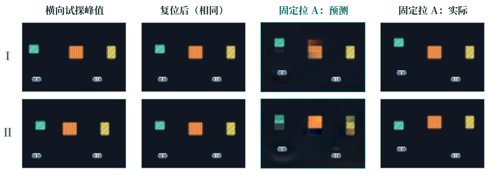

# 同一画面，不同后果
**联合状态转移预测中功能性分组的形成与迁移边界 · 岳轲**

两个世界最后看起来完全一样。过去横拉把手时，一个世界的中间载荷跟着走，另一个不跟。现在改成竖拉，要求一件东西移动、另一件留下：模型究竟知道会发生什么，还是只知道选哪个把手？

这是论文、可重训的代码、冻结权重与实际执行记录的同一份发布。主实验在独立的三载荷模拟器中进行，无桌面权限、私人截图、遥测、账户或机器人硬件要求。模型只有 RGB、过去的命令、候选动作和公开的目标条件，不接收挂接真值或实例掩码。

**从这里开始：** [完整中文论文（PDF）](../../paper/JSTP-岳轲.pdf) · [可编辑正文](../../paper/manuscript.md) · [英文摘要](../../paper/abstract-en.md) · [同场方法与主流路线的区别](../../docs/COMPARISON.md) · [复现手册](../../docs/REPRODUCIBILITY.md)

上、下两行是同一布局的两种挂接；从左到右是试探峰值、复位、固定拉 A 的事前预测、实际后果。图取预定的第一题，不是最佳案例。下载项目后直接打开 [交互证据页](../../docs/paired-demo.html) 可切换目标、经历和接线，也可看三个种子的训练曲线；该页不联网，不把归档回放冒充现场推理。

## 核心结果

下表是逐像素验证的**实际任务成功率（%）**，不是模拟器替模型评价想象质量。训练只给过单区目标；熟悉连接的布局也是全新的。双区目标按可达性构造，不一定更难。

| 同场方法 | 熟悉连接·单区 | 熟悉连接·新双区 | 新连接·单区 | 新连接·新双区 |
|---|---:|---:|---:|---:|
| JSTP：平移搬运＋成对后果 | 86.7 | **88.7** | 50.1 | **45.8** |
| 同一搬运网络，仅分别重建各分支 | 50.5 | 49.7 | 52.2 | 50.8 |
| 普通残差 RGB，成对目标 | 49.5 | 49.0 | 50.3 | 50.1 |
| 普通残差 RGB，仅分别重建 | 49.4 | 49.2 | 49.8 | 50.1 |
| 完整历史直接策略 | 100.0 | **89.1** | 50.4 | **68.3** |
| DINO-WM 任务适配 | 50.2 | 50.1 | 49.9 | 49.9 |
| 显式一位规则 | 84.4 | 96.1 | 63.3 | 81.2 |
| 显式三位规则 | 100 | 100 | 100 | 100 |

每个连接条件 128 个布局，各学习方法 3 个初始化。熟悉连接配新目标，JSTP 比同结构单分支目标高 **38.9 个百分点**（按布局配对 95% 区间 36.8 至 41.0），与直接策略差 −0.4 点；连接和目标都换新，JSTP 比直接策略低 22.5 点。一位规则双新精确值为 81.25%。[逐布局汇总和区间](../../evidence/paper/analysis/metrics.csv) · [配对方法差](../../evidence/paper/analysis/paired_differences.csv) · [每个种子的成功数](../../evidence/paper/analysis/per_seed.csv)。

任务做对不等于分割正确。对于同把手、同区域，要求两种挂接下的“跟动/不动”均判断正确，JSTP 的比例为 **51.7% → 16.0%**（熟悉 → 新连接）；对应绝对位移误差 **1.53 → 3.02 像素**，真位移为 0 或 6 像素。这是有关可操作共动的局部证据，不是完整对象分割、稳定身份或人类水平。也没有在本实验上直接部署 OpenVLA、π0.7 或 DreamZero。

## 三条运行路线

以下命令在**项目根目录**执行。完整训练路径实测于 Windows、CPython 3.13.5、RTX 3090、PyTorch 2.15.0+cu132。

**① 核对文件，无需安装第三方软件包：**

    python scripts/verify_release.py

**② 在 CPU 上，从真实执行记录重算全部表格：**

    python -m pip install numpy==2.5.5
    python -m jstp.analysis --release evidence/paper --out work/recount
    python -m unittest discover -s tests

**③ 从零生成数据、训练六种方法 × 三个种子、再封存和执行（Windows PowerShell，须已安装 Python、Git 及支持 cu132 的 NVIDIA 驱动）：**

    py -3.13 -m venv .venv
    .\.venv\Scripts\python.exe -m pip install -r requirements-windows-cu132.txt
    .\.venv\Scripts\python.exe scripts/reproduce.py
    .\.venv\Scripts\python.exe scripts/compare_runs.py evidence/paper work/reproduction-results

首次重训会向官方源获取 DINOv2 和 DINO-WM，不需 API 密钥。程序拒绝覆盖已封存的结果。独立目录从种子二次全量重训，**122,880 个选择及其成败逐项一致**，预测位移读数最大差 0；这是同机同栈复现，不是 122,880 个独立场景，也不保证跨平台逐位相同。[独立复现差异记录](../../evidence/paper/independent-reproduction.json)。

## 仓库地图

| 路径 | 用途 |
|---|---|
| [configs/paper.json](../../configs/paper.json) | 数据划分、种子、先验、训练及盲测协议 |
| [jstp/arena.py](../../jstp/arena.py)、[jstp/v7_model.py](../../jstp/v7_model.py) | 三件模拟器与共同未来 RGB 预测器 |
| [jstp/learn.py](../../jstp/learn.py)、[jstp/foundation.py](../../jstp/foundation.py)、[jstp/rules.py](../../jstp/rules.py) | 直接策略、两因素消融、公开模型适配、可见规则 |
| [jstp/exam.py](../../jstp/exam.py)、[jstp/analysis.py](../../jstp/analysis.py) | 先封存再执行；任务、物理配对和区间计算 |
| [evidence/paper](../../evidence/paper) | 18 份训练检查点、学习曲线、承诺、实际结果与盲测统计 |
| [evidence/legacy6](../../evidence/legacy6)、[evidence/legacy7](../../evidence/legacy7) | 前期 V6/V7 原记录及冻结推理重放；不混入主试验 |
| [paper](../../paper)、[scripts](../../scripts) | 论文、排版与证据页构建、训练和复现入口 |

软件与实验数据的许可见 [LICENSE](../../LICENSE)；字体、第三方模型及论文版权的边界见 [THIRD_PARTY.md](../../THIRD_PARTY.md)。引用信息见 [CITATION.cff](../../CITATION.cff)，公开发布步骤见 [GitHub 发布说明](../../docs/PUBLISHING.md)。
