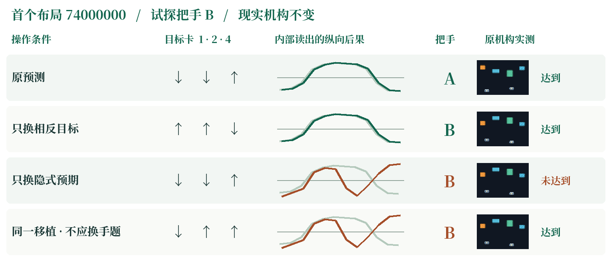

# 预期能否驱动行动？ · 岳轲

**一个会预测后果的网络，真的会因为预期不同而换一只手吗？**

在这项联合状态转移预测（JSTP）实验里，模型先自己选把手、横向试探并复位，再预测若正式使用这只把手，四件载荷将怎样移动。直到这时我们才揭晓目标。每份模型只有一套权重，没有分割器，也没人替它给候选把手打分。它可以使用预期，也可以从原经历直接发出动作。

[增订论文 PDF · 岳轲](../../paper/mechanism_study/JSTP-运动与符号回输-岳轲.pdf) · [可编辑正文](../../paper/mechanism_study/manuscript.md) · [晚到目标实验与复现](../../docs/LATE-GOALS.md) · [原理论稿](../../theory/JSTP-详细理论稿.md)

图中第三行很重要：**给错内部预期，模型换了把手，在没有改变的真实机构上反而做错。** 第四行施加相同干预，但换了一个不应换手的任务，模型仍用正确把手。这是区分“后果参与行动”和“扰动让模型乱动”的办法。

## 两个事前问题，分别回答

| 冻结后只改什么？ | 新布局上的结果 | 应当怎样理解 |
|---|---:|---|
| **只换目标。** 同一次试探，给两张相反、训练未见的三轨目标卡。 | 18,400 / 18,432 对均成功，**99.83%** | 能把同一段经历用于新的目标组合。单卡成功 99.87%。 |
| **只改隐式后果。** 固定真实经历、目标、真实离合和直接路，仅移植隐状态中与未来物理读数对应的四个方向。 | 本应换手的题，11,047 / 18,432 定向换手，**59.93%** | 对照：等长但不改物理读数的扰动 **0.88%**；同一物理移植在不应换手的题上误换 **0.54%**。 |
| 同题换成只走直接动作的网络。 | 相反目标对 **100%** 均成功 | 联合组的预期有因果作用，**不等于**这条路不可替代，或使任务成绩更高。 |

三种子、192 个独立考试布局。表里的分母还含同布局的接线、离合、目标和模型种子，置信区间按布局聚类，并没有把它们当作 18,432 个独立世界。[主统计与配对差](../../evidence/late-goals/analysis/summary.json) · [分种子指标](../../evidence/late-goals/analysis/per_seed.csv) · [事前协议](../../lategoal/protocol.json) · [冻结权重复演记录](../../evidence/late-goals/frozen-replay.json)

## 看它现场运行

本机已建立项目虚拟环境时，双击[打开晚到目标实验台](../../打开晚到目标实验台.cmd)，或在项目根目录运行：

    .\.venv\Scripts\python.exe -m lategoal.window

点击 **连看三次实做**：原目标选 A；只换目标后选 B；恢复原目标，只改内部后果，模型在原世界改选 B 而失败。也可点“论文实例”复位后，手动换目标或改预期。窗口使用冻结网络重新推理和实际虚拟位移，不是录像；会显示试探、复位、内部光学预期、真实末帧和训练曲线。[三次现场记录](../../evidence/late-goals/window-case.json)各自带有前缀和末帧指纹。不采集桌面，不控制系统鼠标。

新机器可用 `py -3.13 -m venv .venv`、`.\.venv\Scripts\python.exe -m pip install -r requirements-windows-cu132.txt` 安装实测环境。核对整包：`python scripts/verify_release.py`。只重新算分、从权重复演或从零重训，分别见[三条复现路线](../../docs/LATE-GOALS.md)。

## 前作也保留，不用阳性结果替换阴性结果

- [研究一：《同一画面，不同后果》](../01-grouping/README.md)：比较可操作共动、直接策略、结构消融与 DINO-WM 适配，并披露新接线迁移失败。
- [研究二：双台搬运与三比特回输](../02-motor-symbol/README.md)：能正确预测物理后果，但原主模型换手净效应 **0.00 个百分点**；电路任务中自学三位形成可组合码。[当时原封不动的发行版](https://github.com/ykykykk/jstp-intervention-bench/releases/tag/v2.0.0)。
- [本次追加研究](../../docs/LATE-GOALS.md)：另用新装置和九份新权重，沿用一套网络的约束。两次的任务、训练和干预方法都不同，不能把差别单独归功于目标延迟。

仓库按作者选择为**私有**；文章是研究手稿，无 DOI，不代表期刊录用。[引用信息](../../CITATION.cff) · [授权范围](../../LICENSE) · [第三方来源](../../THIRD_PARTY.md)。
