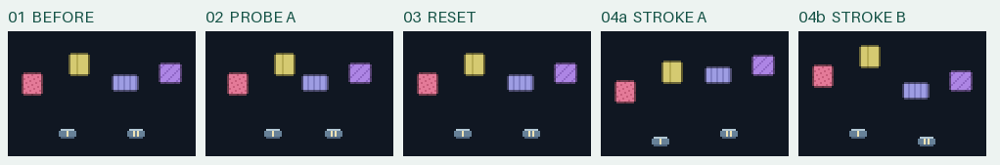

# Joint State Transition Prediction: Goal Generalization with Sparse Action Labels

Ke Yue · Independent Researcher · v1.2 · Protocol clarified 21 November 2026

**Project repository:** [https://github.com/ykykykk/jstp-intervention-bench](https://github.com/ykykykk/jstp-intervention-bench)

**Full JSTP theory:** [English translation](https://zenodo.org/records/24392467/files/JSTP-Theory-Ke-Yue.en.pdf) · [Chinese original](https://zenodo.org/records/24392467/files/JSTP-Theory-Ke-Yue.zh.pdf)

**Preprint DOI (v1.2):** [10.5281/zenodo.24392467](https://doi.org/10.5281/zenodo.24392467)

## Abstract

A controller can learn what an action does without being told when to take it. Does that knowledge help when a new goal arrives? Joint State Transition Prediction (JSTP) treats action and environmental change as components of the same transition; it does not require a full reconstruction of the future. We varied the number of action labels in a fixed bank of 16,384 interactions. Frozen controllers operated a four-track simulator on 192 held-out layouts. A pair counted as successful only if the controller achieved two opposite, unseen goals after the same probe. At 128 labels, JSTP achieved 71.69% paired success. Disconnecting its consequence-to-action path while retaining both training losses reduced success to 66.75% (difference: 4.94 percentage points; 99% paired layout-bootstrap interval [3.97, 5.85]). In an expanded comparison, a pretrained ACT adaptation did better at 128 labels (73.78%); at 1,024 labels ACT and JSTP reached 94.58% and 94.90%, respectively. JSTP thus approached ACT on this apparatus with 18,304 parameters trained from scratch, but was not the best sparse-label method. The matched comparison supports a contribution from consequence feedback; task success alone does not establish emergent object segmentation.

**Keywords:** joint state transition prediction; goal-conditioned control; action supervision; functional grouping; latent intervention.

## 1. Introduction

Suppose a controller can pull either of two handles. A brief horizontal pull reveals how four loads respond; the apparatus then resets. Only after the reset does the controller learn which loads should move up or down. The probe answers a question about the apparatus. The goal answers a different question about which physical outcome is wanted. By presenting opposite goals after the very same probe, we can ask whether the controller uses that distinction rather than relying on a preference for one handle.

Joint State Transition Prediction (JSTP) regards the agent's own next action as one possible component of a future shared with its environment. A network need not reconstruct that future in full before acting: it can predict its action directly. Conversely, predicting even a small part of what would happen under an action may supply information useful for goals not yet specified. These possibilities motivate a more discriminating comparison than simply adding a prediction loss. Two networks can learn from the same outcomes and predict the same kinds of measurements while differing in whether their motor decision can use a particular predicted consequence.

The matched and external comparisons answer different questions. The first asks whether a particular consequence prediction helps a network that can already act directly; the second asks whether another controller can do as well. We define partial joint prediction and test both questions on the same histories and nested action labels. The original eight-method comparison identified a sparse-label benefit from the feedback path. Adding ACT, Diffusion Policy, and V-JEPA 2.1 changed the ordering at that budget, not the matched-path estimate. Finally, we distinguish selecting the right action, encoding which parts move together, and changing an action when an expected consequence is altered. These are separate measurements, not three names for task success.

## 2. What counts as a joint prediction?

**The state need not be reconstructed.** The broader theory starts from the view that change arises through joint transitions among things. The experiment needs only a narrower premise: the agent and environment admit a joint state, and different observable quantities depend on its evolution. Let S denote this state, H the history of observations and actions available to the agent, and c the currently known conditions. A query Q specifies the component of interest; its projection is denoted by π:

$$
y^Q_{t+1}=\pi_Q(S_{t+1}),\qquad \hat y^Q_{t+1}=F_\theta(H_t,c,Q).\tag{1}
$$

Q may refer to the agent's own motion, a local sensory consequence, a latent quantity, or a symbol. Equation (1) does not require the network to represent the full state explicitly. Nor does it guarantee that an arbitrary latent projection has a unique observable interpretation. Here the testable quantities are the displacements at specified sensor locations and the handle selected for execution. The measurement channels are supplied by the experimenter; the network does not discover where to look. Predicting what action one will take is also not the same as taking a successful action. Success must be grounded separately in the goal and the executed physical transition.

**Grouping is a function to be learned.** Having distinct units makes local differences representable. It does not imply that the network has already individuated objects. A narrower criterion for grouping is whether its state distinguishes parts that will change together from parts that can change separately when the actuation or coupling changes. This criterion does not call for a dedicated segmentation module. Our measurement is restricted to the co-motion of four addressed tracks. It does not test whether the network can discover the tracks without addresses, draw an object boundary, or maintain identity through occlusion.

**Scope of the cognitive claims.** JSTP also proposes that explicitly articulable judgments of cause, truth, or logical validity operate at a linguistic level, whereas successful nonlinguistic prediction need involve neither an explicit judgment nor a conscious image. A further proposal is that internally predicted sound, imagery, and sensation can be fed back to sustain thought, without postulating a separate observer of those signals. The controller below tests neither the necessity of language nor the existence or absence of an independent self. It also says nothing about whether internal feedback reaches peripheral sensory receptors. Section 8 specifies observations that would narrow the theory rather than merely illustrate it.

## 3. Related work

**Predictive states and trajectory models.** Predictive representations of state describe a system in terms of observable outcomes conditional on future action sequences [1]. Predictive coding offers a different precedent: top-down predictions and residual errors can account for aspects of visual responses [2]. Masked Trajectory Models (MTM) are the closest architectural comparison: the same weights can answer forward-dynamics, inverse-dynamics, or policy queries by changing the mask, including settings with missing modalities [3]. Play-LMP learns reusable latent plans from play without task labels [4]. Gato uses a single network to predict text or actions according to context [5]. Shared weights, learning from partially labelled experience, and reuse across goals are therefore not by themselves the contributions here. We ask whether a particular prospective state has an identifiable behavioral role when a direct action path is still available.

**World models and action policies.** DINO-WM predicts future DINOv2 patch features and plans toward a goal observation without synthesizing future pixels [6, 7]. DreamerV3 learns a policy and a value function from trajectories imagined with a world model [8]; using a direct policy and learning a world model are not mutually exclusive. SmolVLA conditions a flow-matching action expert on visual, language, and state inputs [9]. Our comparisons use two specific adaptations: partial fine-tuning of the official SmolVLA policy, and a DINO-WM predictor with a task-specific optical target instead of future image patches. Neither is a reproduction of its upstream robotics benchmark.

Three further methods provide different starting points for transfer. Action Chunking with Transformers (ACT) predicts a sequence of actions jointly [10]. Diffusion Policy generates actions by conditional denoising [11]. Both bring a pretrained observation-to-action mapping. V-JEPA 2.1 instead learns dense image and video representations [12]; a readout must learn how to turn those features into a four-track decision. We evaluate these task interfaces, not the methods on their original benchmarks.

**Grouping and intervention.** Slot Attention provides exchangeable slots and a competitive assignment mechanism for object-centric learning [13]. We provide neither object slots nor instance supervision. In a predictive network trained on natural video, Ye et al. found border-ownership selectivity and used ablations to examine its contribution to prediction [14]. This demonstrates the possibility of a grouping-related computation, not that all predictive systems acquire full object representations. Geiger et al. use interchange interventions to test proposed causal abstractions of networks [15]. Our intervention makes a narrower claim: a displacement-aligned component of a network's expectation can affect the direction of its choice.

## 4. Model and objectives

### 4.1 Shared transition and motor readout

An encoder E compresses static brightness, probe-induced brightness changes, overlapping optical readings, and public instrument readings into a 48-dimensional state h. A shared residual cell T combines this state with a learned event embedding e. Querying either handle a yields a latent consequence z. The motor decision uses handle A as a fixed reference; the cell can also be queried for B:

$$
h=E(x),\qquad T(h,e)=h+f(h+e),\qquad z_a=T(h,e_a).\tag{2}
$$

Only after the probe is over is the signed four-component goal g supplied. A learned linear map R projects the reference expectation back into the direct path, and the same transition cell is reused with a motor-commitment embedding. W and b are parameters of the readout:

$$
s(h,g)=g^\top \big[ W T(h+Rz_A,e_m)+b \big].\tag{3}
$$

The controller executes B if the score is nonnegative and A otherwise. It need not search both candidates or decode an image to act. The reference expectation is always computed, but its influence is learned; a separate path from h is retained. Two design choices matter for interpretation. Because the goal enters after the reference expectation is formed, changing only the goal cannot change that expectation. And because the readout is linear in the goal, reversing the goal reverses the score, except that ties receive the same action. Neither invariance nor a mere switch of handles is evidence that the network learned the physics. The decision is informative only if it chooses the right direction.

### 4.2 Two sources of supervision

Each physical example supplies 12 overlapping optical displacement measurements for a vertical stroke. Four measurement locations M are sampled for the squared prediction error at each update. Action-labelled examples are drawn separately. From the same reset condition, A and B are executed independently; the handle whose stroke makes a majority of the three designated tracks move as requested provides the target y (−1 for A, +1 for B). The joint training criterion is:

$$
\mathcal L=\mathbb E_{\mathrm{label}}\!\left[\log(1+e^{-ys})\right]+3\,\mathbb E_{\mathrm{phys}}\!\left[\tfrac14\sum_{j\in M}(\hat d_j-d_j)^2\right].\tag{4}
$$

The first expectation is over goal–action labels, the second over physical outcomes. A label is an execution-derived answer, not a human demonstration video. Instance masks, hidden attachment labels, and simulator coordinates specifying the optimal handle are not inputs. The matched ablation retains both losses and the shared encoder; it removes only the contribution of Rz to the motor readout. This is a closer test of the proposed mechanism than removing all physical supervision.

## 5. Experimental protocol

### 5.1 Four-track rules: one probe, two goal cards

**Apparatus and probe.** Four sliders are numbered 1 to 4 from left to right. A vertical pull on either handle, A or B, moves all four sliders. At a fixed setting, switching handles reverses every slider's direction. The hidden linkage varies across layouts, so a still image does not establish which sliders will move up under A. The experimenter first specifies a horizontal pull on A or B. The sliders move sideways and return exactly to their starting positions. The controller sees that motion, the probe handle, and the subsequently disclosed clutch setting and markings on the two tracks affected by the clutch. It does not see the linkage. No goal has been issued and no vertical pull has been made.

**Goal and scoring.** Only after the reset does the controller receive a card specifying up or down for three named tracks. The fourth track does not count. The controller chooses one handle for a single vertical pull. An independent judge measures motion from the before-and-after camera images; two or three matches win the card. A second card reverses all three requested directions. The two cards branch from the same post-probe state; they are not consecutive moves. Both choices are sealed before execution, so the controller cannot use the first result to answer the second. The pair earns one point only if both cards are won. Neither autonomous probe selection nor real-robot control is tested.

**Worked example.** In the first archived layout (113670000; original wiring and clutch), a horizontal probe on A moved sliders 1 and 2 right, and 3 and 4 left. After reset, a vertical pull on A moved tracks 1 to 4 down, down, up, up; B produced up, up, down, down. The table gives the frozen JSTP controller's recorded choices (128 labels, seed 9301). All four cards score only tracks 1, 2, and 4.

| Card: target on tracks 1, 2, 4 | Handle chosen | Tracks matched | Card result |
| --- | ---: | ---: | ---: |
| 1: down, up, up | A | 1, 4 | 2/3, win |
| 2: up, down, down | B | 1, 4 | 2/3, win |
| 3: down, up, down | A | 1 | 1/3, loss |
| 4: up, down, up | B | 1 | 1/3, loss |

Cards 1 and 2 earned one paired point; cards 3 and 4 earned none. The controller switched handles in both pairs but chose the wrong assignment in the second. Switching is therefore not evidence of choosing correctly.

**What was held out.** The training bank crosses 2,048 layouts with two wirings, two clutch settings and two probe handles, yielding 16,384 physical records. Each record is assigned one of 24 training cards: a single track, or the triple (1, 2, 3) or (2, 3, 4). All physical records remain available at every budget. What varies is how often the successful handle is labelled: the first 128, 1,024, or all 16,384 records in the same shuffled order. Frozen controllers are tested on 192 new layouts. The 16 test cards use only the two withheld triples, (1, 2, 4) and (1, 3, 4); they are not training cards presented on a new layout. Each checkpoint faces 12,288 opposite-goal pairs. No checkpoint was selected on the basis of its test outcome.

### 5.2 Comparators and information budgets

**Six systems trained from scratch.** Besides JSTP and its disconnected counterpart, the action-only policy learns the successful action from history and goal; a one-step world model predicts both candidate consequences and compares their learned goal utilities. A masked trajectory Transformer uses distinct queries for missing actions and displacements; it is a local MTM-inspired implementation, not the original MTM. A conditional flow policy generates an action in eight steps from a fixed starting value. Five systems use an additive goal readout; the flow policy uses its own goal conditioning. Backbone width is 48 throughout. Registered parameter counts range from 15,361 to 28,096, so this is not an exact compute match.

**Two pretrained adaptations.** Each SmolVLA fit starts from the official policy and updates the state projection, action output projection, and last action-expert layer (6,067,072 trainable parameters). It retains its native action objective and emits one signed action using four flow steps from zero noise at evaluation. The DINO-WM adaptation freezes DINOv2-S/14, retains the authors' unmodified ViT predictor implementation, and trains 107,024 task-side parameters. It estimates the 12 optical displacements and compares the two handles. Its four sampled sensor locations and optical loss weight are identical to JSTP's; native SmolVLA does not use this loss.

We trained three seeds (9301, 9419, 9547) per method and budget, for 72 checkpoints. Each fit ran 768 updates with batches of 128 labelled draws and used its final weights. The downstream record indices, labels, and update counts were matched, not pretraining, objectives, or FLOPs. The six scratch-trained arms were evaluated first. The adapters' protocol was locked after those results were known but before the 18 new fits began. The adapters were evaluated on the original layouts and paired with the original sealed JSTP choices.

**Expanded external comparison.** We retrained the intact 18,304-parameter JSTP with its original trainer. The ALOHA-pretrained ACT adapter encodes the before and probe-peak views in one observation and uses the first of 100 action queries. The Push-T Diffusion Policy uses both observed frames, runs four deterministic DDIM updates over a 16-position trajectory, and reads the first executable position. Both freeze the backbone and train the terminal projection and a four-track readout (54,602 and 46,142 parameters, respectively). For V-JEPA 2.1 we freeze the distilled ViT-B/16, repeat each of the two observed frames twice, and fit 80,028 readout parameters to spatiotemporal features; we do not run an action-conditioned planner.

These three adapters and JSTP receive the same 18 public instrument readings, labelled actions, and physical examples with the same handle and four sampled optical measurements. Each scores a late goal by taking its dot product with four learned coordinates. We fitted nine checkpoints per method (36 new fits). The 18 existing SmolVLA and DINO-WM checkpoints were not refitted: their choices were recomputed from frozen weights and executed again. The six methods issued 1,327,104 formal strokes in this comparison. It adds comparators to the original 192 layouts, whose historical results were already known; it does not add independent layouts or replace the original trials.

### 5.3 Estimands and uncertainty

The primary metric is **paired success**: from one history the controller is given g and its opposite in separate branches; both actions must satisfy their respective goals. Secondary metrics are single-goal success, how often the controller selects the same handle for opposite goals, and the co-motion readout in Section 6.4. We made 3,000 paired bootstrap draws of whole layouts, keeping the dependent histories, goals, and all seed results within each of the 192 layouts. At 128 labels, Table 1 retains two Bonferroni families (five scratch contrasts at 99% each and two earlier adapters at 97.5% each). Table 2 treats the five external contrasts as one family, using 99% intervals at 128 labels; its other budgets use descriptive 95% intervals. These are not simultaneous intervals across tables. Inference is conditional on one label split and three fixed seeds.

## 6. Results

### 6.1 When does the consequence path improve action selection?

**Table 1. Paired success for the original eight methods on the primary panel (%).** Differences at 128 labels are JSTP minus comparator in percentage points, computed before rounding. Intervals are layout-paired and adjusted within family. Wins count matching seeds for which JSTP scores higher. Bold denotes the highest mean within this table.

| Method | 128 | 1,024 | 16,384 | Δ128 | Adjusted interval | Wins |
| --- | ---: | ---: | ---: | ---: | ---: | ---: |
| JSTP (shared transition) | **71.69** | 94.90 | 99.67 | — | — | — |
| One-step world model | 67.45 | 74.10 | 60.28 | +4.25 | [2.89, 5.54] | 2/3 |
| No consequence feedback | 66.75 | **96.46** | **99.84** | +4.94 | [3.97, 5.85] | 3/3 |
| Masked trajectory model | 54.01 | 74.54 | 84.27 | +17.68 | [16.43, 18.87] | 3/3 |
| DINO-WM adaptation | 50.58 | 50.39 | 50.13 | +21.12 | [18.79, 23.41] | 3/3 |
| Action-only policy | 49.79 | 62.74 | 90.17 | +21.90 | [20.66, 23.16] | 3/3 |
| Conditional flow policy | 39.04 | 60.90 | 78.14 | +32.65 | [31.27, 34.00] | 3/3 |
| SmolVLA fine-tuning | 23.74 | 24.59 | 26.00 | +47.95 | [46.18, 49.69] | 3/3 |

At 128 labels JSTP leads the original eight methods in Table 1, but not ACT in Table 2. Its margin over the direct policy is 21.90 percentage points, not a clean estimate of the feedback path's contribution: the direct policy also lacks the optical objective. Retaining that objective and removing just the connection gives a smaller difference: **4.94 points** (99% interval 3.97 to 5.85). The one-step world model reaches 67.45% and beats JSTP on one of the three seeds. At 1,024 and 16,384 labels the disconnected network scores slightly higher than JSTP. The advantage of the connection depends on how many successful actions are labelled.

The pretrained adapters were compared against sealed JSTP trials on the same layouts, with 442,368 additional formal strokes across the two adapters. The sparse-budget differences favor JSTP by 21.12 points over the DINO-WM adaptation and 47.95 over SmolVLA. For each comparison the adjusted interval excludes zero and all three matched seed differences have the same sign, meeting the stated adapter criterion. The latter comparison gives the two methods equal downstream action labels, not equal physical prediction losses.

JSTP with 1,024 labels also outperforms the action-only model with 16,384. This is a comparison between two observed points, not an estimate of a universal sixteenfold reduction in labelling. We did not measure the intermediate crossover or reduce the amount of physical experience.

### 6.2 External comparison: ACT changes the sparse-label ranking

**Table 2. Intact JSTP and five external task adaptations: paired success (%).** The same histories and layouts were used throughout; columns vary the number of distinct action labels. Each cell pools 36,864 goal pairs over three training seeds. Δ128 is JSTP minus comparator in percentage points. The layout-paired interval adjusts for five contrasts; wins count seeds on which JSTP leads.

| Method | 128 | 1,024 | 16,384 | Δ128 | 99% interval | Wins |
| --- | ---: | ---: | ---: | ---: | ---: | ---: |
| ACT adaptation | **73.78** | 94.58 | **99.96** | −2.08 | [−3.28, −0.93] | 0/3 |
| JSTP (shared transition) | 71.69 | **94.90** | 99.67 | — | — | — |
| Diffusion Policy adaptation | 61.83 | 86.83 | 87.35 | +9.86 | [+8.49, +11.16] | 3/3 |
| V-JEPA 2.1 readout | 55.38 | 61.38 | 49.66 | +16.32 | [+15.01, +17.74] | 3/3 |
| DINO-WM adaptation | 50.58 | 50.39 | 50.13 | +21.12 | [+18.41, +23.71] | 3/3 |
| SmolVLA fine-tuning | 23.74 | 24.59 | 26.00 | +47.95 | [+45.94, +49.95] | 3/3 |

At 128 labels ACT beat JSTP on all three seeds, by 2.08 percentage points on average (adjusted 99% interval [0.93, 3.28], ACT minus JSTP). JSTP in turn exceeded Diffusion Policy by 9.86 points and outscored the V-JEPA 2.1, DINO-WM and SmolVLA adaptations. At 1,024 labels JSTP reached 94.90% and ACT 94.58% (JSTP minus ACT: +0.33 points, descriptive 95% interval [−0.12, +0.79]). These data establish neither a lead nor equivalence at that budget. With all labels the two approached ceiling, at 99.67% and 99.96%, respectively.

The paired score has two useful chance references. An independent fair guess for each goal gets both right 25% of the time. Guessing on the first goal and always reversing that handle for the second gets both right 50% of the time. Except at ties, goal reversal already reverses the scores for JSTP and the three new adapters. The informative question is whether the first handle has the correct physical direction. ACT and JSTP share that symmetry and receive the same optical supervision; ACT nevertheless gets more directions right with 128 labels. This comparison does not isolate the effect of chunking, pretraining, or parameter count.

### 6.3 What changes when the goal is reversed?

**Table 3. Seed-level paired success and behavioral diagnostics for the original eight methods with 128 labels (%).** Single = single-goal success; same = same handle for opposite goals; group = strict co-motion readout; blind = that readout with probe changes concealed. The last four columns aggregate three seeds. “n.m.” means not measured, not zero.

| Method | 9301 | 9419 | 9547 | Single | Same | Group | Blind |
| --- | ---: | ---: | ---: | ---: | ---: | ---: | ---: |
| JSTP (shared transition) | 72.55 | 71.76 | 70.77 | 71.69 | 0.00 | 72.35 | 0.09 |
| One-step world model | 74.37 | 68.33 | 59.64 | 67.45 | 0.00 | 46.88 | 0.09 |
| No consequence feedback | 68.22 | 65.32 | 66.72 | 66.75 | 0.00 | 91.02 | 0.26 |
| Masked trajectory model | 54.65 | 53.54 | 53.86 | 54.01 | 0.00 | 85.81 | 0.00 |
| DINO-WM adaptation | 50.65 | 50.65 | 50.43 | 50.61 | 0.06 | n.m. | n.m. |
| Action-only policy | 49.67 | 50.02 | 49.70 | 49.79 | 0.00 | 0.26 | 0.39 |
| Conditional flow policy | 39.43 | 37.51 | 40.19 | 51.14 | 24.19 | 0.22 | 0.26 |
| SmolVLA fine-tuning | 25.16 | 20.52 | 25.53 | 51.85 | 56.23 | n.m. | n.m. |

The one-step world model reaches 74.37% on seed 9301, above JSTP's 72.55% for the same seed. The adapter results expose different ways to miss a pair. SmolVLA succeeds on 51.85% of single goals yet chooses the same handle for 56.23% of opposite-goal pairs. Exactly one member of each such pair must fail. DINO-WM repeats the handle in only 0.06% of pairs, but achieves just 50.58% paired success. Its utility is a dot product with the goal: reversing the goal ordinarily changes the choice even if the predicted direction is wrong. The same warning applies to JSTP's goal readout. Switching is not the criterion; switching in the right direction is.

### 6.4 What is represented, and what is used?

We froze each scratch-trained controller and fitted a linear direction readout using labelled camera observations from 96 separate validation layouts. For a fixed A stroke in a new layout, all four track directions must be recovered under **both** clutch settings: eight signs, with no partial credit. Only this post-training diagnostic uses the direction labels to fit a readout; no grouping labels train the controller. The result measures the availability of a functional relation in a representation, not a segmentation mask.

At 128 labels co-motion is most readily decoded from the disconnected model (91.02%), followed by the masked trajectory model (85.81%); JSTP yields 72.35%. Across its three seeds the grouping result ranges from 34.77% to 100.00%. Concealing the brightness changes and horizontal displacements produced by the probe drops its mean to 0.09%. These results implicate the interaction history in the readout. They also show why the readout cannot stand in for successful control. Appendix A reports all budgets; none of the five external adaptations received this diagnostic.

To test whether a consequence state affects the actual decision, we kept the real wiring, history, goal, and direct motor path fixed. A donor expectation came from the alternate clutch setting under the same wiring. We transplanted only the four latent directions most aligned with the optical readout. A matched control placed a perturbation of the same norm in the readout's null space; a second control used cases where the donor and real situation had the same optimal handle. No donor action label was transplanted. Rates below are fractions of **all** trials in the indicated stratum, not post hoc percentages restricted to trials initially answered correctly.

At 128 labels, in cases with different real and donor optima, the policy was initially correct and then switched to the donor's handle on 11.75% of trials, versus 5.79% under the equal-norm control. The net difference is 5.96 points (95% paired layout interval 5.29 to 6.64). When the optimum should stay the same, the physical transplant changed a correct choice into a wrong one in 4.98% of trials. In 94.18% of cases the original optical readout was closer to the real measurement and the intervened readout was closer to the donor measurement. Net directed switching over the equal-norm control rose to 22.68 and 35.09 points at the two larger budgets.

This manipulation changes a frozen controller, not the physics. Its tendency to turn a previously correct decision into an error in the donor direction is evidence that the path is used, **not** that the intervention helps the policy. The selected latent directions could also carry other information correlated with displacement; the result does not identify a dedicated physical concept or a particular causal neuron.

## 7. Supplement: does the action gradient impair the world model?

On the primary panel, increasing the one-step world model's labels from 1,024 to 16,384 reduces paired success from 74.10% to 60.28%. One possible explanation is that gradients from the action objective interfere with learning dynamics. After the main result, we locked a supplementary protocol that holds initialization, records, optical supervision, and update budget fixed and stops the action gradient at the dynamics pathway. The forward decision still evaluates predicted outcomes. Nine new checkpoints and the six original scratch-trained arms were executed on a separate unopened panel of 192 layouts from the same apparatus family. The pretrained adapters were not evaluated on this panel.

**Table 4. Paired success on a second panel of layouts (%).** Compare rows within this table. Gradient isolation changes the backward path, not the availability of predicted consequences at decision time.

| Method | 128 | 1,024 | 16,384 |
| --- | ---: | ---: | ---: |
| JSTP (shared transition) | 72.04 | 95.02 | 99.57 |
| One-step world model | 66.87 | 74.12 | 60.50 |
| No consequence feedback | 66.38 | 96.47 | 99.85 |
| Masked trajectory model | 53.77 | 74.38 | 84.52 |
| Action-only policy | 50.79 | 62.18 | 90.20 |
| Conditional flow policy | 38.74 | 59.72 | 78.27 |
| Gradient-isolated world model | 58.14 | 57.55 | 58.03 |

At 128 labels the isolated world model reaches 58.14%, versus 66.87% for the original on the same panel (difference: −8.73 points; 95% paired layout interval −10.28 to −7.24). At full labels their optical root mean squared errors are 0.846 and 0.837 respectively, normalized by the four-pixel stroke. Isolating this gradient does not rescue success. The comparison does not identify a unique cause of the original decline.

## 8. Discussion

**What the evidence supports.** At a fixed amount of physical experience, with few labels for successful actions, feeding a local consequence prediction back into a controller that can still act directly improves its use of new goals. The matched-path ablation, not the wide gap to a particular pretrained model, is the strongest evidence for that statement. More labels reverse the ordering of the two matched networks even though the intervention continues to move choices. Relying on a consequence is a different property from benefiting from that reliance.

The ACT result limits a different claim. A positive return-path effect within JSTP does not imply that competing architectures need this particular route. ACT did better with 128 labels. Conversely, the small JSTP trained from scratch reached roughly 95% alongside the strongest pretrained comparator at 1,024 labels. That is a result about this task, not about compute efficiency: the pretrained backbones and the number of parameters updated were different. Table 2 contains no co-motion probes or latent interventions on the external methods. Their task scores tell us neither that ACT dispenses with expectations nor that JSTP segments objects better.

The device supplies discrete handles, a fixed stroke, track addresses, and reproducible reset conditions. New layouts and held-out goal combinations do not constitute a new physical family. Indeed, in an earlier, separate three-load study that changed both wiring and goals, JSTP scored 45.8% versus 68.3% for a direct policy. Under another protocol with sufficient training a one-step world model, JSTP-P, and an action-only model all reached 100%. These results are not pooled with Table 1. If the sparse-label contrast fails on new annotation splits or a different mechanism, the empirical claim must stay with this apparatus.

**What would constitute stronger evidence for objects?** A controller could read track-specific motion correctly without representing a persisting object. A stronger test would hold the final image fixed while changing the occlusion history. Two visible regions might be parts of one rigid body in one history and independent pieces in the other. Pushing one region would then reveal whether the model predicted the correct response of the other. This distinguishes persistence from re-identification by appearance; it is a proposed experiment, not a reported success.

**What would narrow the linguistic claim?** Varley and Siegal describe an individual with severe agrammatic aphasia who retained some nonverbal causal reasoning [16]. Loss of grammar is not proof of the absence of all internal symbols, but impaired verbal expression cannot by itself establish impaired reasoning. If an equally resourced nonlinguistic system reliably revises a judgment in response to counterexamples and transfers the reason for the revision to new tasks, the necessity claim should be restricted. Relabelling any successful latent state as language after the fact would defeat the test.

**Conclusion.** On sparse labels in this apparatus, a controller that can act directly benefits from feeding a local consequence prediction back to its motor pathway. ACT can still perform better. A discriminating next test would retain ACT and the matched disconnected controller on a new physical mechanism and new label splits: one comparison tests competitive performance, the other tests whether the return-path benefit replicates.

## Appendix A. Co-motion and reproducibility

**Table A1. Strict co-motion readout by action-label budget (%).** All four directions under both clutch settings must be decoded correctly on held-out layouts. Only the six scratch-trained controllers were measured.

| Method | 128 | 1,024 | 16,384 |
| --- | ---: | ---: | ---: |
| JSTP (shared transition) | 72.35 | 100.00 | 100.00 |
| One-step world model | 46.88 | 9.24 | 1.09 |
| No consequence feedback | 91.02 | 100.00 | 99.96 |
| Masked trajectory model | 85.81 | 27.69 | 29.17 |
| Action-only policy | 0.26 | 2.21 | 48.05 |
| Conditional flow policy | 0.22 | 2.39 | 20.66 |

A separate finite-symbol experiment trained on sequences of at most four steps and tested on eight. A learned three-bit code, a holistic code, and explicit predicates could all solve that task; clearing the feedback signal returned all three to 50%. It establishes reusable signalling in a prescribed three-bit channel under finite rules, not natural language. Its weights are not the four-track controller's weights. No experiment reported here directly tests awareness or sensory recirculation.

**Data and code.** The [study archive](https://github.com/ykykykk/jstp-intervention-bench/tree/9dd500171a8a59b3716ae3802c5b24c40c7d0f1a/studies/joint_primer) contains protocol snapshots, immutable training schedules, final weights, per-seed outcomes, paired layout counts, camera observations, and reproduction commands. Separate records cover the [primary panel](https://github.com/ykykykk/jstp-intervention-bench/blob/9dd500171a8a59b3716ae3802c5b24c40c7d0f1a/studies/joint_primer/evidence/analysis/summary.json), [pretrained adapters](https://github.com/ykykykk/jstp-intervention-bench/blob/9dd500171a8a59b3716ae3802c5b24c40c7d0f1a/studies/joint_primer/evidence/official/analysis/summary.json), and [gradient-isolation panel](https://github.com/ykykykk/jstp-intervention-bench/blob/9dd500171a8a59b3716ae3802c5b24c40c7d0f1a/studies/joint_primer/evidence/challenge/results.json). The [companion studies](https://github.com/ykykykk/jstp-intervention-bench/tree/9dd500171a8a59b3716ae3802c5b24c40c7d0f1a/studies) document the negative transfer and finite-symbol results discussed above. Protocols were fixed in private Git commits; this was not public preregistration. All task executions were performed in the dedicated simulator, not on a real desktop or robot.

Table 2 has a separate [fixed archive of the extended comparison](https://github.com/ykykykk/jstp-intervention-bench/tree/5514eb4c851ec6670a17d8420184b1fc7a98ac2b/studies/fourtrack_foundations), including the training schedules, weights, frozen commands and executed outcomes. The source package includes per-layout paired counts (anc/fourtrack-layout-counts.csv), per-seed results, and the contrast summary. These permit reconstruction without pretrained weights. To reproduce the intervals, sum successes and denominators over the three seeds within each layout before resampling the same layout indices for every method (NumPy default_rng, seed 57019, 3,000 draws).

**AI assistance.** OpenAI Codex assisted with experimental implementation, table preparation, and drafting the manuscript. Both language editions report the same frozen executions. Preparing this revision did not involve selecting new checkpoints or rerunning the experiment.

## References

[1] Littman, M. L., Sutton, R. S. & Singh, S. [Predictive Representations of State](https://proceedings.neurips.cc/paper/2001/hash/1e4d36177d71bbb3558e43af9577d70e-Abstract.html). Advances in Neural Information Processing Systems 14, 2001.

[2] Rao, R. P. N. & Ballard, D. H. [Predictive coding in the visual cortex: a functional interpretation of some extra-classical receptive-field effects](https://www.nature.com/articles/nn0199_79). Nature Neuroscience 2:79–87, 1999.

[3] Wu, P., Majumdar, A., Stone, K., Lin, Y., Mordatch, I., Abbeel, P. & Rajeswaran, A. [Masked Trajectory Models for Prediction, Representation, and Control](https://proceedings.mlr.press/v202/wu23o.html). ICML, PMLR 202:37607–37623, 2023.

[4] Lynch, C., Khansari, M., Xiao, T., Kumar, V., Tompson, J., Levine, S. & Sermanet, P. [Learning Latent Plans from Play](https://proceedings.mlr.press/v100/lynch20a.html). Conference on Robot Learning, PMLR 100:1113–1132, 2020.

[5] Reed, S. et al. [A Generalist Agent](https://arxiv.org/abs/2205.06175). Transactions on Machine Learning Research, 2022.

[6] Zhou, G., Pan, H., LeCun, Y. & Pinto, L. [DINO-WM: World Models on Pre-trained Visual Features enable Zero-shot Planning](https://proceedings.mlr.press/v267/zhou25t.html). ICML, PMLR 267:79115–79135, 2025.

[7] Oquab, M. et al. [DINOv2: Learning Robust Visual Features without Supervision](https://arxiv.org/abs/2304.07193). Transactions on Machine Learning Research, 2024.

[8] Hafner, D., Pasukonis, J., Ba, J. & Lillicrap, T. [Mastering diverse control tasks through world models](https://doi.org/10.1038/s41586-025-08744-2). Nature 640:647–653, 2025.

[9] Shukor, M. et al. [SmolVLA: A Vision-Language-Action Model for Affordable and Efficient Robotics](https://arxiv.org/abs/2506.01844). arXiv:2506.01844, 2025.

[10] Zhao, T. Z., Kumar, V., Levine, S. & Finn, C. [Learning Fine-Grained Bimanual Manipulation with Low-Cost Hardware](https://roboticsproceedings.org/rss19/p016.html). Robotics: Science and Systems XIX, 2023.

[11] Chi, C., Feng, S., Du, Y., Xu, Z., Cousineau, E., Burchfiel, B. & Song, S. [Diffusion Policy: Visuomotor Policy Learning via Action Diffusion](https://diffusion-policy.cs.columbia.edu/). Robotics: Science and Systems XIX, 2023.

[12] Mur-Labadia, L. et al. [V-JEPA 2.1: Unlocking Dense Features in Video Self-Supervised Learning](https://arxiv.org/abs/2603.14482). arXiv:2603.14482, 2026.

[13] Locatello, F. et al. [Object-Centric Learning with Slot Attention](https://proceedings.neurips.cc/paper_files/paper/2020/hash/8511df98c02ab60aea1b2356c013bc0f-Abstract.html). Advances in Neural Information Processing Systems 33, 2020.

[14] Ye, Z., Wessel, R. & Franken, T. P. [Brain-like border ownership signals support prediction of natural videos](https://doi.org/10.1016/j.isci.2025.112199). iScience 28:112199, 2025.

[15] Geiger, A., Lu, H., Icard, T. & Potts, C. [Causal Abstractions of Neural Networks](https://proceedings.neurips.cc/paper_files/paper/2021/hash/4f5c422f4d49a5a807eda27434231040-Abstract.html). Advances in Neural Information Processing Systems 34, 2021.

[16] Varley, R. & Siegal, M. [Evidence for cognition without grammar from causal reasoning and 'theory of mind' in an agrammatic aphasic patient](https://pubmed.ncbi.nlm.nih.gov/10873809/). Current Biology 10:723–726, 2000.
