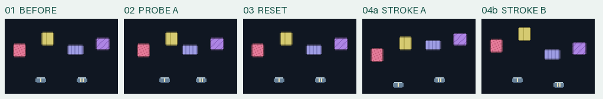

# 联合状态转移预测导论：从共同变化到对象、行动与语言

**岳轲**　｜　理论导论与实验　｜　研究手稿，2026 年 11 月 19 日

Joint State Transition Prediction: From Joint Change to Objects, Action, and Language

## 摘要

杯子刚滑出桌沿，人已经伸手。这个动作是否要求人先在脑中看见杯子下落的全过程？联合状态转移预测（JSTP）的回答是：不要求。自身运动本来就是未来的一部分。网络可以只预测将要伸出的手，也可以预期手与杯子的相遇，再让这份预期参与动作。两者可以是同一套网络从不同经历中学出的运行方式。

本文以此为起点，区分关于世界、学习和语言的三层主张，并提出一个比「智能就是预测」更窄、可以被实验否定的问题：**当正确动作的示范很少，观察自己行动的局部后果，是否有助于一个仍能直接行动的网络理解新目标？** 我们设计一套共享转移网络，不设对象分割器，不要求重建画面。六种方法从零接受相同的 16,384 条四轨交互记录；仅改变可用的目标—正确动作标注数。冻结后，模型在同一段试探经历上接收训练未见的目标，并在独立虚拟机构上执行。

在 192 个新布局上，只给 128 条动作示范时，JSTP 在同一次试探后把相反目标两题均做对的比例为 71.69%，仅动作策略为 49.79%，一步世界模型为 67.45%。保留物理学习、只断开预期通往动作的路径，成绩为 66.75%；示范充足时，这个对照反而略高。保持现实和目标不变，仅替换与物理后果相关的隐分量，一部分动作会按照供体世界的方向改变。这支持的是特定装置上复用物理经验的优势，不是各类智能都需要这种动作通路。

论文的贡献不是把已有的世界模型或动作策略改名叫作 JSTP，而是给这个理论一个要承担结果的版本：说明一次预测涉及什么、经验如何在不同目标间复用，以及怎样检验一个可读的预期是否真的改变了动作。实验涉及局部共动和有限操作；关于语言判断和自我意识的主张保留为假说。

**关键词**　联合状态转移预测；局部未来；动作示范；功能性分组；世界模型；隐状态干预。

<!-- page -->

## 1　从一只伸出去的手说起

杯子落下时，旁观者能描述许多未来：杯沿会经过桌角，手指会张开，杯子或许会被接住。当事人不必先拥有这份旁观者的描述。也可能只发生了一个粗略的运动预期，随后手就伸了出去。如果把后者叫作「没有预测的直接反应」，或把前者规定为「必须生成全部未来的画面」，都已经替理论做了它没有做的选择。

**世界层。** 作者的出发点是：世界事物的本质是联合事物的转移。一只手并非先孤立地完成运动、再与杯子构成关系。两者同处一个变化过程，但可以分别改变。这里的「联合」不要求万物同步，也不意味着系统能读到整个世界。实验只借用一个比本体主张弱得多的条件：在同一局部过程中，有些差异可以分别改变，有些后果会一起出现。

**运行层。** 用 S 表示真实情境，H 表示已经获得的经历，Z 表示经历在网络里留下的当下状态。S 的变化不由预测保证；网络须用它还没看到的结果接受检验。写作「从 H、Z 和当前条件，预测随后某一部分 Q」时，Q 可以是一只手的运动、一片视觉变化、一种感觉，或下一句要说的话。Q 是研究者说明预测内容的记号，不是脑内要先选中一张任务清单。本实验人为选好观测位置，未研究网络如何自行选择 Q。

**学习层。** 一段经历结束以后，Z 不必继续存在；下一次遇到相似情形仍能用上它，靠的是经历改变了网络参数。这里说的「经验沉淀」既包括记住杯子会落，也包括学到哪些差异值得一起处理。神经元或隐藏单元可以分别活动，只是分化的条件；这不等于结构一开始就知道什么是杯子。若一种处理方式长期稳定地出现，它就是一种学出的机制，并不因为系统只有一套权重而不存在。

联合预测也不自动给出好动作。人可以准确预期自己又犯同样的错。本实验把成功示范的来源、物理经历的来源和判断任务成败的标准分开。若不说明系统怎样接触到好坏之别，「预测到了，所以做对了」便是循环论证。

<!-- page -->

## 2　对象、动作和语言：同一假说，三种证据负担

**对象是一种可以拆开的预测。** 手和杯子一起移动时，光靠共同运动还不足以把它们认成两个个体。松开手以后，杯身和把手仍一起转，手却可以往别处去。只有换一种操作，系统还知道哪些部分继续共变、哪些部分能分别更新，才有了关于对象的证据。本文把这种较弱的能力叫作「功能性分组」。描出轮廓、遮挡后保持同一身份和理解可独立操作的整体，是更强的三件事。它们不能用一张漂亮的热图互相替代。

**动作是联合状态的一部分。** 直接预测自己的动作，并不违反 JSTP。另一条允许的路是：同一段经历先使「拉这里可能发生什么」在隐状态中发生变化，目标晚些到达，网络据此改变动作。前者未必有可读的未来感觉；后者也无须先绘画或通过一个清醒的裁判。若两条路都能成功，应当在固定现实和目标的前提下只动内部的后果预期，看手是否随之改变。

**语言是作者提出的更强分界。** 预见推杯子后它会倒，与陈述「因为我推了它，所以它倒了」不是同一件事。作者主张，可陈述的因果、是非、逻辑判断等高级智能只存在于语言层；声音或符号一旦能够由网络预测并回作输入，便能在没有当下外物提示时继续组织下一句。这不是说动物不能对干预产生正确预期，也不是把一切灵活行为重新命名成语言。若把任意有记忆的活动都算语言，「只有语言能判断」将无法反驳。

关于心声，作者进一步主张，预测的声音、图像和感觉回流并延长思维；通常被称作自我意识的内容，并非另一个内在主体在接收。**模型不需要一个内部指挥者，推不出人不存在自我意识。** 感觉端是否真有回流、经过外周感受器还是中枢通路、回流为何伴随体验，均不是下述实验的观测对象。保留这一主张的原有力度，也就必须保留它尚无本文证据的地位。

对应的证据由弱到强依次是：一次新行动能否成功；一种局部关系能否从状态读出；只改变它，行为能否按事先预期的方向改变。至于语言的必要性，还需要另一类任务，不能从把手实验顺推过去。

<!-- page -->

## 3　哪些思想已经有人做过，JSTP 又问什么

用未来定义状态，有清楚的先例。预测状态表示用在给定动作序列后可观测的结果来表示系统状态 [1]。视觉预测编码研究给出了利用上下层预测与误差解释视觉反应的具体模型 [7]。JSTP 既不声称首先提出预测，也不指定必须采用某一种误差回路。

最接近本文工程想法的是 Masked Trajectory Models [2]：同一轨迹网络改变已知与待补全部分，就可以担当正向动力学、逆向动力学或策略。Gato [3] 也已经说明，同一组权重可以依情境输出文字或动作。因此，「一套网络有多种输出」本身不是本文的创新。JSTP 还要求区分：当直接动作的路没有被封死，面向后果的经验能否节省示范，以及能读出的内容是否实际参与了选手。

| 路线 | 它与 JSTP 的交集 | 本文不混淆的区别 |
| --- | --- | --- |
| 显式世界模型 [4] | 能在潜在特征中预测，不必还原整帧 | 可预测两个候选后果再比较。JSTP 也容许直接动作；本文不宣称世界模型不能这样扩展。 |
| 视觉语言动作模型（VLA）[5] | 以状态、指令为条件预测自身动作 | 动作本身就是一种局部未来。动作准确不自动证明模型使用了物理预期。 |
| 轨迹补全 [2] | 一份经历可以支持不止一种读出 | 本文用示范稀缺、晚到目标和内部替换去检验具体实现，而不是凭能补全就判胜。 |
| 视频预测与视觉分化 [6] | 未教前景标签的预测网络可形成边界归属相关响应 | 这为「不必预装分割器」提供先例；它不是本文实验测得的四轨共动，更不是已获得完整对象。 |

本文检验两种相反预期。若物理经验可复用，少量示范就有机会让网络把新目标接到已学的后果上；若任务足以靠动作捷径解决，给出更多示范后，显式回用后果可能不再占优。更强的假说是后果信息会**定向**改变动作；单看任务得分，无法在这两种解释中作出选择。

<!-- page -->

## 4　一套网络怎样接受两种经验

实验装置有四条轨道、两个把手。研究者指定先横拉哪只把手；载荷短暂移动后精确复位。公开的离合设置可使两条被标记的轨道反向。到此为止，各模型拿到的观察相同。随后揭晓目标卡，例如「第一轨向上、第二轨向下、第四轨向上」。一次竖拉只要使指定方向占多数就算成功。机构真正执行这次动作，裁判从执行后的相机画面测方向，不读取模型分数。横向试探在这项研究里不是模型自由选的行为。

**架构。** 编码器把静态亮度、试探造成的亮度变化、重叠光学传感器和公开仪表编码成 48 维状态 h。一次共享转移写作 T(h,e) = h + f(h + e)，e 标记一次动作或动作提交。竖拉 A 的内部预期是 zA = T(h,eA)，B 的预期可以用同一组权重查询。给出目标前，zA 不读目标。给出目标后，将 h 与一项由 zA 学习投影来的信号相加，再用同一个 T 得到自身运动的读出。默认决策只需要一个参考后果，不逐一评估两只把手。h 保留直通路径；不要求某次一定依赖 zA。

**两种补全。** （一）给一段经历和一个正式动作，预测十二处重叠光学位移；网络可输出十二个数，但每例每次只在随机四处计算误差。（二）给一段经历和目标卡，预测一次成功的有符号动作。动作标签由实际 A、B 两次后果配目标卡导出，不是人类示范录像。每次更新同时取两类样本：动作误差加三倍局部光学均方误差。没有实例掩码、连接真值或部件归属标签。

这不是另起炉灶。研究四已经共用转移单元，但让试探哪只手决定默认预想哪只手。本次固定以正式拉 A 为参考，两种试探在每组都考；把物理经历与带动作标签的经历分开采样。因此可以单独改变示范量。未来读出不随目标卡改变是结构保证，不把它称作网络自己发现的性质。

**已给定的东西同样重要。** 轨道地址、动作原语、复位时刻和目标卡格式都不是学出来的；加性目标读出使相反卡天然倾向相反动作。正常运行时 zA 总会计算。可以走直接路，是指动作不必依赖 zA，不是网络学会了按需跳过这次计算。统一的是一套可学习权重，不是所有抽象都由零开始发明。

<!-- page -->

## 5　怎样给对手同样的机会

沿用上项研究原字节数据：2,048 个训练布局，每个布局有两种挂接、两档离合、两种试探，一共 16,384 条实际分支记录。每条都分派一张固定训练卡，24 种卡尽量平衡。128、1,024、16,384 个可见动作标注是同一随机次序的嵌套前缀。物理记录不因标注少而减少。正式 A、B 的物理读数来自同机构、同离合、同复位画面的配对执行；重配试探手和正式手没有增加一种新物理经历。

| 模型 | 怎样给出动作 | 怎样使用后果记录 |
| --- | --- | --- |
| JSTP 共享转移 | 直接历史和一个参考后果皆可用 | 同一转移单元预测局部光学，也参与提交动作 |
| 同结构断回输 | 保留共同编码，但动作不读后果隐状态 | 两种损失都保留；用于隔离动作通路的作用 |
| 仅直接动作 | 从历史和目标直接发出动作 | 相同记录可用，目标函数不使用光学后果 |
| 一步世界模型 | 分别预测 A、B 的局部光学，用学到的目标价值比较 | 显式有后果；主试验允许动作误差回传至动力学 |
| 掩码轨迹 Transformer | 单层自注意力，用不同查询补动作或光学 | 同样使用两种监督；是 MTM 启发的本地实现，不是作者权重 |
| 条件流动作 | 从固定起点用八步流场给出带符号动作 | 从目标与动作标签学习；不是任何基础 VLA 的替身 |

所有路线读相同的观察、同一张已标注目标卡；同一个训练排程规定每步抽到哪条记录、哪个传感位置。从零训练 768 步，每步各取 128 条动作与物理样本，物理流恰好遍历全库六次。稀缺档重复同一批标签，不另补新示范。每种方法、每档预算训练三个初始化，固定取最后一份权重。各模型宽度 48，但注册参数从 15,361 到 28,096，运算量也不相等。除条件流外，各路线共享加性目标地址读出；条件流采用自己的条件化方式。

**封卷。** 考试用 192 个未见布局、16 张从未用作训练目标的三轨卡，分别来自训练排除的两种地址组合。给每段试探两张互为相反的目标卡，两次都成功才记一对成功。两种挂接、两档离合、两侧试探都考；先封存全部动作，再执行。每份权重有 12,288 对题，但独立布局只有 192 个。区间按布局配对重采样 3,000 次，三个种子固定。相反卡不是独立猜币：每次总发同一动作会得零；始终发相反动作却猜错物理方向，仍会两题都错。

<!-- page -->

## 6　示范少的时候，看过后果值多少

| 模型 | 128 条 | 1,024 条 | 16,384 条 |
| --- | --- | --- | --- |
| JSTP 共享转移 | 71.69 | 94.90 | 99.67 |
| 同结构断回输 | 66.75 | 96.46 | 99.84 |
| 仅直接动作 | 49.79 | 62.74 | 90.17 |
| 一步世界模型 | 67.45 | 74.10 | 60.28 |
| 掩码轨迹 Transformer | 54.01 | 74.54 | 84.27 |
| 条件流动作 | 39.04 | 60.90 | 78.14 |

**表 1．在同一经历之后处理相反目标，两题都成功的比例（%）。** 三列只改变允许看到的不同动作标注数，训练步数、物理记录和考试布局不变。三次初始化缺一不可，未按验证集或考场成绩挑模型。

稀缺档里，JSTP 相对仅动作高 21.90 [20.66, 23.16] 个百分点，相对一步世界模型高 4.25 [2.89, 5.54] 点，相对同结构断回输高 4.94 [3.97, 5.85] 点。方括号是五项事先比较各用 99% 的布局配对区间，作 Bonferroni 家族校正。三个初始化平均后 JSTP 在这个预算下领先五组；其中一个初始化的一步世界模型仍以 74.4% 高于对应 JSTP 的 72.6%。这些区间不含重新抽取示范或换一批模型初始化的方差。

最能分开两种作用的不是直接动作，而是断回输组。它也学过每步竖拉的光学后果，只是不让该后果状态直接进入运动读出。稀缺档里，共享编码和光学学习已经解释了相当一部分任务优势；把预期送回动作，还多出一些。到 1,024 条或全部标注时，断回输组反而略高。不能把稀缺档的差值当作所有行动都需要后果通路的证据，也不能把两项差值当成严格的因果中介分解。

**这不是「见得少，做得反而好」。** 三档看过同样多的物理变化，少的是哪种动作符合某个指定目标的标签。在这三档被实际测到的预算上，JSTP 用 1,024 个标签的成对成绩已经高于仅动作使用全部 16,384 个标签的成绩；后者有 16 倍的不同标签。没有测两档之间的阈值，所以不能据此声称普遍可减少十六倍标注。这里检验的是在现有物理经历上多用一种学习信号的价值，不是更少计算或更少真实交互。

<!-- page -->

## 7　会做、能读出、会因它而改手

**把「分割」变成可错的一题。** 冻结后，给每种模型同样的线性读出方法：在未参与训练的 96 个验证布局上，用相机测得的四轨方向校准读出器。到新布局，指定正式拉 A：四条轨道的方向必须全部读对，离合反向以后还要全部读对，一项才通过。目标卡没有参与这个读出。校准用到了方向标签，所以这是检验已有表征，不是声称无监督发现了四个物体。

| 模型 | 128 条 | 1,024 条 | 16,384 条 |
| --- | --- | --- | --- |
| JSTP 共享转移 | 72.35 | 100.00 | 100.00 |
| 同结构断回输 | 91.02 | 100.00 | 99.96 |
| 仅直接动作 | 0.26 | 2.21 | 48.05 |
| 一步世界模型 | 46.88 | 9.24 | 1.09 |
| 掩码轨迹 Transformer | 85.81 | 27.69 | 29.17 |
| 条件流动作 | 0.22 | 2.39 | 20.66 |

**表 2．严格共动读出（%）。** 三个预算与表 1 相同。稀缺档里，断回输比 JSTP 更容易读出，掩码模型也很强；它们的任务成绩却较低。JSTP 在该档三个种子的分组成绩从 34.8% 到 100.0%，远没有任务均值显示得那样稳定。隐去试探的亮度变化和横向位移后，JSTP 的严格读出在三档均约 0.09%。因此读出确实依赖历史输入；没有证明网络获得跨遮挡的个体身份。

**只给错预期。** 在保持真实机构、目标、试探经历和直接通路不变时，用同挂接、另一离合的预期作供体。只移植与实测光学最相关的四个隐方向，不移植供体该选哪只手。对照一是在光学读出的零空间注入等长度改动；对照二是在正确把手本不应改变时施加相同的物理移植。所有改动都在冻结权重上进行。

128 条示范时，在供体与真实最优动作相反的题中，原本正确且向供体换手的比例为 11.75%；等幅无关扰动为 5.79%，两者净差 5.96 [5.29, 6.64] 个百分点（95% 布局区间）。在最优动作相同的题中，物理移植使原本正确的动作错换了 4.98%。原预期更贴近真实物理且移植后更贴近供体的比例为 94.18%。随着示范增至 1,024 和 16,384 条，物理移植与等幅对照的定向换手净差分别为 22.68 和 35.09 点。各比率的分母是相应条件下全部题，不是事后只挑会换手的题。

这是另一种证据：读得出来的东西，有一部分真的能把手带向供体。给错预期时，原来正确的动作因而可能变错。这是识别路径的代价，不是任务性能的收益。移植物理分量仍可能带着相关的非物理信息；零空间控制只对本光学读出无效，也不保证修改后的隐状态是自然状态。

<!-- page -->

## 8　认真对待一个表现反常的对手

主试验中，一步世界模型从 1,024 条到全部标注，成对任务从 74.10% 降到 60.28%；同时默认的光学预测误差升高。若只是挑这一行宣布 JSTP 胜过世界模型，比较就失去了意义。我们在看到主结果后才提出一个解释：也许为动作选得好而传回的梯度干扰了动力学。于是另锁一份协议，只阻断这一路梯度；同样初始化、同样采样、同样光学损失，动作目标只更新价值读出。没有改预算或搜索超参数。

| 模型 | 128 条 | 1,024 条 | 16,384 条 |
| --- | --- | --- | --- |
| JSTP 共享转移 | 72.04 | 95.02 | 99.57 |
| 同结构断回输 | 66.38 | 96.47 | 99.85 |
| 仅直接动作 | 50.79 | 62.18 | 90.20 |
| 一步世界模型 | 66.87 | 74.12 | 60.50 |
| 掩码轨迹 Transformer | 53.77 | 74.38 | 84.52 |
| 条件流动作 | 38.74 | 59.72 | 78.27 |
| 隔离梯度世界模型 | 58.14 | 57.55 | 58.03 |

**表 3．第二个考场的成对任务成功率（%）。** 又训练九份隔离梯度的世界模型。其余六组直接使用原冻结权重，七种方法在另一批未开启的 192 个布局上先封卷后执行。这是对主结果的同分布补考，不是独立团队复现或新物理环境。

隔离梯度没有救回这个实现。128 条示范时，隔离版相对端到端世界模型的成对差为 -8.73 [-10.28, -7.24] 点；全部标注时亦未反超。相同光学读数上的均方根误差在全部标注时分别为 0.846 与 0.837（相机位移已除以四像素行程）。因而不能把原来的反常表现简单归咎于动作梯度破坏物理预测。这里没有诊断出唯一原因，也没有在补考后再调对手。

**真实 VLA 与特征世界模型放在哪里。** 本文新增的掩码网络、条件流都没有借用外部大模型的名字。另有本项目研究四已经完成的同下游数据适配：一次遍历相同的 16,384 条记录、512 次更新、单个种子，旧的未见布局上，一步世界模型为 86.87%，当时的 JSTP-P 为 73.96%，官方 SmolVLA 局部微调为 14.47%，官方 DINOv2 特征加 DINO-WM 作者预测器的任务适配为 49.71%。这些旧数字只在那一行预算内可比，不是本文新做的三档实验。用低分辨率仪表、短动作和有限微调考 VLA，不能给机器人模型排世界名次。研究四充分训练时，JSTP-P、仅动作和一步世界模型甚至同为 100%。

<!-- page -->

## 9　一项理论需要同时记得阳性和阴性结果

较早的三载荷实验用两个末帧相同、经历不同的世界考分组。熟悉接线换新目标时，JSTP 的任务成功率为 88.7%，直接策略为 89.1%；换新接线又换目标时，前者降至 45.8%，后者是 68.3%。能从旧结构中读出共同运动，不能保证换一种连接关系仍会正确地拆开与合并。该项结果至今仍限制本文结论。

另一次同项目实验把「能预见」与「依预期而行动」分开。熟悉接线时，局部共动判别可达到 100%；但原定的定向换手净差是 0.00 个百分点。之后采用晚到目标、另一装置和不同干预方法，才测到 59.93% 的应换手题定向换手，等幅对照为 0.88%。二者不是一套权重，也不足以断言效果全由目标晚到造成。新实验保留了这种可被否定的检验，并把它与示范稀缺放到同场。

关于语言，现有证据要薄得多。先前的有限电路任务用最多四步训练，冻结后测试八步：可学习的三比特码、整体码和显式谓词都能完成；清空回输都回到 50%。这说明在给定三比特通道和有限规则的条件下，经验可以塑造可复用的记号。它不表明只有语言才能推理，不等于学会自然语言，更没有让四轨网络同时成为语言模型。把这些零件放在一篇导论里，不是把历史上的多套权重说成已经做出了一颗统一的大脑。

**理论在哪些地方会输？** 第一，若取消预设的轨道地址、改成遮挡和暂时共动的自由物体，系统只能按外观找回相似部件，而不能预测单独推动的后果，就不能把本实验推广为对象形成。第二，若在相同记忆容量和训练经验下，无语言的系统也能稳定解决被事先界定的反例修正、真假变换与理由迁移题，就必须收缩「高级判断只在语言层」的必要性主张，而不能事后把该状态重命名为语言。第三，若在新的物理家族、同样强的对手和新标注划分上不再节省示范，稀缺优势便属于本装置，不属于一般原理。

值得继续追问的不是系统能否画出一个看似完整的未来，而是：**当世界换了一种组合，有哪一部分经验仍足以让它做对下一步？** 这是 JSTP 最小的承诺，也是把它与一句包容一切的口号区别开的地方。

<!-- page -->

## 文献与复现

[1] Littman, M. L., Sutton, R. S. & Singh, S. (NeurIPS, 2001). [Predictive Representations of State](https://proceedings.neurips.cc/paper/2001/hash/1e4d36177d71bbb3558e43af9577d70e-Abstract.html).

[2] Wu, P. et al. (ICML, 2023). [Masked Trajectory Models for Prediction, Representation, and Control](https://arxiv.org/abs/2305.02968).

[3] Reed, S. et al. (TMLR, 2022). [A Generalist Agent](https://arxiv.org/abs/2205.06175).

[4] Zhou, G. et al. (ICML, 2025). [DINO-WM: World Models on Pre-trained Visual Features enable Zero-shot Planning](https://arxiv.org/abs/2411.04983).

[5] Shukor, M. et al. (2025). [SmolVLA: A Vision-Language-Action Model for Affordable and Efficient Robotics](https://arxiv.org/abs/2506.01844).

[6] Ye, Z., Wessel, R. & Franken, T. P. (iScience 28, 112199, 2025). [Brain-like border ownership signals support prediction of natural videos](https://doi.org/10.1016/j.isci.2025.112199).

[7] Rao, R. P. N. & Ballard, D. H. (Nature Neuroscience 2, 79–87, 1999). [Predictive coding in the visual cortex: a functional interpretation of some extra-classical receptive-field effects](https://www.nature.com/articles/nn0199_79).

### 本文的证据入口

[研究五：代码、两份协议、训练记录与复现命令](../README.md)；[主试验逐方法估计与配对区间](../evidence/analysis/summary.json)；[补考七组全部成绩](../evidence/challenge/results.json)；[答题记录和训练曲线](evidence-room.html)。新试验只使用独立虚拟机构和既有本地研究数据，无桌面截屏、外部预训练或真实机器人。

[作者完整理论稿](../../../theory/JSTP-详细理论稿-2026-11-19.md)；[研究一：功能性分组与新接线](../../01-grouping/README.md)；[研究二：运动与符号回输](../../02-motor-symbol/README.md)；[研究三：晚到目标与后果干预](../../03-late-goals/README.md)；[研究四：同数据 VLA 与世界模型比较](../../partial_futures/README.md)。这些研究的设置不同，本文没有把它们合成一张排行榜。

**可复查的范围。** 主试验训练前在本地 Git 锁定协议与训练实现；补考方案形成于主结果揭晓之后，在任何补考训练之前另行锁定。这是有先后顺序的私有研究记录，不是公开预注册。布局区间不能替代更多训练种子、更多标注划分、跨环境复验或独立复现。本文为研究手稿，未宣称已经同行评审。
