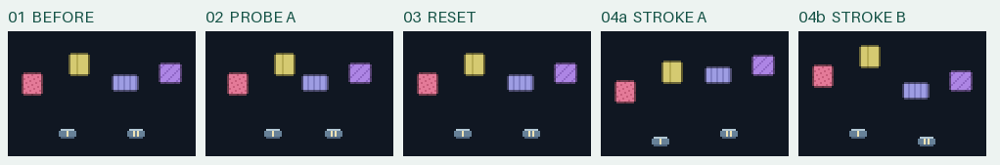

# Joint State Transition Prediction: Goal Generalization with Sparse Action Labels

Ke Yue · Independent Researcher · 19 November 2026 · Version 1.1

**Project repository:** [https://github.com/ykykykk/jstp-intervention-bench](https://github.com/ykykykk/jstp-intervention-bench)

**Full JSTP theory:** [English translation](https://zenodo.org/records/[[record]]/files/JSTP-Theory-Ke-Yue.en.pdf) · [Chinese original](https://zenodo.org/records/[[record]]/files/JSTP-Theory-Ke-Yue.zh.pdf)

**Preprint DOI:** [[[version_doi]]](https://doi.org/[[version_doi]])

## Abstract

A controller can learn what an action does without being told when to take it. Does that knowledge help once a new goal is specified? Joint State Transition Prediction (JSTP) treats an agent's action and changes in its environment as components of the same transition. We test a network that can predict its action directly or use a latent prediction of a local consequence. Eight methods were trained at three action-label budgets on a fixed bank of 16,384 interactions. Frozen policies operated a four-track simulator on 192 held-out layouts. Each trial pair required the policy to achieve two opposite, previously unseen goals from the same probe history. With 128 labels, JSTP achieved 71.69% paired success, versus 67.45% for a one-step world model and 49.79% for an action-only policy. Disconnecting the consequence-to-action path while retaining both training losses reduced paired success to 66.75% (difference: 4.94 percentage points; 99% paired layout-bootstrap interval: 3.97 to 5.85). The disconnected network scored slightly higher at both larger budgets and had more readily decoded co-motion at 128 labels. The results isolate a benefit of using predicted consequences under sparse action supervision in this apparatus. They do not establish that better control requires more readily decoded object representations.

**Keywords:** joint state transition prediction; goal-conditioned control; action supervision; functional grouping; latent intervention.

## 1. Introduction

Suppose a controller can pull either of two handles. A brief horizontal pull reveals how four loads respond; the apparatus then resets. Only after the reset does the controller learn which loads should move up or down. The probe answers a question about the apparatus. The goal answers a different question about which physical outcome is wanted. By presenting opposite goals after the very same probe, we can ask whether the controller uses that distinction rather than relying on a preference for one handle.

Joint State Transition Prediction (JSTP) regards the agent's own next action as one possible component of a future shared with its environment. A network need not reconstruct that future in full before acting: it can predict its action directly. Conversely, predicting even a small part of what would happen under an action may supply information useful for goals not yet specified. These possibilities motivate a more discriminating comparison than simply adding a prediction loss. Two networks can learn from the same outcomes and predict the same kinds of measurements while differing in whether their motor decision can use a particular predicted consequence.

We make three contributions. First, we give an operational definition of partial joint prediction and specify a network in which the route from history to action remains intact when consequence feedback is removed. Second, we compare eight controllers on identical downstream annotation budgets and new layouts, recording the actions each frozen controller actually executes. Third, we distinguish three findings that might otherwise be mistaken for one: selecting a successful action, encoding which parts move together, and changing an action in response to an intervention on an expected consequence. The strongest contrast is with the same network trained with both objectives but without the consequence-to-action connection.

## 2. What counts as a joint prediction?

**The state need not be reconstructed.** The broader theory starts from the view that change arises through joint transitions among things. The experiment needs only a narrower premise: the agent and environment admit a joint state, and different observable quantities depend on its evolution. Let S denote this state, H the history of observations and actions available to the agent, and c the currently known conditions. A query Q specifies the component of interest; its projection is denoted by π:

[[eq_partial]]

Q may refer to the agent's own motion, a local sensory consequence, a latent quantity, or a symbol. Equation (1) does not require the network to represent the full state explicitly. Nor does it guarantee that an arbitrary latent projection has a unique observable interpretation. Here the testable quantities are the displacements at specified sensor locations and the handle selected for execution. The measurement channels are supplied by the experimenter; the network does not discover where to look. Predicting what action one will take is also not the same as taking a successful action. Success must be grounded separately in the goal and the executed physical transition.

**Grouping is a function to be learned.** Having distinct units makes local differences representable. It does not imply that the network has already individuated objects. A narrower criterion for grouping is whether its state distinguishes parts that will change together from parts that can change separately when the actuation or coupling changes. This criterion does not call for a dedicated segmentation module. Our measurement is restricted to the co-motion of four addressed tracks. It does not test whether the network can discover the tracks without addresses, draw an object boundary, or maintain identity through occlusion.

**Scope of the cognitive claims.** JSTP also proposes that explicitly articulable judgments of cause, truth, or logical validity operate at a linguistic level, whereas successful nonlinguistic prediction need involve neither an explicit judgment nor a conscious image. A further proposal is that internally predicted sound, imagery, and sensation can be fed back to sustain thought, without postulating a separate observer of those signals. The controller below tests neither the necessity of language nor the existence or absence of an independent self. It also says nothing about whether internal feedback reaches peripheral sensory receptors. Section 8 specifies observations that would narrow the theory rather than merely illustrate it.

## 3. Related work

**Predictive states and trajectory models.** Predictive representations of state describe a system in terms of observable outcomes conditional on future action sequences [1]. Predictive coding offers a different precedent: top-down predictions and residual errors can account for aspects of visual responses [2]. Masked Trajectory Models (MTM) are the closest architectural comparison: the same weights can answer forward-dynamics, inverse-dynamics, or policy queries by changing the mask, including settings with missing modalities [3]. Play-LMP learns reusable latent plans from play without task labels [4]. Gato uses a single network to predict text or actions according to context [5]. Shared weights, learning from partially labelled experience, and reuse across goals are therefore not by themselves the contributions here. We ask whether a particular prospective state has an identifiable behavioral role when a direct action path is still available.

**World models and action policies.** DINO-WM predicts future DINOv2 patch features and plans toward a goal observation without synthesizing future pixels [6, 7]. DreamerV3 learns a policy and a value function from trajectories imagined with a world model [8]; using a direct policy and learning a world model are not mutually exclusive. SmolVLA conditions a flow-matching action expert on visual, language, and state inputs [9]. Our comparisons use two specific adaptations: partial fine-tuning of the official SmolVLA policy, and a DINO-WM predictor with a task-specific optical target instead of future image patches. Neither is a reproduction of its upstream robotics benchmark.

**Grouping and intervention.** Slot Attention provides exchangeable slots and a competitive assignment mechanism for object-centric learning [10]. We provide neither object slots nor instance supervision. In a predictive network trained on natural video, Ye et al. found border-ownership selectivity and used ablations to examine its contribution to prediction [11]. This demonstrates the possibility of a grouping-related computation, not that all predictive systems acquire full object representations. Geiger et al. use interchange interventions to test proposed causal abstractions of networks [12]. Our intervention makes a narrower claim: a displacement-aligned component of a network's expectation can affect the direction of its choice.

## 4. Model and objectives

### 4.1 Shared transition and motor readout

An encoder E compresses static brightness, probe-induced brightness changes, overlapping optical readings, and public instrument readings into a 48-dimensional state h. A shared residual cell T combines this state with a learned event embedding e. Querying either handle a yields a latent consequence z. The motor decision uses handle A as a fixed reference; the cell can also be queried for B:

[[eq_transition]]

Only after the probe is over is the signed four-component goal g supplied. A learned linear map R projects the reference expectation back into the direct path, and the same transition cell is reused with a motor-commitment embedding. W and b are parameters of the readout:

[[eq_motor]]

The controller executes B if the score is nonnegative and A otherwise. It need not search both candidates or decode an image to act. The reference expectation is always computed, but its influence is learned; a separate path from h is retained. Two design choices matter for interpretation. Because the goal enters after the reference expectation is formed, changing only the goal cannot change that expectation. And because the readout is linear in the goal, reversing the goal reverses the score, except that ties receive the same action. Neither invariance nor a mere switch of handles is evidence that the network learned the physics. The decision is informative only if it chooses the right direction.

### 4.2 Two sources of supervision

Each physical example supplies 12 overlapping optical displacement measurements for a vertical stroke. Four measurement locations M are sampled for the squared prediction error at each update. Action-labelled examples are drawn separately. From the same reset condition, A and B are executed independently; the handle whose stroke makes a majority of the three designated tracks move as requested provides the target y (−1 for A, +1 for B). The joint training criterion is:

[[eq_loss]]

The first expectation is over goal–action labels, the second over physical outcomes. A label is an execution-derived answer, not a human demonstration video. Instance masks, hidden attachment labels, and simulator coordinates specifying the optimal handle are not inputs. The matched ablation retains both losses and the shared encoder; it removes only the contribution of Rz to the motor readout. This is a closer test of the proposed mechanism than removing all physical supervision.

## 5. Experimental protocol

### 5.1 Histories, goals, and execution

The experimenter chooses a horizontal probe with A or B. The loads briefly move and then return to their original positions. The controller receives this history before it sees a goal card, such as “track 1 up, track 2 down, track 4 up.” It then makes one vertical stroke. The judge compares camera images before and after the stroke; success requires at least two of the three requested directions. In Figure 1 the two vertical strokes are separate simulator executions starting from the same reset state. The protocol tests neither autonomous probe selection nor real-robot control.

The training bank crosses 2,048 layouts with two wirings, two clutch settings, and two probe sides, giving 16,384 interaction records. Each record is assigned one of 24 training goal cards. The three action-label budgets are nested prefixes of one shuffled order: 128, 1,024, or 16,384 distinct goal–action labels. All physical outcomes remain available at every budget. Testing uses 192 new layouts and 16 signed three-track goals whose two track-address combinations were excluded from the training cards. Each checkpoint faces 12,288 pairs of opposite goals. All choices were sealed before execution. No checkpoint was selected on the basis of its test outcome.

### 5.2 Comparators and information budgets

**Six systems trained from scratch.** Besides JSTP and its disconnected counterpart, the action-only policy learns the successful action from history and goal; a one-step world model predicts both candidate consequences and compares their learned goal utilities. A masked trajectory Transformer uses distinct queries for missing actions and displacements; it is a local MTM-inspired implementation, not the original MTM. A conditional flow policy generates an action in eight steps from a fixed starting value. Five systems use an additive goal readout; the flow policy uses its own goal conditioning. Backbone width is 48 throughout. Registered parameter counts range from 15,361 to 28,096, so this is not an exact compute match.

**Two pretrained adaptations.** Each SmolVLA fit starts from the official policy and updates the state projection, action output projection, and last action-expert layer (6,067,072 trainable parameters). It retains its native action objective and emits one signed action using four flow steps from zero noise at evaluation. The DINO-WM adaptation freezes DINOv2-S/14, retains the authors' unmodified ViT predictor implementation, and trains 107,024 task-side parameters. It estimates the 12 optical displacements and compares the two handles. Its four sampled sensor locations and optical loss weight are identical to JSTP's; native SmolVLA does not use this loss.

We trained three seeds (9301, 9419, 9547) per method and budget, for 72 checkpoints. Each fit ran 768 updates with batches of 128 labelled draws and used its final weights. The downstream record indices, labels, and update counts were matched, not pretraining, objectives, or FLOPs. The six scratch-trained arms were evaluated first. The adapters' protocol was locked after those results were known but before the 18 new fits began. The adapters were evaluated on the original layouts and paired with the original sealed JSTP choices.

### 5.3 Estimands and uncertainty

The primary metric is **paired success**: from one history the controller is given g and its opposite in separate branches; both actions must satisfy their respective goals. Secondary metrics are single-goal success, how often the controller selects the same handle for opposite goals, and the co-motion readout defined below. We made 3,000 paired bootstrap draws of whole layouts, preserving the dependent histories, goals, and seed results within each of the 192 layouts. At 128 labels the five scratch-trained contrasts and the two adapter contrasts form two separate families. Bonferroni correction gives 99% intervals per scratch contrast and 97.5% per adapter contrast; these are not joint 95% coverage across all seven comparisons. Uncertainty is conditional on one label split and the three fixed seeds.

## 6. Results

### 6.1 When does the consequence path improve action selection?

**Table 1. Paired success on the primary panel (%).** Differences at 128 labels are JSTP minus comparator in percentage points, computed before rounding. The interval is layout-paired and adjusted within the relevant comparison family. Wins count matching seeds for which JSTP scores higher. Best means in each budget are bold.

[[main_table]]

At 128 labels JSTP has the highest mean paired success of the eight methods. Its margin over the direct policy is 21.90 percentage points, but this is not a clean estimate of the contribution of the consequence-to-action connection. The direct policy also lacks the optical objective. Retaining that objective and removing just the connection gives a smaller difference: **4.94 points** (99% interval 3.97 to 5.85). The one-step world model is closer still in mean performance, at 67.45%, and beats JSTP on one of the three seeds. In the 1,024- and 16,384-label regimes, the disconnected network scores slightly higher than JSTP. Thus the advantage of this connection depends on how many successful actions are labelled.

The pretrained adapters were compared against sealed JSTP trials on the same layouts, with 442,368 additional formal strokes across the two adapters. The sparse-budget differences favor JSTP by 21.12 points over the DINO-WM adaptation and 47.95 over SmolVLA. For each comparison the adjusted interval excludes zero and all three matched seed differences have the same sign, meeting the stated adapter criterion. The latter comparison gives the two methods equal downstream action labels, not equal physical prediction losses.

JSTP with 1,024 labels also outperforms the action-only model with 16,384. This is a comparison between two observed points, not an estimate of a universal sixteenfold reduction in labelling. We did not measure the intermediate crossover or reduce the amount of physical experience.

### 6.2 What changes when the goal is reversed?

**Table 2. Seed-level paired success and behavioral diagnostics with 128 labels (%).** Single = single-goal success; same = same handle for opposite goals; group = strict co-motion readout; blind = that readout with probe changes concealed. The last four columns aggregate three seeds. “n.m.” means not measured, not zero.

[[detail_table]]

The one-step world model reaches 74.37% on seed 9301, above JSTP's 72.55% for the same seed. The adapter results expose different ways to miss a pair. SmolVLA succeeds on 51.85% of single goals yet chooses the same handle for 56.23% of opposite-goal pairs. Exactly one member of each such pair must fail. DINO-WM repeats the handle in only 0.06% of pairs, but achieves just 50.58% paired success. Its utility is a dot product with the goal: reversing the goal ordinarily changes the choice even if the predicted direction is wrong. The same warning applies to JSTP's goal readout. Switching is not the criterion; switching in the right direction is.

### 6.3 What is represented, and what is used?

We froze each scratch-trained controller and fitted a linear direction readout using labelled camera observations from 96 separate validation layouts. For a fixed A stroke in a new layout, all four track directions must be recovered under **both** clutch settings: eight signs, with no partial credit. Only this post-training diagnostic uses the direction labels to fit a readout; no grouping labels train the controller. The result measures the availability of a functional relation in a representation, not a segmentation mask.

At 128 labels co-motion is most readily decoded from the disconnected model (91.02%), followed by the masked trajectory model (85.81%). JSTP, which leads in task success, yields 72.35%. Across its three seeds the grouping result ranges from 34.77% to 100.00%. Concealing the brightness changes and horizontal displacements produced by the probe drops its mean to 0.09%. These results implicate the interaction history in the readout. They also show why the readout cannot stand in for successful control. Appendix A reports all budgets; neither pretrained adapter received this diagnostic.

To test whether a consequence state affects the actual decision, we kept the real wiring, history, goal, and direct motor path fixed. A donor expectation came from the alternate clutch setting under the same wiring. We transplanted only the four latent directions most aligned with the optical readout. A matched control placed a perturbation of the same norm in the readout's null space; a second control used cases where the donor and real situation had the same optimal handle. No donor action label was transplanted. Rates below are fractions of **all** trials in the indicated stratum, not post hoc percentages restricted to trials initially answered correctly.

At 128 labels, in cases with different real and donor optima, the policy was initially correct and then switched to the donor's handle on 11.75% of trials, versus 5.79% under the equal-norm control. The net difference is 5.96 points (95% paired layout interval 5.29 to 6.64). When the optimum should stay the same, the physical transplant changed a correct choice into a wrong one in 4.98% of trials. In 94.18% of cases the original optical readout was closer to the real measurement and the intervened readout was closer to the donor measurement. Net directed switching over the equal-norm control rose to 22.68 and 35.09 points at the two larger budgets.

This manipulation changes a frozen controller, not the physics. Its tendency to turn a previously correct decision into an error in the donor direction is evidence that the path is used, **not** that the intervention helps the policy. The selected latent directions could also carry other information correlated with displacement; the result does not identify a dedicated physical concept or a particular causal neuron.

## 7. Supplement: does the action gradient impair the world model?

On the primary panel, increasing the one-step world model's labels from 1,024 to 16,384 reduces paired success from 74.10% to 60.28%. One possible explanation is that gradients from the action objective interfere with learning dynamics. After the main result, we locked a supplementary protocol that holds initialization, records, optical supervision, and update budget fixed and stops the action gradient at the dynamics pathway. The forward decision still evaluates predicted outcomes. Nine new checkpoints and the six original scratch-trained arms were executed on a separate unopened panel of 192 layouts from the same apparatus family. The pretrained adapters were not evaluated on this panel.

**Table 3. Paired success on a second panel of layouts (%).** Compare rows within this table. Gradient isolation changes the backward path, not the availability of predicted consequences at decision time.

[[challenge_table]]

At 128 labels the isolated world model reaches 58.14%, versus 66.87% for the original on the same panel (difference: −8.73 points; 95% paired layout interval −10.28 to −7.24). At full labels their optical root mean squared errors are 0.846 and 0.837 respectively, normalized by the four-pixel stroke. Isolating this gradient does not rescue success. The comparison does not identify a unique cause of the original decline.

## 8. Discussion

**What the evidence supports.** At a fixed amount of physical experience, with few labels for successful actions, feeding a local consequence prediction back into a controller that can still act directly improves its use of new goals. The matched-path ablation, not the wide gap to a particular pretrained model, is the strongest evidence for that statement. More labels reverse the ordering of the two matched networks even though the intervention continues to move choices. Relying on a consequence is a different property from benefiting from that reliance.

The device supplies discrete handles, a fixed stroke, track addresses, and reproducible reset conditions. New layouts and held-out goal combinations do not constitute a new physical family. Indeed, in an earlier, separate three-load study that changed both wiring and goals, JSTP scored 45.8% versus 68.3% for a direct policy. Under another protocol with sufficient training a one-step world model, JSTP-P, and an action-only model all reached 100%. These results are not pooled with Table 1. If the sparse-label contrast fails on new annotation splits or a different mechanism, the empirical claim must stay with this apparatus.

**What would constitute stronger evidence for objects?** A controller could read track-specific motion correctly without representing a persisting object. A stronger test would hold the final image fixed while changing the occlusion history. Two visible regions might be parts of one rigid body in one history and independent pieces in the other. Pushing one region would then reveal whether the model predicted the correct response of the other. This distinguishes persistence from re-identification by appearance; it is a proposed experiment, not a reported success.

**What would narrow the linguistic claim?** Varley and Siegal describe an individual with severe agrammatic aphasia who retained some nonverbal causal reasoning [13]. Loss of grammar is not proof of the absence of all internal symbols, but impaired verbal expression cannot by itself establish impaired reasoning. If an equally resourced nonlinguistic system reliably revises a judgment in response to counterexamples and transfers the reason for the revision to new tasks, the necessity claim should be restricted. Relabelling any successful latent state as language after the fact would defeat the test.

**Conclusion.** A partial prediction of an external consequence and a direct prediction of the agent's action can coexist in a single network. In this experiment, coupling them helps chiefly when successful actions are sparsely labelled. Co-motion decodability, task success, and the behavioral effect of changing an expectation give different answers about the same controller. Keeping these questions separate makes the proposed mechanism testable without treating a four-track result as a general theory of cognition.

## Appendix A. Co-motion and reproducibility

**Table A1. Strict co-motion readout by action-label budget (%).** All four directions under both clutch settings must be decoded correctly on held-out layouts. Only the six scratch-trained controllers were measured.

[[group_table]]

A separate finite-symbol experiment trained on sequences of at most four steps and tested on eight. A learned three-bit code, a holistic code, and explicit predicates could all solve that task; clearing the feedback signal returned all three to 50%. It establishes reusable signalling in a prescribed three-bit channel under finite rules, not natural language. Its weights are not the four-track controller's weights. No experiment reported here directly tests awareness or sensory recirculation.

**Data and code.** The [study archive](https://github.com/ykykykk/jstp-intervention-bench/tree/9dd500171a8a59b3716ae3802c5b24c40c7d0f1a/studies/joint_primer) contains protocol snapshots, immutable training schedules, final weights, per-seed outcomes, paired layout counts, camera observations, and reproduction commands. Separate records cover the [primary panel](https://github.com/ykykykk/jstp-intervention-bench/blob/9dd500171a8a59b3716ae3802c5b24c40c7d0f1a/studies/joint_primer/evidence/analysis/summary.json), [pretrained adapters](https://github.com/ykykykk/jstp-intervention-bench/blob/9dd500171a8a59b3716ae3802c5b24c40c7d0f1a/studies/joint_primer/evidence/official/analysis/summary.json), and [gradient-isolation panel](https://github.com/ykykykk/jstp-intervention-bench/blob/9dd500171a8a59b3716ae3802c5b24c40c7d0f1a/studies/joint_primer/evidence/challenge/results.json). The [companion studies](https://github.com/ykykykk/jstp-intervention-bench/tree/9dd500171a8a59b3716ae3802c5b24c40c7d0f1a/studies) document the negative transfer and finite-symbol results discussed above. Protocols were fixed in private Git commits; this was not public preregistration. All task executions were performed in the dedicated simulator, not on a real desktop or robot.

**AI assistance.** OpenAI Codex assisted with experimental implementation, table preparation, and drafting the English manuscript. The reported measurements come from the archived training and execution records. No new experimental runs were conducted for this English edition.

## References

[[references]]
