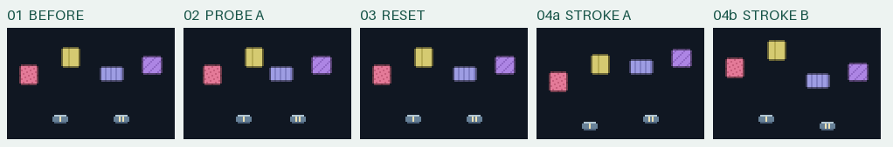

# 联合状态转移预测导论：从局部后果到少示范动作泛化

Joint State Transition Prediction: Goal Generalization with Sparse Action Labels

岳轲　　修订稿 v1.2 · 2026 年 11 月 21 日补明实验规则

**项目仓库：** [https://github.com/ykykykk/jstp-intervention-bench](https://github.com/ykykykk/jstp-intervention-bench) · [本版 DOI：10.5281/zenodo.24392467](https://doi.org/10.5281/zenodo.24392467)

## 摘要

联合状态转移预测（JSTP）把自身动作与环境变化视为同一转移的可预测分量，不要求先重建完整未来。本文检验一个问题：正确动作标注很少时，让动作通路使用对局部后果的预期，能否帮助网络为未见目标选对动作？我们固定 16,384 条物理经历，改变其中带动作标注的条数。冻结的控制器在 192 个留出布局上操作四轨装置；同一试探后分别给出两个相反目标，两次操作都达标才得分。128 条标注时，JSTP 的成对成功率为 [[ext_joint_128]]%；保留两个训练损失、只断开后果回输后为 66.75%，相差 4.94 个百分点（99% 布局配对区间 [3.97, 5.85]）。扩展比较中，ACT 适配在该档达到 [[ext_act_128]]%，高于 JSTP；1,024 条时两者分别为 [[ext_act_1024]]% 和 [[ext_joint_1024]]%。没有外部预训练的 JSTP 以 18,304 个参数接近 ACT，但不是少标注条件下的最优方法。结果支持的是这条后果回输通路在该装置上的贡献，而非完整对象分割的涌现。

**关键词：** 联合状态转移预测；目标条件控制；动作标注效率；功能性分组；隐状态干预

## 1　引言

在目标条件控制中，记录一次操作的物理后果，并不等于示范了面对某个目标时该怎么做。如果先让系统试探并复位，再公布目标，两种信息就可以在实验中分开：试探揭示了装置如何响应；随后给出的目标决定哪一种响应有用。对同一段试探给出相反目标，还能区分模型是否选对了动作，还是仅偏好其中一个动作。

JSTP 把动作也视为未来状态的一部分。直接预测动作与预测外部后果并不互斥：前者不必以完整未来画面为中介；后者可以为尚未给定的目标保留可复用的信息。这与“训练时多预测一项指标就会改善控制”不同。若一个网络能预测物理后果，但动作读出并不使用该预期，它仍可能有很高的任务成功率。

同结构对照和外部对照回答不同的问题：前者检验后果预期是否为仍能直接行动的网络增加了信息；后者检验别的策略是否也能做到。我们给出局部预测的可执行定义，用同一份经历和嵌套标注分别做这两种比较。原八组比较识别出稀缺档中的回输收益；随后加入 ACT、Diffusion Policy 和 V-JEPA 2.1，发现更强的外部对照能改变排名，却不改变同结构对照的差值。最后，我们分别测量是否完成任务、能否从内部状态读出共动、以及只改变后果预期会不会改变动作。语言与自我意识不是这些实验的观测对象。

## 2　理论定义与范围

**联合状态与局部预测。** 理论的出发点是，世界中的事物通过与其他事物共同发生的转移而变化。这个本体主张强于本文所需的实验前提。设 S 为主体和环境的联合状态，H 为此前可获得的观察与动作，c 为当前已知条件。Q 指定要预测的分量，π 表示对联合状态的相应投影：

[[eq_partial]]

Q 可以是自身运动、局部感觉、隐式表征或符号。式（1）表述预测的范围，不假设网络显式构造完整的 S，也不假设投影具有唯一真值；在本实验中，可验证的投影是指定位置的位移和一次执行的动作。研究者给定这些通道，模型没有学习自行选择观察位置。准确预期自己的行为也不保证行为能完成任务，所以动作标签另由已执行的后果与目标共同确定。

**分组作为可学的功能。** 单元可分别活动，是表达局部差别的条件，不等于已经把场景分成对象。若改变执行动作或机构连接，网络仍能区分哪些局部共同变化、哪些可独立变化，就获得了关于功能性分组的证据。它可以由同一网络对交互规律的学习形成，不必预装一个分割器。本研究检验已给定轨道地址上的共动关系，不把方向读出等同于发现独立物体、描出轮廓或保持跨遮挡身份。

**认知层的扩展命题。** JSTP 进一步主张，可陈述的因果、是非和逻辑判断属于语言层；非语言预测不必有显式判断或清晰的意识画面。作者也提出，内部预测的声音、图像和感觉经回输而延长思维，从而无需另设一个接收这些内容的“自我”主体。语言是否必要、感觉回流是否抵达外周感受器、这种解释是否足以否定独立的自我意识，都不由下文的模型预设或实验结果推出。第 8 节给出可使其中部分主张收缩的反证条件。

## 3　相关工作

**预测状态与通用轨迹模型。** Littman 等以给定动作序列后的可观测结果定义预测状态 [1]；Rao 与 Ballard 用层级预测及误差反馈解释视觉反应 [2]。与本文实现最接近的是 MTM：同一组权重可以按不同掩码承担正向动力学、逆向动力学或策略；原论文还研究了动作等模态缺失的轨迹 [3]。Play-LMP 从无任务标注的操控经历学习潜在计划，再为指定目标调用它们 [4]。Gato 也展示了同一网络按上下文预测文本或动作 [5]。因此，共享权重、从无动作标注的经历学习以及跨目标复用，都不是本文单独提出的贡献。本文增加的区分是：当预测动作的直接通路仍在时，特定的候选后果是否产生可测的额外影响。

**世界模型与动作策略。** 原版 DINO-WM 学习未来 DINOv2 图像块特征，并针对目标观测优化动作序列，不需要预测完整像素 [6, 7]。DreamerV3 在世界模型想象的轨迹上学习策略和值函数 [8]，说明世界模型与直接策略也可以共存。SmolVLA 则以视觉、语言和状态为条件，用流匹配动作专家产生动作块 [9]。本文分别实现两类适配：局部微调官方 SmolVLA；保留 DINOv2 和作者预测器，但以装置的可测位移替代未来图像块。结果表评价这些具体适配，不以局部设置推断整类模型的能力。

扩展比较引入三种不同的预训练起点。ACT 用 Transformer 成块预测一段动作 [10]；Diffusion Policy 通过条件去噪生成动作序列 [11]。二者均已学过从视觉到动作的映射。V-JEPA 2.1 则学习图像与视频的稠密表征 [12]；在这里它须另学四轨任务的读出。这三项比较分别使用既有动作表征或视频表征，不是对上游机器人基准的复现。

**分组与机制证据。** Slot Attention 用交换对称的槽位和注意力竞争组织对象表征 [13]；本文不设置槽位，也不以外部实例标签训练。Ye 等在自然视频预测网络中发现边界归属选择性，并通过消融考察它对预测的贡献 [14]。这支持分组相关计算可以随预测学习形成，不意味着任意网络都会学到完整对象。Geiger 等以交换干预检验隐表征的行为作用 [15]。我们采用较窄的检验：替换与可见位移对齐的隐分量，不假设已恢复了完整的因果抽象。

## 4　模型与训练目标

### 4.1　共享转移与动作读出

编码器 E 将静态亮度、试探引起的亮度变化、重叠光学读数及公开仪表组成的历史 x 压缩为 48 维状态 h。对候选操作 a，共享的残差转移 T 在动作嵌入 e 的条件下给出后果隐状态。正式决策使用 A 作为固定参考，B 可由同一单元查询：

[[eq_transition]]

给定四维有符号目标 g 后，网络将参考预期投影回直接通路，再用同一个 T 生成动作读出。m 表示提交自身动作的事件，R 是可学习的线性投影，W 和 b 是动作读出的参数：

[[eq_motor]]

得分非负时执行 B，否则执行 A。网络不必逐一搜索候选，也不必把隐预期解码成图像。h 保留直通路径；参考预期每次都会计算，但权重不一定使用它。因为目标在形成 z 之后才进入，给同一段历史换目标不会改变参考后果；线性目标内积也使相反目标倾向产生相反得分。这两点是架构性质，不能记作学出的能力。实验检验的是产生的动作方向是否正确。

### 4.2　局部后果与成功动作的监督

每条物理样本包含一次竖拉的 12 个重叠光学位移。每次抽取其中四个位置 M，计算位移预测的均方误差。动作样本另行抽取：同一复位状态下分别执行 A、B，哪个动作让目标指定的轨道多数朝所需方向移动，哪个就是该目标的标签 y（A 为 −1，B 为 +1）。共享转移网络的目标为：

[[eq_loss]]

两项期望分别来自已标注动作和物理后果样本；动作监督不是人类演示录像。网络没有接收实例掩码、挂接真值或最优动作的环境内部坐标。匹配消融保留两个损失与共同编码，仅从动作读出中移除 Rz。相比去掉整个物理损失，这个对照更接近“可读的后果预期是否对决策有额外贡献”这一问题。

## 5　实验设置

### 5.1　四轨规则：一次试探，两张目标卡

**装置与试探。** 四个滑块从左到右编号 1 至 4，两个把手记为 A、B。正式竖拉任一把手，四个滑块都会动；在同一设置下，把手从 A 换成 B，每一轨的运动方向都反过来。不同布局的内部挂接不一定相同，看静止画面不能确定拉 A 后哪几轨会向上。每局先由实验程序指定横拉 A 或 B，滑块左右移动，再精确复位。模型能看到这次移动、试拉的是哪个把手，以及随后公布的离合档位和受离合影响的两轨标记；它看不到内部挂接。至此还没有目标，也没有执行正式竖拉。

**出题与判分。** 复位后才出示目标卡。每张考卡指名三条轨道和各自要走的方向，第四轨不计。模型选一个把手竖拉一次，裁判从执行前后的相机画面量出方向：三轨中至少两轨符合，就是单卡成功。再把同一段试探经历配上方向完全相反的卡。两张卡是从同一复位状态分出的两道独立题，不是连续操作；两个选择都先封存，模型不能看了第一题的结果再答第二题。两张卡都成功，这一对才得一分。这里不考自主选择试探，也不是现实机器人操作。

**计分例：同一局里的一对成功和一对失败。** 取归档回放的首个布局 113670000，原挂接、原档，横拉 A 时第 1、2 轨向右，第 3、4 轨向左。复位后，竖拉 A 的实测方向依次为「下、下、上、上」，竖拉 B 则为「上、上、下、下」。下表是冻结 JSTP 的实际选择（128 条标注，种子 9301）。四张卡都只看第 1、2、4 轨。

| 卡号：目标方向（第 1、2、4 轨） | 所选把手 | 符合的轨道 | 单卡结果 |
| --- | ---: | ---: | ---: |
| 1：下、上、上 | A | 1、4 | 2/3，成功 |
| 2：上、下、下 | B | 1、4 | 2/3，成功 |
| 3：下、上、下 | A | 1 | 1/3，失败 |
| 4：上、下、上 | B | 1 | 1/3，失败 |

卡 1 和卡 2 合计得一分；卡 3 和卡 4 得零分。模型两次都随目标换了把手，但第二对恰好选反。因此，「换了手」不是「选对了手」。

**哪些信息是新的。** 训练有 2,048 个布局，每个布局交叉两种挂接、两档离合和两个试探把手，共 16,384 条物理经历。训练卡共 24 种：单轨卡，或同时要求第 1、2、3 轨或第 2、3、4 轨的卡。每条经历分配一张固定训练卡。三档训练都可用全部物理经历；不同的是，按同一随机顺序取前 128、1,024 或全部 16,384 条，额外告诉模型「这张卡该选哪个把手」。测试冻结权重，换用 192 个新布局；16 张考卡只用训练排除的两种三轨组合（1、2、4 或 1、3、4），不是简单地把同一张训练卡换个布局。每份权重执行 12,288 对相反目标，不依据实操结果挑选权重。

### 5.2　比较方法与信息预算

**从零训练的六组。** 除 JSTP 和同结构断回输外，仅动作策略只从历史和目标学习成功动作；一步世界模型预测 A、B 的局部后果，再比较其目标效用；掩码轨迹 Transformer 用不同查询补全动作或位移，是受 MTM 启发的本地实现；条件流策略从固定起点经八步生成动作。前五种使用加性目标读出；条件流采用自己的条件化方式。六组主干宽度均为 48，注册参数量为 15,361–28,096，算力不完全匹配。

**两个预训练适配。** SmolVLA 从官方策略重新开始，微调状态投影、动作输出投影以及动作专家最后一层，共 6,067,072 个可训练参数。保留原生动作训练目标，在此任务中从零噪声执行四步流更新，输出单个有符号动作。DINO-WM 适配冻结 DINOv2-S/14，使用作者未修改的 ViT 预测器，训练任务侧的 107,024 个参数，估计 12 处位移并比较两只把手。后者用与 JSTP 完全相同的四个采样位置和光学损失权重；SmolVLA 不使用光学损失。表 1 中的两种适配均不是复述原论文的机器人基准成绩。

每种方法、每个预算训练三个种子（9301、9419、9547），768 次更新，每次取 128 条动作标注，固定使用最后的权重。样本行号、目标卡、更新次数对齐，不对齐外部预训练、原生目标或运算量。八种方法共 72 份权重。六组主试验先完成；两种官方适配的协议在主结果已知、18 次新训练尚未开始时锁定，再回到主试验的同一批布局，与封存的 JSTP 执行逐题配对。

**扩展比较。** 完整 JSTP 使用原训练器，从头更新全部 18,304 个参数。ACT 从 ALOHA 预训练策略出发，将试探前后编码为一次观测，取 100 个动作查询中的第一个。Diffusion Policy 从 Push-T 策略出发，输入两帧观测，在 16 个动作位置上做四步确定性 DDIM 去噪，取第一个可执行位置。两者冻结骨干，训练末端投影和四轨读出（54,602 和 46,142 个参数）。V-JEPA 2.1 冻结蒸馏版 ViT-B/16，将两个观察时刻各重复两帧，保留时空特征，训练 80,028 个读出参数；没有使用动作条件规划器。

三个新适配与 JSTP 使用相同的 18 个公开仪表值、相同的动作标注，以及相同的物理样本、操作侧和四个光学读数；均以四个分数与晚到目标作内积。四种方法各训练九份权重，共 36 份。此前训练的 18 份 SmolVLA 和 DINO-WM 权重不重复训练，但全部重新推理，再由模拟器执行。六种方法共执行 [[ext_strokes]] 次正式动作。此轮沿用原来的 192 个布局，已有成绩在设计时已知；它扩展的是对照方法，不是独立盲测，也不改变表 1 的证据。

### 5.3　指标与统计推断

主指标是成对成功率：对同一试探历史分别给出 g 和 −g，实际执行的两个动作均满足各自目标才得一分。次指标包括单题成功、相反目标仍选同手，以及第 6.4 节的共动读出。置信区间对 192 个布局做 3,000 次配对自助重采样，保留同一布局内的试探、目标和全部种子。表 1 的稀缺档有两个比较族：五个从零对照与两个早期预训练适配，分别作 Bonferroni 校正。表 2 将五个外部对照作为一个单独的比较族，128 档各报 99% 区间；其他两档的 95% 区间为描述性区间。不同表的区间不构成一次联合推断。区间以三个固定种子和一次标注划分为条件。

## 6　实验结果

### 6.1　动作标注量与相反目标的成对成功

**表 1　原八种方法在主考场的成对成功率（%）。** Δ 为 128 条示范时 JSTP 减该方法的百分点差，按未舍入数据计算；“胜/3”是 JSTP 领先的对应种子数。各列最优值仅在本表内加粗。

[[main_table]]

表 1 的校正区间对五个从零对照各为 99%，对两项预训练适配各为 97.5%。两种适配分别对同一批布局额外实际执行，合计 442,368 次正式动作；JSTP 行复用原冻结记录。外部适配的事先判据为差值区间下界大于零，且至少两个对应种子方向一致。

[[main_findings]]

这一比较区分了两种标注效率。保留光学学习但断开后果回输，仍比只学动作得到更高的稀缺档成绩；与这种匹配对照的差值，才是本实验对回输作用最直接的估计。1,024 条示范的 JSTP 也高于用全部 16,384 条示范的仅动作策略，但未观测中间预算的交叉点，不能据此宣称普遍节省 16 倍标注，更不能推出减少了环境交互次数。

### 6.2　与五种外部方法比较：ACT 改变了稀缺档的排序

**表 2　完整 JSTP 与五种外部适配的成对成功率（%）。** 同一批物理经历与留出布局，列按不同动作标注数分档；每格合计三个训练种子、36,864 对目标。Δ128 为 JSTP 减该行的百分点差；区间按布局配对并校正五项比较，“胜/3”是 JSTP 领先的种子数。

[[external_table]]

128 条时，ACT 在三个种子上都超过 JSTP：按未舍入计数平均领先 [[ext_act_lead]] 个百分点（校正后 99% 区间 [[ext_act_limits]]）。同一档 JSTP 比 Diffusion Policy 高 [[ext_diffusion_gap]] 点，也高于 V-JEPA 2.1、DINO-WM 和 SmolVLA 的本任务适配。1,024 条时，JSTP 与 ACT 分别为 [[ext_joint_1024]]% 和 [[ext_act_1024]]%，差 [[ext_mid_delta]] 点（描述性 95% 区间 [[ext_mid_limits]]）；现有布局不能区分谁领先，也不足以声称两者等效。全量标注时两者分别达到 [[ext_joint_16384]]% 和 [[ext_act_16384]]%，都已接近满分。

相反目标使两种猜测策略产生不同的参照值：每张卡独立掷硬币，只有 25% 的题对会两次都正确；若第一张盲猜、第二张必换把手，则有 50%。JSTP 和三个新适配的目标内积在非平局时自动使选择反转，因此要检验的是选对方向的比例，而不是有没有换手。ACT 与 JSTP 的比较尤其有信息量：两者都有这种对称性，并使用同一批光学监督，ACT 仍在稀缺档选对了更多方向。这个差值不能单独归因于动作分块、预训练或参数量。

### 6.3　逐种子表现与换手行为

**表 3　原八组在 128 条示范下的逐种子成对成功率与行为诊断（%）。** 三个种子列分别计算；其余列汇总三个种子。“同手”指两张相反目标卡仍选择同一把手。“共动”和“遮试探”分别为完整与隐去试探信息的严格共动读出；两个早期适配未测这两项，不能记为零。

[[detail_table]]

[[error_analysis]]

### 6.4　从功能性分组到隐状态干预

对六个从零训练的网络冻结权重，在另取的 96 个验证布局上以相机方向校准线性读出器。对新布局的固定操作 A，四轨方向必须全部正确，且同一装置切换离合后仍须全部正确，才算一项共动读出成功。校准使用了方向标签，但控制网络训练没有分组标签。它测量内部状态保留了多少共动信息，不测像素轮廓或遮挡后的身份连续性。

[[group_findings]]

为区分“能够读出”和“确实用于行动”，我们固定真实挂接、试探、目标及直接通路，从另一离合状态取得供体预期，只替换与实测光学最相关的四个隐方向。等范数对照将扰动加在光学读出的零空间；另一项对照保留供体与原情境相同的最优把手。干预不移植供体动作标签。各比例分母为指定条件下的全部题，而非事后筛选的原本正确题。

[[intervention]]

该干预改变的是冻结网络的选择，不是装置的物理规律。给错预期使部分本来正确的动作变错，是该通路参与决策的证据，不是性能增益。移植方向仍可能携带与物理后果相关的其他信息；不能据此声称识别出独立的“物理概念神经元”。

## 7　补充实验：隔离动作损失通往动力学的梯度

主考场的一步世界模型由 1,024 条增至全部标注时，成对成功率从 74.10% 降到 60.28%。一种可能的解释是动作损失的梯度干扰了后果学习。我们在主结果揭晓后锁定追加协议：保持初始化、训练样本、光学损失和更新预算不变，只阻断动作梯度进入动力学。九份新权重与原六种方法在另一批同分布的 192 个未开启布局上实际执行；五种外部适配均未参加这批布局的补考。

**表 4　独立布局批次上的成对成功率（%）。** 这是同一装置家族的补充实验，排名只在本表内部比较。隔离梯度不等于禁止用后果选动作。

[[challenge_table]]

[[challenge_result]]

## 8　讨论与结论

**机制收益不等于排名第一。** 只断开后果回输的对照估计了该通路在本模型里的增益；它不能说明另一种架构达不到同样的成绩。ACT 在 128 条时更好，正是这个区别的实证反例。反过来，JSTP 不依赖外部预训练，用 1,024 条标注就达到约 95%，与本任务最强的预训练对照 ACT 接近。这是一个小型共享转移网络的实测能力，不是等算力优势。表 2 没有为外部方法测量共动读出或干预其后果状态；仅凭这张表，既不能说 ACT 没用物理预期，也不能说 JSTP 自动分割得更好。

**动作泛化的适用条件。** 本实验的核心结果是固定物理经历时的动作标注效率，而非普遍的算法排名。它以离散把手、固定行程、已知轨道地址和可复位的同一装置家族为条件。更强的对照来自同项目的负结果：在另一套三载荷装置上同时更换接线和目标，JSTP 与直接策略分别取得 45.8% 和 68.3%；在另一项充分训练的协议里，一步世界模型、JSTP-P 和仅动作均达到了 100%。这些实验与表 1 的数据和协议不同，不合并估计。若在新物理家族或新的标注划分上优势消失，结论就应限于当前装置。

**对象与语言的证据边界。** 本文观察到对共动关系的可读性，尚未观察到没有地址先验的自由对象发现。可以用相同末帧、不同遮挡历史的布局，要求模型预测推动一个可见部分后，另一部分是否随动，以区别外观匹配与对象持续性。作者关于高级判断只在语言层的主张还面对另一类证据：Varley 与 Siegal 报告一名严重语法障碍患者仍能完成部分非语言因果推理任务 [16]。语法损伤不等于排除一切内部符号，但这一结果不允许仅凭语言表达受限就推断推理缺失。若等容量、等经历的非语言系统也能稳定完成预先界定的反例修正和理由迁移任务，语言必要性的主张应当收缩，而不能事后把其隐状态重新命名为语言。

**结论。** 在四轨装置的稀缺标注条件下，用预期的局部后果辅助直接行动，比同一网络学了后果却不回输更有效；这一结论同时容许 ACT 做得更好。下一项有区分力的检验，是在未见的物理装置和新的标注划分上同时保留 ACT 与同结构断回输对照，分别看任务成绩和通路增益能否重现。

## 参考文献

[[references]]

## 附录 A　分组结果与复现材料

**表 A1　原六种从零训练方法在三档预算下的严格共动读出（%）。** 与成对任务成绩分开呈现。五种外部适配均未进行此探针。

[[group_table]]

另一个有限符号实验以最多四步训练、八步测试，可学习的三比特码、整体码和显式谓词都能完成，清空回输后三者回到 50%。该结果说明给定三比特通道和有限规则后，学习可形成可复用信号；它不等同于自然语言，也不能与四轨网络拼接成同一套已验证权重。与自我意识及感知回流有关的命题尚无本研究的直接检验。

[逐种子 Excel 对照表](tables/JSTP-八种模型同场对照.xlsx)；[数据与复现命令](../README.md)；[主考场汇总](../evidence/analysis/summary.json)；[官方适配汇总](../evidence/official/analysis/summary.json)；[补充考场汇总](../evidence/challenge/results.json)；[逐题冻结回放](evidence-room.html)。研究方案以私有 Git 提交固定版本，不等于公开预注册；全部下游操作来自独立虚拟机构，无真实桌面或机器人数据。

表 2 的冻结命令、实操记录和复现方法保存在[扩展比较的固定版本](https://github.com/ykykykk/jstp-intervention-bench/tree/5514eb4c851ec6670a17d8420184b1fc7a98ac2b/studies/fourtrack_foundations)。随英文稿的源码包另附逐布局成功数、逐种子成绩和配对区间（anc/），无需预训练权重即可重算表 2。

[完整理论稿](../../../theory/JSTP-详细理论稿-2026-11-19.md)；[三载荷与新接线](../../01-grouping/README.md)；[运动与有限符号回输](../../02-motor-symbol/README.md)；[晚到目标与干预](../../03-late-goals/README.md)；[局部未来与不同适配](../../partial_futures/README.md)。
