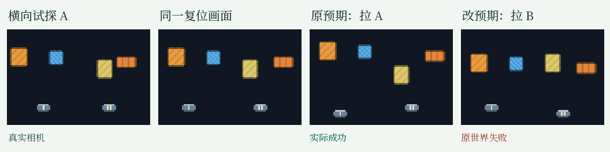
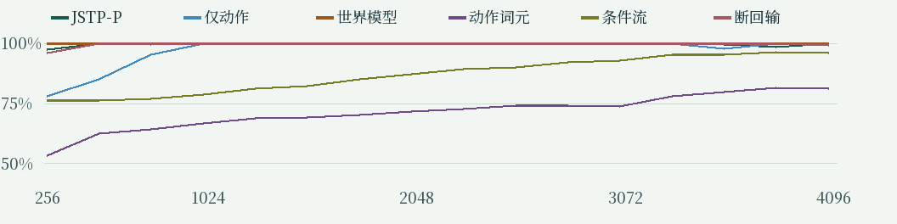

# 不必预演整幅未来：局部预测、直接动作与世界模型的同数据比较

**岳轲**　｜　JSTP 研究手稿 04　｜　2026 年 11 月 19 日

## 摘要

同一个人在看到杯子滑落时，可以只伸手，也可以预期手与杯子将在哪里接触。如果两种处理都能接住杯子，怎样分清它们学到了什么？我们将这个问题缩小到一台四轨虚拟装置：冻结网络先试探，再接收训练中没有见过的目标组合，并真实驱动把手。新设计的局部续写网（JSTP-P）用同一个状态更新单元处理自身动作与局部光学变化，保留从经历直接到动作的通路；不要求画出未来，也不预置对象分割器。

六种小模型在字节相同的 2,048 个布局上从零训练。独立的 192 个新增考试布局中，JSTP-P、直接动作和一步世界模型的相反目标成对成功率均为 100%。但在每对离合条件下同时读对四轨运动方向的比例分别为 100%、38.11%、100%。在 JSTP-P 内保持真实经历、目标和直接通路不变，将与测量后果对齐的四个潜在方向改成另一离合的值，17.75% 的应换手题定向换手；等幅无关扰动为 0.92%。另将官方 SmolVLA 与使用官方 DINOv2 权重及 DINO-WM 作者预测器的适配方法单列评测，避免把不同的预训练和计算预算混为一谈。

结果支持一个有限命题：不要求完整未来画面，局部后果仍可以被同一网络学到并参与动作。它既不是完成此任务的必要路径，也不是 JSTP 独有的性能优势。

**关键词**　联合状态转移预测；动作条件世界模型；视觉语言动作模型；功能性分组；隐状态干预。

<!-- page -->

## 1　问题：直接动作不是理论的反面

联合状态描述的是行动者和环境共同处于什么情境，不是规定网络必须同时预测双方的全部未来。预测“自己接下来会拉 A”与预测“拉 A 会带动哪些载荷”都是可检验的内容。本文不把预测动作的策略排除在 JSTP 之外，而把抽象理论缩成三道可判错的题：给新目标能否做对？不提供对象身份能否从经历中学到可操作的分组？在任务已能用直接动作完成时，只改预期的后果还能不能改变行为？

**与世界模型的区别不在于是否画图。** DINO-WM [2] 在预训练的空间特征中预测动作后果并规划；V-JEPA 2 [6] 也是在表示空间学习和规划。本文一步世界模型必须比较两只候选把手的预测后果。JSTP-P 只产生被试探把手的一份局部预期，无须枚举两条未来，也允许直接预测动作。究竟哪种更准，由数据决定。

**与 VLA 的区别也不是“它们没有预测”。** OpenVLA [3] 与 π₀ [4] 分别代表动作离散化和条件流的一类设计。我们在同等采样预算下隔离这两个动作目标，另外用真实 SmolVLA [5] 权重作迁移实验。小型路线对照不冒充原版大模型；没有运行 π₀.₇ [7]，也不将其公开的真实机器人基准折算成这台装置的分数。

### 1.1　任务与实验单位

四个载荷的外观和接线因布局而异。模型从停靠画面预测探查把手，横拉并复位；这时离合状态和两个可反转轨道的标记才公开。最后出示四个地址上的上、下或不要求指令，模型提交 A 或 B 的一次正式纵拉。相机测得三个要求中至少两个满足，就达标。相反目标必需不同动作；一对题必须两次都做对，才记一次成对成功。探查时序和动作原语由装置提供，是否试探不在本研究之内。

训练使用已归档的 2,048 个布局、16,384 条已执行传感分支，验证为 96 个布局。训练 24 张卡：所有单轨，以及 123、234 两种三轨支持；考试 16 张卡：124、134 两种支持上的全部方向组合。继承面板和新面板各 192 个布局，不重叠；只有新面板不曾用于前作的评估。两者来自同一机械家族，不是新物理定律。训练文件和验证文件均与研究三 [1] 的 SHA-256 对齐。

<!-- page -->

## 2　模型、监督与对照

**JSTP-P 的局部续写。** 把基准亮度、试探变化、重叠光学测点、所发命令、轨道标记和离合编码为状态 h。令 U(s,e) = s + f(s+e)，其中 f 是同一组可学习的归一化与两层非线性变换。先用探查把手作为事件，得到 z = U(h, e手)。十二个未来光学位移从 z 线性读出，仅在训练或测量时需要。目标到达后，以 U(h + Bz, e执行) 预测自身下一动作；h 始终有直通路径。目标的四个公开地址作加性读出，输出一个有符号的驱动。没有目标前的外部候选评分器、完备世界状态、实例掩码或对象槽。

[[models]]

**为什么要保留两种近邻。** “断回输”保留光学学习、只切掉运动路径上的 Bz；“仅动作”还去掉了光学损失，两者都从零训练。直接通路的存在是刻意的：若用硬瓶颈迫使动作必须经过 z，改变 z 会改变动作就不稀奇。对承担光学监督的方法，目标是观察到的位移，不是接线真值。一步世界模型的目标评分也是从训练动作学习的，考试不读相机裁判。

**共享什么。** 六组的训练布局、每个种子的样本顺序、可见传感器、目标卡、批量 160、4,096 次更新、固定末次权重相同；每次训练看 655,360 个采样例，三个种子为 6043、6221、6553。采用 AdamW，学习率 0.0016。动作、光学或流损失随方法而异；目标融合方式、有效参数量、FLOPs 不完全相等。没有以考题挑检查点。六组宽度均为 64，但参数数目不同；直接与断回输的总参数含未参与动作的一部分。

<!-- page -->

## 3　能完成任务，能读出分组，分别怎么判

封卷时，真实横拉决定每个网络看到的经历；对一段前缀分别给不同目标，所有命令先写盘，再从同一复位态驱动独立模拟器副本，从实际终态相机读数计分。不拿隐藏接线或预测画面给任务打分；同一姿态仅重用渲染，不合并布局或命令计数。表中区间为 3,000 次配对布局重采样，所有同布局的离合、接线、目标和模型种子始终一起抽取。区间条件于三个已训练种子；全对时的零宽区间不是对无限总体的零误差保证。

**分组测的不是轮廓。** 在另外 192 个校准布局上，各模型冻结，拟合相同形式的线性岭读出预测四轨方向。校准可以看相机给出的方向，模型训练没有对象掩码。对同一接线的两个离合状态，八个方向全对才过一道严格题。预测监督组从被试探动作的后果状态读；直接、动作词元和流模型从给目标前的历史状态读。位置不同，所以低分不能证明整个网络都没有这条信息。“抹去试探”只清零图像差与十二个水平光学变化，保留当时的命令、基准图、标记和离合；这是缺失信息的压力测试，不是自然经历。

[[results]]

**表 1．** 成对成功衡量任务；“四轨／抹去”是新面板的严格分组读出。每个面板每种方法有 18,432 个相反目标对（192 布局 × 4 物理状态 × 8 对目标 × 3 种子），不是 18,432 个独立世界。新面板 JSTP-P 对直接动作、对一步世界模型的成对差都为 0.00 个百分点；对动作词元或条件流的差异只适用于这里的实现和预算。

<!-- page -->

## 4　后果究竟有没有参与自身动作

固定网络权重、真实试探、离合、晚到目标和历史直通路径。用校准数据中光学位移的前四主方向及冻结的光学线性读出，取潜在状态中对应的四维子空间。只把这四个分量替换成同接线另一离合的值，未改动其余分量。没有把供体的正确动作喂给模型。沿完整光学读出零空间施加等长度的修改，作第一个对照；对原本无需换手的题施加同样的物理修改，作第二个对照。

[[mechanism]]

**表 2．** “定向换手”要求原动作正确，移植后改为供体世界的正确把手，分母为全部应换手题；“错换”在供体与真实最优把手相同的题中计算。新面板的物理读数移向供体达 100%。但这不意味着所有动作都经由被移植的四维信息。三个种子的定向换手率为 [[seeds]]；断回输组虽然仍可读出四轨运动，修改其后果对动作的影响为零。

旧面板中，研究三原网络的定向换手率为 59.93% [1]，本模型是 18.06%。因此新架构没有增强这个干预效应。变的是同一输入和目标下对测得后果方向的依赖；不能从两套网络的差值中分离出某个单独的结构原因。给错后果有时会让原世界任务失败，这是方向性干预的预期，不是应计入任务收益的进步。

**一种带约束的分离。** 直接动作与 JSTP-P 同样会做题，但前者这一位置的四轨表征没那么容易线性读出；断回输的表征则读得出来、对动作却不起这条作用。这说明只测通关率或只看可视化，都不足以决定一个系统靠什么行动。世界模型也将四轨读对，其光学误差还较低；没有理由将分组称为 JSTP 专属能力。

<!-- page -->

## 5　给外部预训练模型同一套下游经历

这张表单列，回答“带入外部权重、在本任务上适配之后怎样”，不回答相同总训练数据或相同算力下谁最强。两种方法均使用同一批 16,384 条记录、相同排列和相同训练目标卡，一次遍历、批量 32、512 次更新、一个种子。图像来自档案里 6×12 的基准和变化亮度网格，不另取高清图像；两种方法可用相同的 18 个仪表数值和目标。SmolVLA 还接收目标卡的逐字规则英文串，不引入新指令含义。输入本身远离自然图像、自然语言和机器人连续控制。

**真实权重与改动。** SmolVLA 严格加载官方策略张量，保留视觉语言干路和流动作专家，调整状态投影、动作输出和最后一层专家。一个按钮占一个动作轴，一个分段只取一步；128×128 传感图，推理从零用四步欧拉积分。DINO 组使用官方冻结 DINOv2-S/14 特征 [8] 和 DINO-WM 作者未修改的 ViT 预测器源码 [2]，在本任务重新学习预测器与目标读出；56×56 传感图、16 个图块。原档没有未来 DINO 图块目标，这里预测十二个实际光学位移，再比较两候选，**不是上游完整 DINO-WM 原系统或原分数**。两者均有从停靠信息学习的试探读出。

[[transfer]]

[[bridge]]

SmolVLA 在新面板按单张卡计为 53.64%，按相反卡两题都成功计为 14.47%；78.34% 的相反卡对得到相同把手。这是可以从封卷中定位的失分方式，不足以确定是低分辨率输入、有限微调预算还是目标融合造成的。DINO 适配的单卡为 49.95%，相反卡却很少给同一把手：会随目标翻转，不等于翻转方向正确。

**表 3．** ¹官方模型列实际更新的参数，桥接组列小网络注册参数（仅动作含不参与损失的后果支路）。为公平起见，另把 JSTP-P、直接动作与一步世界模型从头训练一遍，逐行使用与官方适配组相同的记录、目标卡和更新次数。这三行是在知道主组与 DINO 结果以后增加的预算桥接，不是原定主检验，未重调官方模型。区间只含布局不确定性。低分不能外推为模型家族的上限；对于真实相机、自由语言指令、长序列及跨机器人迁移，这台装置没有作答能力。

<!-- page -->

## 6　讨论、局限与复现

这里支持的不是“JSTP 比其他架构都聪明”。更明确的结论是：在一台结构已知、物理挂接未知的装置上，保留直接动作不会妨碍系统形成可测的局部后果预期。人为改变这份预期，可以使一部分动作按供体物理有方向地改变。另一方面，在这个可被加性目标结构解决的任务上，不显式预测后果的策略也能满分。预测能力、预测的可读性、预测对动作的因果作用是三项不同的结论。

本试验只测局部运动组织，没有测实例轮廓、遮挡期间的持续身份，也没有排除所有与物理相关的伴随特征。四个轨道地址和重叠光学前端是给定的；校准读出有方向标签，不能说“完全无监督发现了四个物体”。子空间移植可能离开自然状态分布，零空间仅保证对该光学读出无效。24 张训练卡和多数规则使直接策略可利用组合规律；动作词元与结果相差较大不能代表所有 VLA。三次初始化不足以估计所有训练波动；迁移组更只有一个种子。关于意识、语言必要性或世界本体，本论文没有实验结论。

下一道有区分力的题不是再刷这 192 个布局，而是让两个系统在熟悉目标都成功，再改变它们以往从未分开过的机械关系，看谁能凭一次新经历把原先一起运动的部分分开。应事先固定未见接线与对象身份题，保留同等直接动作路径，分别验收任务、分组与干预效应。

**复现与开放范围。** 同一私有仓库按研究归档，含训练数据原字节、数据与权重指纹、逐题封卷、执行后的相机结果、逐种子统计、协议与源码。外部基础模型只给固定来源和指纹，不再分发上游权重；保存本任务的训练增量。协议先提交到本地 Git，再训练；这是有时间顺序的私有研究记录，不是公开预注册。本文为研究手稿，未声称同行评审或 DOI。

[[references]]
